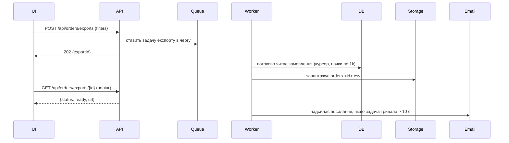

# Експорт замовлень у CSV — Специфікація

## Коротко

Додаємо асинхронну задачу експорту. Сторінка «Orders» надсилає поточні фільтри на новий ендпоінт, фоновий воркер потоково пише відповідні замовлення у CSV в об’єктному сховищі, а мерчант завантажує файл за підписаним посиланням. Посилання показується в інтерфейсі та надсилається на пошту, якщо задача тривала довше за кілька секунд. Навіщо це потрібно, описано в [PRD](./prd.md).

## Контекст і поточний стан

- Список замовлень віддає `GET /api/orders` (`api/orders/list.ts`) з пагінацією по 50 рядків, фільтри — в `OrdersFilter` (`api/orders/filter.ts`).
- Фонові задачі вже працюють через чергу `jobs` (`workers/queue.ts`); є готова задача надсилання листів, її можна перевикористати.
- У великих магазинів до ~80 тис. замовлень на рік (кількість рядків `orders` на мерчанта, березень 2026), тому синхронна відповідь перевищить 30-секундний таймаут гейтвею.

## Пропоноване рішення

### Огляд

### Компоненти та зміни

- `api/orders/exports.ts` — новий: створення експорту, отримання статусу експорту.
- `workers/orders-export.ts` — нова задача: будує запит через `OrdersFilter`, потоково читає рядки курсором БД і пише CSV за допомогою вже підключеної залежності `csv-stringify`.
- `web/pages/orders/ExportButton.tsx` — новий: кнопка, полінг, завантаження.

### Модель даних

Нова таблиця `order_exports`: `id`, `merchant_id`, `filters` (jsonb), `status` (`pending|running|ready|failed`), `file_key`, `row_count`, `created_at`, `finished_at`.

### API / інтерфейси

- `POST /api/orders/exports` — тіло: `OrdersFilter`; повертає `202 { exportId }`.
- `GET /api/orders/exports/{id}` — повертає `{ status, rowCount?, url? }`; `url` — підписане посилання, дійсне 24 год.

## Покриття вимог

| ID у PRD | Як виконується | Розділ |
|----------|----------------|--------|
| R1 | Кнопка експорту + асинхронна задача, яка формує CSV | Компоненти та зміни |
| R2 | Задача використовує `OrdersFilter` — той самий код, що й список | Компоненти та зміни |
| R3 | Потокове читання курсором пачками по 1k, асинхронно — без таймауту гейтвею | Огляд |
| R4 | **Частково:** лист із посиланням, якщо задача тривала > 10 с, іде лише на адресу власника магазину; співробітник, який запустив експорт, нічого не отримує (PRD Q3) | Огляд |
| R5 | Скасовано в PRD | — |

## Альтернативи та рішення

| Рішення | Розглянуті варіанти | Обрано | Чому |
|---------|---------------------|--------|------|
| Синхронно чи асинхронно | Синхронна потокова відповідь; асинхронна задача | Асинхронна задача | Синхронний варіант упирається в 30-секундний таймаут гейтвею у великих магазинів (R3) |
| Логіка фільтрів | Продублювати фільтр у воркері; перевикористати `OrdersFilter` | Перевикористати | Гарантує R2 — список і експорт не розійдуться |

## Граничні випадки та обробка помилок

- Жодне замовлення не підходить → CSV лише з рядком заголовків; інтерфейс показує «No orders match your filters» і пропонує скинути фільтри.
- Задача впала → статус `failed`, інтерфейс показує кнопку повтору; помилка логується з `exportId`.
- Термін життя вивантаженого файлу → Припущення (Spec Q1): видаляється через 24 год разом із закінченням дії посилання; зберігати 7 днів — рішення безпеки, яке змінює лише налаштування очищення.
- Мерчант запускає другий експорт, поки триває перший → дозволено. Припущення (PRD Q2): не більше 3 одночасних на мерчанта, мінімальний ліміт, за якого мерчант усе ще може вивантажити кілька відфільтрованих вибірок; інакше `429`.

## План тестування

- Unit: форматування рядків CSV (екранування, дати в часовому поясі мерчанта).
- Інтеграційні: експорт із кожною комбінацією фільтрів збігається з результатом `GET /api/orders` (R2).
- Навантажувальні: фікстура на 100 тис. замовлень вивантажується на стейджингу менш ніж за 2 хвилини (R3).

## Розгортання та відкат

Розгортання — це сам реліз. Міграція `order_exports` лише додає таблицю, тому виконується до деплою коду. Кнопка Export — єдина точка входу, і вона додається останньою, після навантажувального тесту, тож до перевірки бекенду ніщо не доступне. Відкат: задеплоїти попередню версію; таблиця залишається невикористаною.

## Спостережуваність

Події `orders_export_started` / `orders_export_finished` (з `row_count`, `duration_ms`) живлять метрику використання з PRD; алерт, якщо частка помилок > 5% за 1 год.

## Відкриті питання

- [ ] **Q1.** Видаляти вивантажені файли через 24 год чи зберігати 7 днів? — Sam Lee (безпека)
