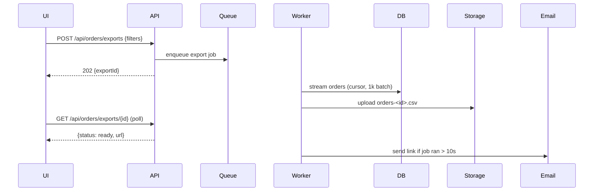

# Orders CSV export — Spec

## Summary

Add an async export job: the Orders page sends its current filters to a new endpoint, a background worker streams matching orders into a CSV in object storage, and the merchant downloads it via a signed URL (shown in the UI, and emailed if the job takes longer than a few seconds). See the [PRD](./prd.md) for the why.

## Context & current state

- The Orders list is served by `GET /api/orders` (`api/orders/list.ts`), paginated at 50 rows, filters in `OrdersFilter` (`api/orders/filter.ts`).
- Background jobs already run on the `jobs` queue (`workers/queue.ts`); there's an existing email-sending job we can reuse.
- Large stores have up to ~80k orders per year, so a synchronous response would exceed the 30s gateway timeout.

## Proposed design

### Overview

### Components & changes

- `api/orders/exports.ts` — new: create export, get export status.
- `workers/orders-export.ts` — new job: reuses `OrdersFilter` to build the query, streams rows with a DB cursor, writes CSV with the existing `csv-stringify` dependency.
- `web/pages/orders/ExportButton.tsx` — new: button, polling, download.

### Data model

New table `order_exports`: `id`, `merchant_id`, `filters` (jsonb), `status` (`pending|running|ready|failed`), `file_key`, `row_count`, `created_at`, `finished_at`.

### API / interfaces

- `POST /api/orders/exports` — body: `OrdersFilter`; returns `202 { exportId }`.
- `GET /api/orders/exports/{id}` — returns `{ status, rowCount?, url? }`; `url` is a signed link valid 24h.

## Requirements coverage

| PRD ID | How it's satisfied | Section |
|--------|--------------------|---------|
| R1 | Export button + async job producing CSV | Components & changes |
| R2 | Job reuses `OrdersFilter`, the same code the list uses | Components & changes |
| R3 | Cursor streaming in batches of 1k, async so no gateway timeout | Overview |
| R4 | Email with link when job runs > 10s | Overview |
| R5 | Dropped in PRD | — |

## Alternatives & decisions

| Decision | Options considered | Chosen | Why |
|----------|-------------------|--------|-----|
| Sync vs async | Synchronous streamed response; async job | Async job | Sync hits the 30s gateway timeout for large stores (R3) |
| Filter logic | Duplicate filter in worker; reuse `OrdersFilter` | Reuse | Guarantees R2 — list and export can't drift apart |

## Edge cases & error handling

- Zero matching orders → CSV with header row only; UI shows "No orders match your filters".
- Job fails → status `failed`, UI shows retry button; error logged with `exportId`.
- Merchant starts a second export while one is running → allowed; max 3 concurrent per merchant, otherwise `429`.

## Testing plan

- Unit: CSV row formatting (escaping, dates in merchant timezone).
- Integration: export with each filter combination matches `GET /api/orders` results (R2).
- Load: 100k-order fixture completes under 2 minutes on staging (R3).

## Rollout & rollback

Behind flag `orders_csv_export`: internal stores → 10% of merchants → 100% over two weeks. Rollback: disable the flag; the table and worker are inert without it.

## Observability

Events `orders_export_started` / `orders_export_finished` (with `row_count`, `duration_ms`) feed the PRD adoption metric; alert if failure rate > 5% over 1h.

## Open questions

- [ ] Should exported files be deleted after 24h or kept 7 days? — Sam Lee (security)
