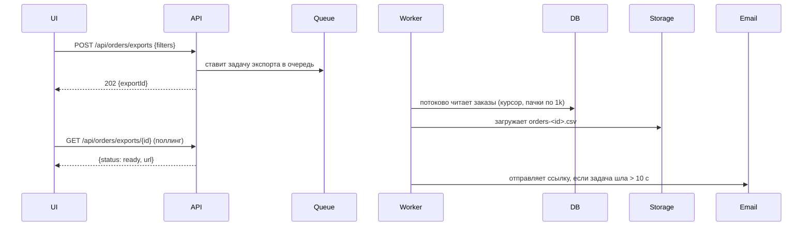

# Экспорт заказов в CSV — Спецификация

## Кратко

Добавляем асинхронную задачу экспорта. Страница «Orders» отправляет текущие фильтры на новый эндпоинт, фоновый воркер потоково пишет подходящие заказы в CSV в объектном хранилище, а мерчант скачивает файл по подписанной ссылке. Ссылка показывается в интерфейсе и отправляется на почту, если задача заняла больше нескольких секунд. Зачем это нужно, описано в [PRD](./prd.md).

## Контекст и текущее состояние

- Список заказов отдаёт `GET /api/orders` (`api/orders/list.ts`) с пагинацией по 50 строк, фильтры — в `OrdersFilter` (`api/orders/filter.ts`).
- Фоновые задачи уже работают через очередь `jobs` (`workers/queue.ts`); есть готовая задача отправки писем, её можно переиспользовать.
- У больших магазинов до ~80 тыс. заказов в год (число строк `orders` на мерчанта, март 2026), поэтому синхронный ответ превысит 30-секундный таймаут гейтвея.

## Предлагаемое решение

### Обзор

### Компоненты и изменения

- `api/orders/exports.ts` — новый: создание экспорта, получение статуса экспорта.
- `workers/orders-export.ts` — новая задача: строит запрос через `OrdersFilter`, потоково читает строки курсором БД и пишет CSV с помощью уже подключённой зависимости `csv-stringify`.
- `web/pages/orders/ExportButton.tsx` — новый: кнопка, поллинг, скачивание.

### Модель данных

Новая таблица `order_exports`: `id`, `merchant_id`, `filters` (jsonb), `status` (`pending|running|ready|failed`), `file_key`, `row_count`, `created_at`, `finished_at`.

### API / интерфейсы

- `POST /api/orders/exports` — тело: `OrdersFilter`; возвращает `202 { exportId }`.
- `GET /api/orders/exports/{id}` — возвращает `{ status, rowCount?, url? }`; `url` — подписанная ссылка, действует 24 ч.

## Покрытие требований

| ID в PRD | Как выполняется | Раздел |
|----------|-----------------|--------|
| R1 | Кнопка экспорта + асинхронная задача, которая формирует CSV | Компоненты и изменения |
| R2 | Задача использует `OrdersFilter` — тот же код, что и список | Компоненты и изменения |
| R3 | Потоковое чтение курсором пачками по 1k, асинхронно — без таймаута гейтвея | Обзор |
| R4 | **Частично:** письмо со ссылкой, если задача шла > 10 с, уходит только на адрес владельца магазина; сотрудник, запустивший экспорт, ничего не получает (PRD Q3) | Обзор |
| R5 | Отменено в PRD | — |

## Альтернативы и решения

| Решение | Рассмотренные варианты | Выбрано | Почему |
|---------|------------------------|---------|--------|
| Синхронно или асинхронно | Синхронный потоковый ответ; асинхронная задача | Асинхронная задача | Синхронный вариант упирается в 30-секундный таймаут гейтвея у больших магазинов (R3) |
| Логика фильтров | Продублировать фильтр в воркере; переиспользовать `OrdersFilter` | Переиспользовать | Гарантирует R2 — список и экспорт не разойдутся |

## Граничные случаи и обработка ошибок

- Ни один заказ не подходит → CSV только со строкой заголовков; интерфейс показывает «No orders match your filters».
- Задача упала → статус `failed`, интерфейс показывает кнопку повтора; ошибка логируется с `exportId`.
- Срок жизни выгруженного файла → Допущение (Spec Q1): удаляется через 24 ч вместе с истечением ссылки; хранить 7 дней — решение безопасности, меняющее только настройку очистки.
- Мерчант запускает второй экспорт, пока идёт первый → разрешено. Допущение (PRD Q2): не больше 3 одновременных на мерчанта, минимальный лимит, при котором мерчант всё ещё может выгрузить несколько отфильтрованных представлений; иначе `429`.

## План тестирования

- Unit: форматирование строк CSV (экранирование, даты в часовом поясе мерчанта).
- Интеграционные: экспорт с каждой комбинацией фильтров совпадает с результатом `GET /api/orders` (R2).
- Нагрузочные: фикстура на 100 тыс. заказов выгружается на стейджинге меньше чем за 2 минуты (R3).

## Раскатка и откат

Раскатка — это сам релиз. Миграция `order_exports` только добавляет таблицу, поэтому выполняется до деплоя кода. Кнопка Export — единственная точка входа, и она добавляется последней, после нагрузочного теста, так что до проверки бэкенда ничего не доступно. Откат: задеплоить предыдущую версию; таблица остаётся неиспользуемой.

## Наблюдаемость

События `orders_export_started` / `orders_export_finished` (с `row_count`, `duration_ms`) питают метрику использования из PRD; алерт, если доля ошибок > 5% за 1 ч.

## Открытые вопросы

- [ ] **Q1.** Удалять выгруженные файлы через 24 ч или хранить 7 дней? — Sam Lee (безопасность)
