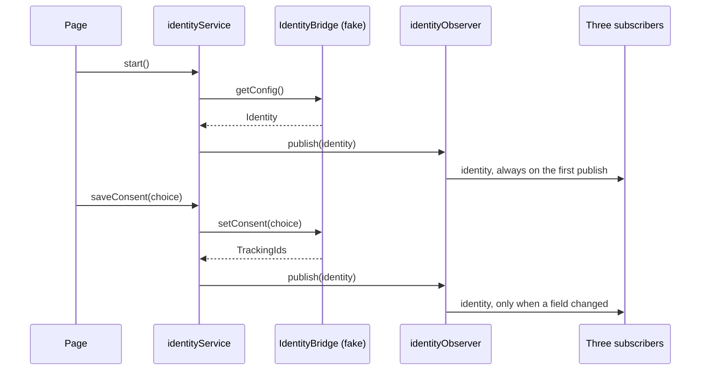
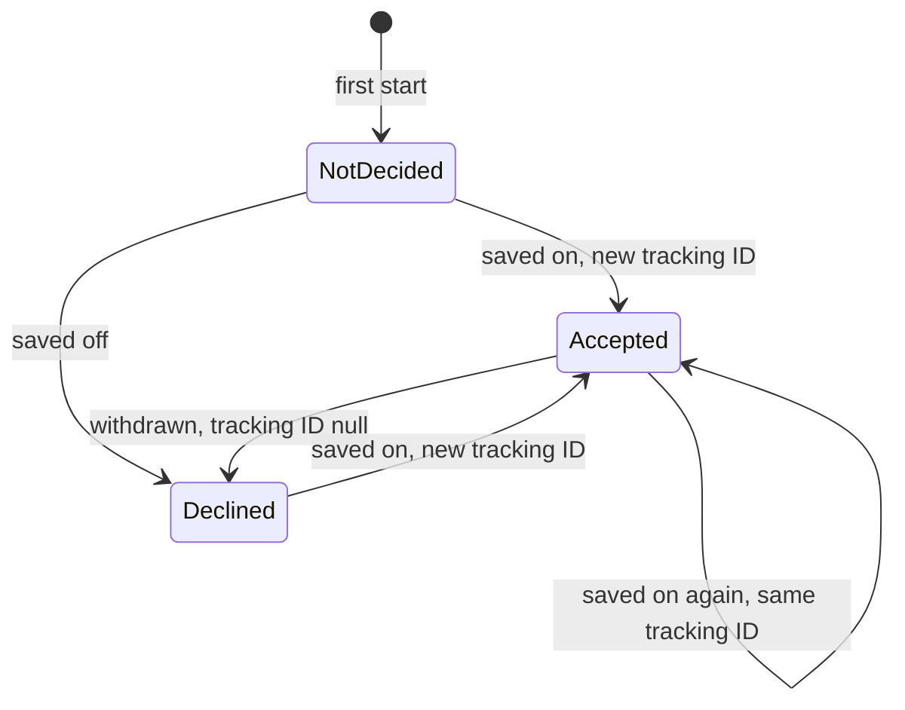

# User identity and tracking consent — Spec

## Summary

A single-page React app, built from nothing. One identity service loads the config through an `IdentityBridge` interface and saves consent through it; an identity observer hands the seven fields to three recording subscribers whenever one of them changes; the page shows the two consent blocks and the debug monitoring. The bridge behind the interface is a fake, so the real one later replaces one file. See the [PRD](./prd.md) for the why.

## Context & current state

- There is no application code yet: the project folder holds only `docs/`. Every path below is new and relative to the project root.
- The repository's first playground app, `playground/app` (path from the repository root), is built with Vite, React and TypeScript and tested with Vitest and Testing Library. This app starts on the same toolchain (see *Alternatives & decisions*).
- The host app's native bridge can't be called yet: its contract is agreed and its methods are fake for now (TRACK-12). The ticket gives the fields and the rules, not the method names or signatures (Spec Q1).
- There is no backend, analytics collector or game config to receive the identity; the three subscribers only record what they get (PRD Q2).

## Proposed design

### Overview



`identityService` is the only caller of the bridge and the only caller of `publish`. A successful `saveConsent` builds the next identity from the previous one, the statuses it just sent and the tracking IDs the bridge returned; a failed one publishes nothing.

### Components & changes

- `package.json`, `vite.config.ts`, `tsconfig.json`, `.gitignore`, `index.html`, `src/main.tsx`, `src/test/setup.ts`: a new Vite + React + TypeScript app with Vitest (jsdom) and Testing Library; scripts `dev`, `build`, `test`. `src/main.tsx` creates the fake bridge, the observer, the service and the three subscribers once and passes them to `App`.
- `src/identity/types.ts`: `ConsentStatus`, `Identity`, `ConsentChoice`, `TrackingIds`.
- `src/bridge/identityBridge.ts`: the `IdentityBridge` interface, all the app knows about the host app.
- `src/bridge/fakeIdentityBridge.ts`: the fake. It answers after a delay, never fails, keeps the choice and the tracking IDs in `localStorage`, and takes the start panel's scenario through `setScenario`.
- `src/identity/identityObserver.ts`: keeps the subscribers and the last identity delivered; `publish` calls them when any of the seven fields differs from it, and always on the first call.
- `src/identity/identityService.ts`: `start()` and `saveConsent(choice)`; holds the current identity and a `busy` flag for the UI.
- `src/subscribers/recorder.ts`: what the three subscribers share: it keeps `{ value, updatedAt }` and lets the UI read it.
- `src/subscribers/requestHeaders.ts`, `src/subscribers/analyticsCollector.ts`, `src/subscribers/gameConfig.ts`: each turns an `Identity` into what its consumer holds (the consumer table in the PRD; header names in *API / interfaces*) and records it.
- `src/ui/ConsentBlock.tsx`: one component for both consent blocks: a title, the "Marketing" and "Analytics" switches, "Save" and "Accept all". A switch is on only for `Accepted`.
- `src/monitoring/StartPanel.tsx`, `src/monitoring/ConfigBlock.tsx`, `src/monitoring/SubscriberBlock.tsx`: the debug blocks, kept in one folder.
- `src/App.tsx`, `src/index.css`: the page. The start panel on top, the config block under it, then the start consent block, then the settings block with the three subscriber blocks beside it.

UI text and layout are provisional. Assumption (PRD Q3): English labels, with the block titles "Tracking consent" (start block) and "Tracking settings" (settings block), the monitoring titles "Config", "Backend request headers", "Analytics collector" and "Game config", and the empty states "Not started" and "No update yet". The final copy and design replace them in `src/ui/ConsentBlock.tsx`, `src/App.tsx` and `src/index.css` without touching the logic.

### Data model

```ts
enum ConsentStatus {
  Declined = 0,
  Accepted = 1,
  NotDecided = 2,
}

interface Identity {
  marketingTrackingId: string | null;
  analyticsTrackingId: string | null;
  deviceId: string;
  temporaryId: string;
  consentRequired: boolean;
  marketingConsentStatus: ConsentStatus;
  analyticsConsentStatus: ConsentStatus;
}
```

The fake keeps one `localStorage` entry, `identity-tracking-consent.fake-bridge`: the status and the tracking ID, for marketing and for analytics. No entry means a first start. `deviceId` is a constant in the fake; `temporaryId` and every new tracking ID come from `crypto.randomUUID()`, so an earlier ID doesn't come back.

Lifecycle of one consent, marketing or analytics, as the fake implements it:



### API / interfaces

```ts
interface ConsentChoice {
  marketing: ConsentStatus.Accepted | ConsentStatus.Declined;
  analytics: ConsentStatus.Accepted | ConsentStatus.Declined;
}

interface TrackingIds {
  marketingTrackingId: string | null;
  analyticsTrackingId: string | null;
}

interface IdentityBridge {
  getConfig(): Promise<Identity>;
  setConsent(choice: ConsentChoice): Promise<TrackingIds>;
}
```

Assumption (Spec Q1): the method names and shapes above, a failed call is a rejected promise, and both fake methods answer after 300 ms, enough to see the busy state without slowing a manual pass.

- The fake adds `setScenario({ consentRequired, firstStart })` outside the interface; the start panel calls it before `start()`.
- `identityService`: `start(): Promise<void>`, `saveConsent(choice): Promise<void>`, `getState(): { identity: Identity | null; busy: boolean }`, `subscribe(listener)`.
- `identityObserver`: `subscribe(fn): () => void`, `publish(identity): void`.

Request headers. Assumption (Spec Q2): the names and value formats below.

| Field | Header | Value |
|---|---|---|
| `marketingTrackingId` | `X-Marketing-Tracking-Id` | the ID; no header while `null` |
| `analyticsTrackingId` | `X-Analytics-Tracking-Id` | the ID; no header while `null` |
| `temporaryId` | `X-Temporary-Id` | the ID |
| `deviceId` | `X-Device-Id` | the ID |
| `consentRequired` | `X-Consent-Required` | `true` or `false` |
| `marketingConsentStatus` | `X-Marketing-Consent-Status` | `0`, `1` or `2` |
| `analyticsConsentStatus` | `X-Analytics-Consent-Status` | `0`, `1` or `2` |

## Requirements coverage

| PRD ID | How it's satisfied | Section |
|--------|--------------------|---------|
| R1 | `identityService.start()` takes the seven fields from `IdentityBridge.getConfig()`; the fake returns a constant `deviceId` and a new random `temporaryId` on every call | Components & changes |
| R2 | The fake returns a tracking ID only with a stored `Accepted`; a first start has no stored entry, so both statuses are `NotDecided`; with `consentRequired = false` it reports `NotDecided` and `null` whatever is stored | Data model |
| R3 | `App` renders the start `ConsentBlock` only when `consentRequired` is `true` and a status is `NotDecided`; the block is part of the page, not a dialog | Components & changes |
| R4 | `App` renders the settings `ConsentBlock` whenever `consentRequired` is `true`; saving with a switch turned off sends `Declined` | Components & changes |
| R5 | `ConsentBlock` turns its two switches into one `ConsentChoice` for one `setConsent` call, and "Accept all" sends both as `Accepted`; the fake handles each field on its own | API / interfaces |
| R6 | The fake's transitions in the lifecycle diagram: the same ID, a new `crypto.randomUUID()`, or `null` | Data model |
| R7 | The fake keeps the choice in its `localStorage` entry and reports it from `getConfig()` on the next start with `consentRequired = true`; "First start" erases it | Data model |
| R8 | `saveConsent` changes nothing and publishes nothing when `setConsent` rejects | Edge cases & error handling |
| R9 | `identityService` publishes after `start()` and after each successful `saveConsent`; `identityObserver` calls the subscribers only when a field differs | Overview |
| R10 | `requestHeaders` builds the headers of the table in *API / interfaces* and leaves out a header whose value is `null` | API / interfaces |
| R11 | `analyticsCollector` records the field set from the PRD, `null` kept | Components & changes |
| R12 | `gameConfig` records the field set from the PRD, `null` kept | Components & changes |
| R13 | `StartPanel` has the two switches and "Start"; it calls `setScenario` and then `start()`, and nothing loads the config before that | Components & changes |
| R14 | `ConfigBlock` shows the current identity of `identityService`, so it changes with every publish | Components & changes |
| R15 | Three `SubscriberBlock` components beside the settings block, each showing the `value` and `updatedAt` of its recorder | Components & changes |

## Alternatives & decisions

| Decision | Options considered | Chosen | Why |
|----------|-------------------|--------|-----|
| Toolchain | Vite + React + TypeScript with Vitest; plain TypeScript without a framework | Vite + React + TypeScript | The repository's other playground app runs on it, so both apps share commands and conventions; the page is a set of blocks redrawn when the identity changes |
| How the app reaches the host app | Call the fake functions directly; an `IdentityBridge` interface with the fake behind it | The interface | The real bridge then replaces one file, and a test can pass a bridge that fails (R8) |
| Who decides that nothing changed | Each subscriber compares; the observer compares the seven fields | The observer | TRACK-12 puts the rule on the observer, and one comparison replaces three |
| Consent blocks | Two components; one `ConsentBlock` rendered twice | One component | The two blocks differ only in title and in when they are shown (R3, R4) |
| Switches of the two blocks | One state shared by both blocks; each block keeps its own until saved | Own state per block | An unsaved switch in one block doesn't move the other; after a save both show the saved statuses |
| Where the fake keeps the choice | In memory; `localStorage` | `localStorage` | The methods remember the choice between reloads (TRACK-12) |
| Monitoring code | Mixed into the product components; a `src/monitoring/` folder of its own | Its own folder | Monitoring is a debug aid to be removed later (PRD *Non-goals*): removal deletes the folder and its uses in `src/App.tsx` |

## Edge cases & error handling

- Before the first "Start" → there is no identity: both consent blocks are hidden, the config block shows "Not started", each subscriber block shows "No update yet".
- "Start" pressed again → a new config with a new `temporaryId`, so all three subscribers are notified.
- A call in flight, start or save → "Start", "Save" and "Accept all" are disabled until it ends; calls never overlap.
- "Save" with the switches as saved → the bridge returns the same IDs, the identity equals the last one delivered, nobody is notified.
- `setConsent` rejects → the identity stays as it was and the switches return to the saved statuses, so the blocks keep showing the current statuses (R3, R4). Assumption (PRD Q4): nothing else is shown, the least that keeps R8; a message or a retry is a product decision.
- Tracking ID after a restart → Assumption (PRD Q5): the fake stores the ID with the choice, so an accepted consent keeps its ID across reloads, in line with R6.
- `consentRequired = false` with a saved choice → the fake reports both statuses `NotDecided` and both IDs `null`. Assumption (PRD Q5): the saved choice stays in `localStorage` and is reported again on the next start with `consentRequired = true`; only "First start" erases it.
- "First start" on → the fake erases its `localStorage` entry before it answers.
- One status `NotDecided` and the other decided → the fake never produces this, a real bridge may: the start block is shown and each switch shows its own status.
- `localStorage` unavailable, or its entry unreadable → the fake behaves as on a first start and keeps the choice in memory until the reload.

## Non-functional

- Privacy: nothing leaves the browser. The subscribers record and don't send; the fake's `localStorage` entry holds the choice and the fake tracking IDs only.
- Accessibility: each switch is a native checkbox with `role="switch"` and a visible label, so it works from the keyboard and tests find it by role and name.

## Testing plan

- Unit (Vitest): the fake bridge (R1, R2, R6, and R7 with a new instance over the same storage); the observer (R9); the three subscribers for both values of `consentRequired` (R10, R11, R12); `identityService` with a bridge that rejects (R8).
- Component (Testing Library): `ConsentBlock` (switches to statuses, "Accept all", disabled while busy: R5); `App` for the three rows of the block table in the PRD (R3, R4); the monitoring blocks (R13, R14, R15).
- Manual, in the browser: the "done" check of TRACK-12: give and withdraw each consent separately and watch the config block and the subscriber blocks change without a reload.

## Rollout & rollback

Assumption (PRD Q2): with fake bridge methods the feature isn't released to real users, and the project has no build pipeline or hosting, so the release is the merge. The tasks land in order, and the page shows nothing of the feature until the last UI task mounts the blocks in `src/App.tsx`. Rollback: revert that merge; the only stored data is the fake's `localStorage` entry in the browser, which nothing else reads.

## Open questions

- [ ] **Q1.** What are the real bridge methods called, what do they take and return, how long does a call take, and how does it fail: by rejecting only, or can it hang? — host app (bridge) team
- [ ] **Q2.** Which header names and value formats does the backend expect? TRACK-12 leaves the names to the implementation. — backend team
