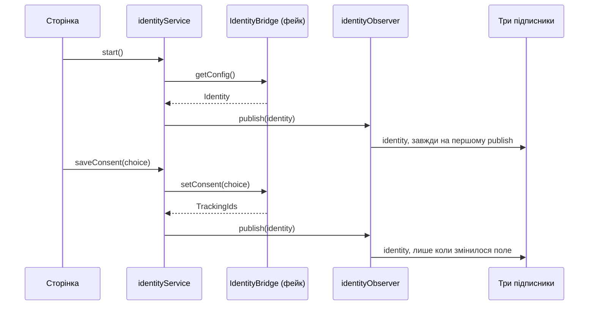
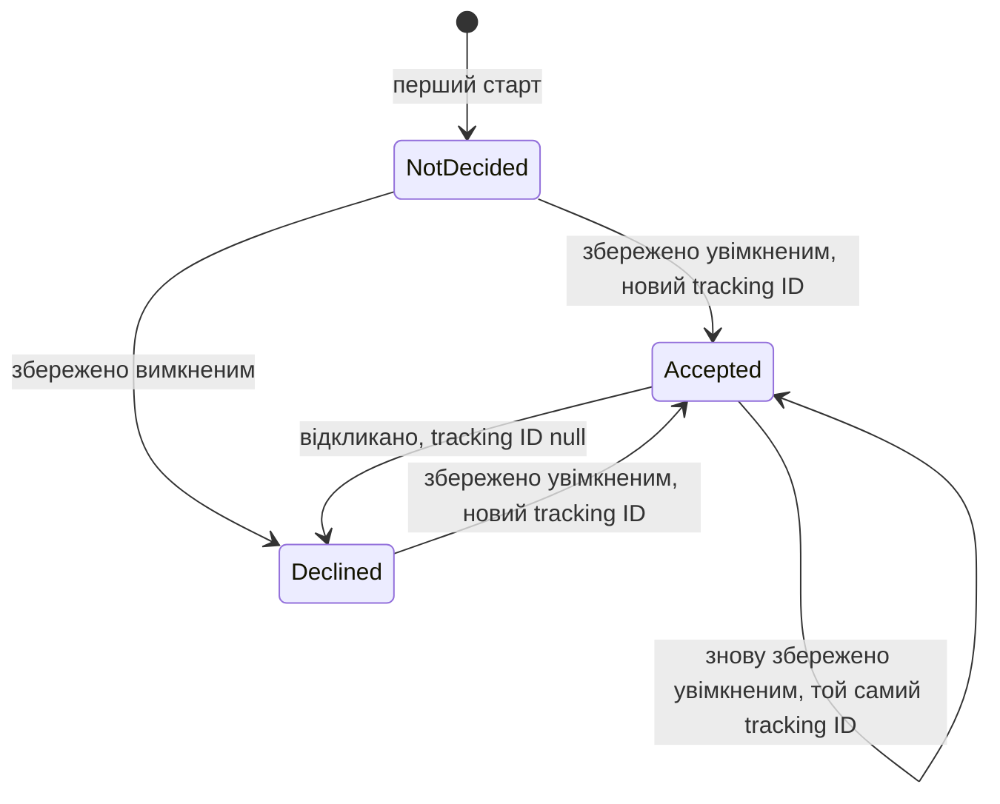

# Identity користувача та згода на трекінг — Специфікація

## Коротко

Односторінковий застосунок на React, який будується з нуля. Один сервіс identity завантажує конфіг через інтерфейс `IdentityBridge` і через нього ж зберігає згоду; обсервер identity передає сім полів трьом підписникам, які їх записують, щоразу, коли одне з них змінюється; сторінка показує два блоки згоди та налагоджувальний моніторинг. За інтерфейсом стоїть фейковий бридж, тож справжній згодом замінить один файл. Навіщо це потрібно, описано в [PRD](./prd.md).

## Контекст і поточний стан

- Коду застосунку ще немає: у теці проєкту є лише `docs/`. Усі шляхи нижче нові й відлічуються від кореня проєкту.
- Перший плейграунд-застосунок репозиторію, `playground/app` (шлях від кореня репозиторію), зібрано на Vite, React і TypeScript, а тести в ньому — на Vitest і Testing Library. Цей застосунок стартує на тому самому тулчейні (див. «Альтернативи та рішення»).
- Нативний бридж хост-застосунку ще неможливо викликати: контракт узгоджено, методи поки фейкові (TRACK-12). Тікет дає поля та правила, але не назви чи сигнатури методів (Spec Q1).
- Немає ні бекенду, ні колектора аналітики, ні гейм-конфігу, які б отримували identity; три підписники лише запам’ятовують отримане (PRD Q2).

## Пропоноване рішення

### Огляд



`identityService` — єдиний, хто викликає бридж, і єдиний, хто викликає `publish`. Успішний `saveConsent` будує наступну identity з попередньої, щойно надісланих статусів і tracking ID, які повернув бридж; невдалий нічого не публікує.

### Компоненти та зміни

- `package.json`, `vite.config.ts`, `tsconfig.json`, `.gitignore`, `index.html`, `src/main.tsx`, `src/test/setup.ts`: новий застосунок на Vite + React + TypeScript із Vitest (jsdom) і Testing Library; скрипти `dev`, `build`, `test`. `src/main.tsx` один раз створює фейковий бридж, обсервер, сервіс і трьох підписників та передає їх в `App`.
- `src/identity/types.ts`: `ConsentStatus`, `Identity`, `ConsentChoice`, `TrackingIds`.
- `src/bridge/identityBridge.ts`: інтерфейс `IdentityBridge` — усе, що застосунок знає про хост-застосунок.
- `src/bridge/fakeIdentityBridge.ts`: фейк. Він відповідає із затримкою, ніколи не падає, зберігає вибір і tracking ID у `localStorage` та отримує сценарій панелі старту через `setScenario`.
- `src/identity/identityObserver.ts`: зберігає підписників і останню доставлену identity; `publish` викликає їх, коли будь-яке із семи полів відрізняється від неї, і завжди — під час першого виклику.
- `src/identity/identityService.ts`: `start()` і `saveConsent(choice)`; зберігає поточну identity та прапорець `busy` для інтерфейсу.
- `src/subscribers/recorder.ts`: спільне для трьох підписників: зберігає `{ value, updatedAt }` і дає інтерфейсу це прочитати.
- `src/subscribers/requestHeaders.ts`, `src/subscribers/analyticsCollector.ts`, `src/subscribers/gameConfig.ts`: кожен перетворює `Identity` на те, що зберігає його споживач (таблиця споживачів у PRD; назви заголовків — у розділі «API / інтерфейси»), і записує це.
- `src/ui/ConsentBlock.tsx`: один компонент для обох блоків згоди: заголовок, перемикачі «Marketing» та «Analytics», «Save» і «Accept all». Перемикач увімкнений лише для `Accepted`.
- `src/monitoring/StartPanel.tsx`, `src/monitoring/ConfigBlock.tsx`, `src/monitoring/SubscriberBlock.tsx`: налагоджувальні блоки, зібрані в одній теці.
- `src/App.tsx`, `src/index.css`: сторінка. Угорі панель старту, під нею блок конфігу, далі стартовий блок згоди, далі блок налаштувань із трьома блоками підписників поруч.

Тексти інтерфейсу та розкладка тимчасові. Припущення (PRD Q3): англійські підписи, заголовки блоків «Tracking consent» (стартовий блок) і «Tracking settings» (блок налаштувань), заголовки моніторингу «Config», «Backend request headers», «Analytics collector» і «Game config», порожні стани «Not started» і «No update yet». Фінальні тексти й дизайн замінять їх у `src/ui/ConsentBlock.tsx`, `src/App.tsx` і `src/index.css`, не зачіпаючи логіки.

### Модель даних

```ts
enum ConsentStatus {
  Declined = 0,
  Accepted = 1,
  NotDecided = 2,
}

interface Identity {
  marketingTrackingId: string | null;
  analyticsTrackingId: string | null;
  deviceId: string;
  temporaryId: string;
  consentRequired: boolean;
  marketingConsentStatus: ConsentStatus;
  analyticsConsentStatus: ConsentStatus;
}
```

Фейк зберігає один запис у `localStorage`, `identity-tracking-consent.fake-bridge`: статус і tracking ID для маркетингової та для аналітичної згоди. Немає запису — це перший старт. `deviceId` у фейку — константа; `temporaryId` і кожен новий tracking ID беруться з `crypto.randomUUID()`, тому попередній ID не повертається.

Життєвий цикл однієї згоди, маркетингової чи аналітичної, як його реалізує фейк:



### API / інтерфейси

```ts
interface ConsentChoice {
  marketing: ConsentStatus.Accepted | ConsentStatus.Declined;
  analytics: ConsentStatus.Accepted | ConsentStatus.Declined;
}

interface TrackingIds {
  marketingTrackingId: string | null;
  analyticsTrackingId: string | null;
}

interface IdentityBridge {
  getConfig(): Promise<Identity>;
  setConsent(choice: ConsentChoice): Promise<TrackingIds>;
}
```

Припущення (Spec Q1): назви й форми методів, наведені вище, невдалий виклик — це відхилений проміс, і обидва фейкові методи відповідають через 300 мс — цього досить, щоб побачити стан очікування, і це не сповільнює ручну перевірку.

- Фейк додає `setScenario({ consentRequired, firstStart })` поза інтерфейсом; панель старту викликає його перед `start()`.
- `identityService`: `start(): Promise<void>`, `saveConsent(choice): Promise<void>`, `getState(): { identity: Identity | null; busy: boolean }`, `subscribe(listener)`.
- `identityObserver`: `subscribe(fn): () => void`, `publish(identity): void`.

Заголовки запитів. Припущення (Spec Q2): назви та формати значень, наведені нижче.

| Поле | Заголовок | Значення |
|---|---|---|
| `marketingTrackingId` | `X-Marketing-Tracking-Id` | ID; без заголовка, поки `null` |
| `analyticsTrackingId` | `X-Analytics-Tracking-Id` | ID; без заголовка, поки `null` |
| `temporaryId` | `X-Temporary-Id` | ID |
| `deviceId` | `X-Device-Id` | ID |
| `consentRequired` | `X-Consent-Required` | `true` або `false` |
| `marketingConsentStatus` | `X-Marketing-Consent-Status` | `0`, `1` або `2` |
| `analyticsConsentStatus` | `X-Analytics-Consent-Status` | `0`, `1` або `2` |

## Покриття вимог

| ID у PRD | Як виконується | Розділ |
|----------|----------------|--------|
| R1 | `identityService.start()` бере сім полів з `IdentityBridge.getConfig()`; фейк на кожен виклик повертає сталий `deviceId` і новий випадковий `temporaryId` | Компоненти та зміни |
| R2 | Фейк повертає tracking ID лише за збереженого `Accepted`; на першому старті запису немає, тому обидва статуси — `NotDecided`; з `consentRequired = false` він повідомляє `NotDecided` і `null` незалежно від збереженого | Модель даних |
| R3 | `App` рендерить стартовий `ConsentBlock` лише тоді, коли `consentRequired` дорівнює `true` і якийсь статус — `NotDecided`; блок є частиною сторінки, а не діалогом | Компоненти та зміни |
| R4 | `App` рендерить `ConsentBlock` налаштувань завжди, коли `consentRequired` дорівнює `true`; збереження з вимкненим перемикачем надсилає `Declined` | Компоненти та зміни |
| R5 | `ConsentBlock` перетворює два свої перемикачі на один `ConsentChoice` для одного виклику `setConsent`, а «Accept all» надсилає обидві згоди як `Accepted`; фейк обробляє кожне поле окремо | API / інтерфейси |
| R6 | Переходи фейка з діаграми життєвого циклу: той самий ID, новий `crypto.randomUUID()` або `null` | Модель даних |
| R7 | Фейк зберігає вибір у своєму записі в `localStorage` і повідомляє його з `getConfig()` на наступному старті з `consentRequired = true`; стирає його «First start» | Модель даних |
| R8 | `saveConsent` нічого не змінює і нічого не публікує, коли `setConsent` завершується помилкою | Граничні випадки та обробка помилок |
| R9 | `identityService` публікує після `start()` і після кожного успішного `saveConsent`; `identityObserver` викликає підписників лише тоді, коли якесь поле відрізняється | Огляд |
| R10 | `requestHeaders` будує заголовки з таблиці в розділі «API / інтерфейси» і пропускає заголовок зі значенням `null` | API / інтерфейси |
| R11 | `analyticsCollector` записує набір полів із PRD, `null` залишається | Компоненти та зміни |
| R12 | `gameConfig` записує набір полів із PRD, `null` залишається | Компоненти та зміни |
| R13 | У `StartPanel` є два перемикачі та «Start»; вона викликає `setScenario`, а потім `start()`, і до цього ніщо не завантажує конфіг | Компоненти та зміни |
| R14 | `ConfigBlock` показує поточну identity з `identityService`, тому змінюється з кожною публікацією | Компоненти та зміни |
| R15 | Три компоненти `SubscriberBlock` поруч із блоком налаштувань, кожен показує `value` та `updatedAt` свого рекордера | Компоненти та зміни |

## Альтернативи та рішення

| Рішення | Розглянуті варіанти | Обрано | Чому |
|---------|---------------------|--------|------|
| Тулчейн | Vite + React + TypeScript із Vitest; чистий TypeScript без фреймворку | Vite + React + TypeScript | На ньому працює інший плейграунд-застосунок репозиторію, тож обидва застосунки мають спільні команди та домовленості; сторінка — це набір блоків, які перемальовуються, коли змінюється identity |
| Як застосунок звертається до хост-застосунку | Викликати фейкові функції напряму; інтерфейс `IdentityBridge`, за яким стоїть фейк | Інтерфейс | Справжній бридж тоді замінить один файл, а тест може передати бридж, який падає (R8) |
| Хто вирішує, що нічого не змінилося | Порівнює кожен підписник; обсервер порівнює сім полів | Обсервер | TRACK-12 покладає це правило на обсервер, і одне порівняння замінює три |
| Блоки згоди | Два компоненти; один `ConsentBlock`, відрендерений двічі | Один компонент | Два блоки відрізняються лише заголовком і тим, коли їх показано (R3, R4) |
| Перемикачі двох блоків | Один стан, спільний для обох блоків; кожен блок тримає власний стан до збереження | Власний стан у кожного блоку | Незбережений перемикач в одному блоці не рухає інший; після збереження обидва показують збережені статуси |
| Де фейк зберігає вибір | У пам’яті; `localStorage` | `localStorage` | Методи пам’ятають вибір між перезавантаженнями (TRACK-12) |
| Код моніторингу | Упереміш із продуктовими компонентами; окрема тека `src/monitoring/` | Окрема тека | Моніторинг — засіб налагодження, який згодом приберуть (PRD, «Поза межами»): прибрати його — це видалити теку та її використання в `src/App.tsx` |

## Граничні випадки та обробка помилок

- До першого «Start» → identity немає: обидва блоки згоди приховано, блок конфігу показує «Not started», кожен блок підписника показує «No update yet».
- «Start» натиснуто ще раз → новий конфіг із новим `temporaryId`, тож усіх трьох підписників сповіщено.
- Виклик триває, старт чи збереження → «Start», «Save» і «Accept all» вимкнено до його завершення; виклики ніколи не накладаються.
- «Save» з перемикачами, як збережено → бридж повертає ті самі ID, identity дорівнює останній доставленій, нікого не сповіщено.
- `setConsent` завершується помилкою → identity залишається такою, як була, а перемикачі повертаються до збережених статусів, тож блоки й далі показують поточні статуси (R3, R4). Припущення (PRD Q4): більше нічого не показується — це найменше, що зберігає R8; повідомлення чи повтор — продуктове рішення.
- Tracking ID після перезапуску → Припущення (PRD Q5): фейк зберігає ID разом із вибором, тож прийнята згода зберігає свій ID між перезавантаженнями, відповідно до R6.
- `consentRequired = false` зі збереженим вибором → фейк повідомляє обидва статуси `NotDecided` і обидва ID `null`. Припущення (PRD Q5): збережений вибір залишається в `localStorage` і знову повідомляється на наступному старті з `consentRequired = true`; стирає його лише «First start».
- «First start» увімкнено → фейк стирає свій запис у `localStorage` перед відповіддю.
- Один статус `NotDecided`, а інший визначений → фейк такого не створює, справжній бридж може: стартовий блок показано, і кожен перемикач показує власний статус.
- `localStorage` недоступний або його запис неможливо прочитати → фейк поводиться як на першому старті й тримає вибір у пам’яті до перезавантаження.

## Нефункціональні вимоги

- Приватність: ніщо не залишає браузер. Підписники записують і нічого не надсилають; запис фейка в `localStorage` містить лише вибір і фейкові tracking ID.
- Доступність: кожен перемикач — нативний чекбокс із `role="switch"` і видимим підписом, тож ним можна керувати з клавіатури, а тести знаходять його за роллю та назвою.

## План тестування

- Unit (Vitest): фейковий бридж (R1, R2, R6 і R7 з новим екземпляром над тим самим сховищем); обсервер (R9); три підписники для обох значень `consentRequired` (R10, R11, R12); `identityService` із бриджем, який завершується помилкою (R8).
- Компонентні (Testing Library): `ConsentBlock` (перемикачі в статуси, «Accept all», вимкнено під час виклику: R5); `App` для трьох рядків таблиці блоків у PRD (R3, R4); блоки моніторингу (R13, R14, R15).
- Вручну, у браузері: перевірка «готово» з TRACK-12: дати й відкликати кожну згоду окремо і побачити, як блок конфігу та блоки підписників змінюються без перезавантаження.

## Розгортання та відкат

Припущення (PRD Q2): із фейковими методами бриджа фіча не випускається для реальних користувачів, а в проєкту немає ні пайплайна збірки, ні хостингу, тож реліз — це мерж. Завдання потрапляють у код по черзі, і сторінка не показує нічого з фічі, доки останнє UI-завдання не змонтує блоки в `src/App.tsx`. Відкат: зревертити цей мерж; єдині збережені дані — запис фейка в `localStorage` браузера, який більше ніщо не читає.

## Відкриті питання

- [ ] **Q1.** Як називаються справжні методи бриджа, що вони приймають і повертають, скільки триває виклик і як він падає: лише відхиленням чи може зависнути? — команда хост-застосунку (бридж)
- [ ] **Q2.** Яких назв заголовків і форматів значень очікує бекенд? TRACK-12 залишає назви на розсуд реалізації. — команда бекенду
