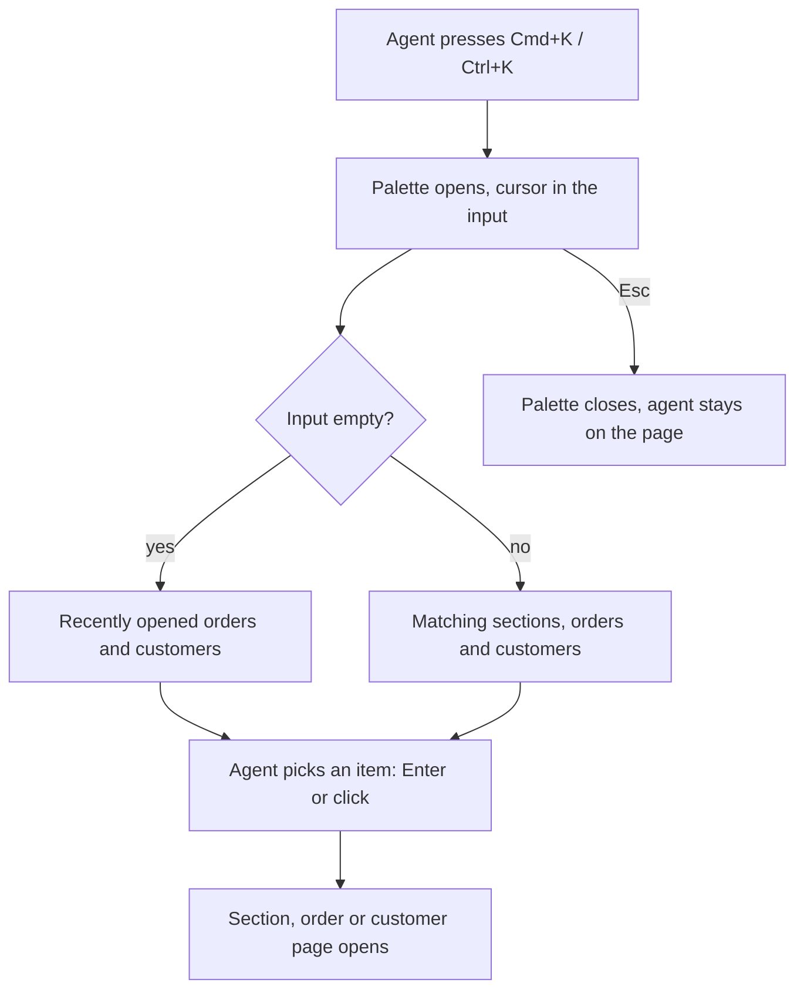

# Command palette (Cmd+K) — PRD

## Summary

Support agents get a keyboard-first command palette in the admin: press Cmd+K (Ctrl+K on Windows), start typing and jump straight to an admin section, an order or a customer. This removes the extra search results page step that agents go through thousands of times a day.

## Problem

Support agents switch between orders and customers all day. To open an order today, an agent clicks the header search, types the number, waits for the search results page and clicks again. Analytics show `header_search_submitted` about 4,000 times a day, almost always followed straight away by `search_result_opened`. The results page is an extra step on almost every lookup. Agents also often come back to the same orders and customers while working a ticket, and today they have to search for them again each time.

We don't know how long opening an order takes today: there is no baseline.

## Goals

- Agents open the order, customer or admin section they need in less time than today.
- Agents get back to orders and customers they recently opened without searching again.

## Non-goals

- Running actions from the palette (e.g. "issue a refund for order…"). Wanted some day, explicitly not now.

## Users & scenarios

Users: support agents working in the admin.

- As a support agent, I want to open an order by typing its number into the palette so that I skip the search results page.
- As a support agent, I want to find a customer by name or email from any page so that I can switch context without leaving the keyboard.
- As a support agent, I want to jump to an admin section (e.g. "Refunds", "Merchants") by typing its name.
- As a support agent, I want to see my recently opened orders and customers when I open the palette so that I can get back to the ticket I'm working on.

## Requirements

| ID | Requirement | Priority | Acceptance criteria |
|----|-------------|----------|---------------------|
| R1 | Agent opens the palette from any admin page with Cmd+K on macOS or Ctrl+K on Windows, and closes it with Esc | Must | On every admin page the shortcut opens the palette with the cursor in its input; Esc closes it and the agent stays on the same page |
| R2 | As the agent types, the palette shows admin sections whose name matches, and opens the selected section | Must | Typing "ref" shows "Refunds"; choosing it with the arrow keys + Enter, or with a click, opens the Refunds page |
| R3 | The palette never shows sections the agent has no access to | Must | An agent without access to Refunds types "ref" and sees no "Refunds" item; an agent with access sees it |
| R4 | As the agent types, the palette shows orders found by order number and customers found by customer number, name or email, and opens the selected one directly | Must | Typing an existing order number shows that order; choosing it opens the order page without going through the search results page. Same for a customer found by number, name and email |
| R5 | With an empty input, the palette shows the orders and customers the agent opened most recently | Could | After opening order A and then customer B, opening the palette shows B and A, most recent first; choosing one opens its page |

## Success metrics

| Metric | Baseline | Target | How measured |
|--------|----------|--------|--------------|
| Time for an agent to open the order or customer they need | unknown — see Q2 | unknown — see Q2 | Analytics events; how exactly the time is measured is defined in the Spec |
| Share of order and customer opens that go through the palette | 0 | unknown — see Q3 | `search_result_opened` split by source |
| Header search submissions per day | ≈ 4,000 | unknown — see Q3 | `header_search_submitted` |

## Risks & dependencies

- No mockups yet; the designer joins later. Final look, wording and empty/error states depend on the design (Q12).
- R3 and R4 depend on the existing permission model and the existing search over orders and customers.

## Timeline

- Wanted next quarter (per ADMIN-231); the exact date will be given later.

## Open questions

- [ ] **Q1.** Who owns this feature and who should review the PRD and Spec? — product (ADMIN-231 author)
- [ ] **Q2.** What baseline and target for the time to open an order or customer? Is a baseline from existing analytics acceptable, or do we need a separate measurement before launch? — product (ADMIN-231 author)
- [ ] **Q3.** What targets for palette adoption and for the drop in header search submissions? — product (ADMIN-231 author)
- [ ] **Q4.** Should an agent without access to orders or customers see orders or customers in the palette results? The ticket only covers sections. — product (ADMIN-231 author)
- [ ] **Q5.** Recent items: how many to show, and does "opened" mean any visit to an order or customer page or only opens from the palette? — product (ADMIN-231 author)
- [ ] **Q6.** Recent items: is it acceptable that they are kept per computer and browser, not synced between them? May the palette remember customer names on the agent's computer, or should it show only order and customer numbers? — product (ADMIN-231 author), security
- [ ] **Q7.** How many orders and customers should the palette show for one query? — designer (TBD)
- [ ] **Q8.** Should typing a customer's name or email also list that customer's orders, or only the customer? — product (ADMIN-231 author)
- [ ] **Q9.** Do the header search and the search results page stay unchanged after launch? — product (ADMIN-231 author)
- [ ] **Q10.** Is the priority of recent items (R5, Could) right? — product (ADMIN-231 author)
- [ ] **Q11.** Which date exactly does "next quarter" mean? — product (ADMIN-231 author)
- [ ] **Q12.** Mockups and UI texts for the palette: dialog title, input placeholder, group names, empty and error states, and the shortcuts help entry. — designer (TBD)
