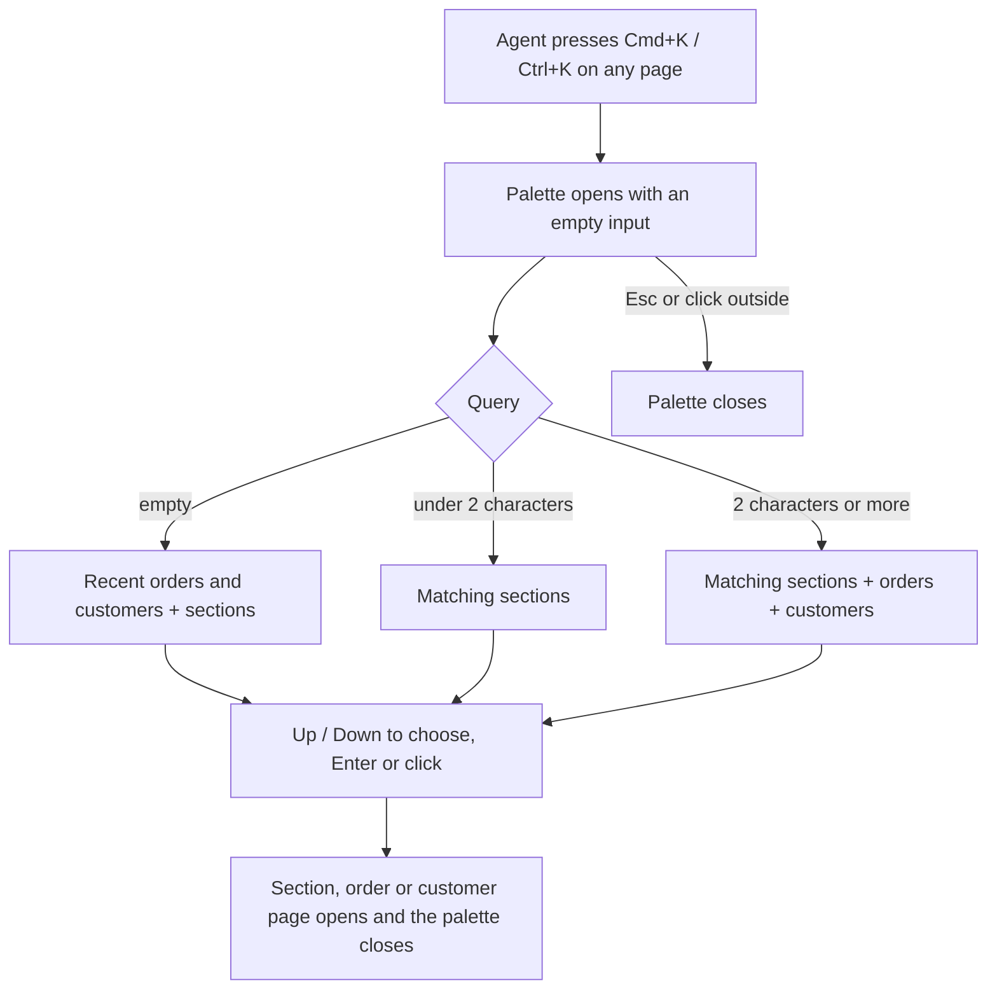

# Command palette (Cmd+K) — PRD

## Summary

Support agents get a command palette: Cmd+K (Ctrl+K on Windows) on any page opens a dialog where typing shows admin sections, orders and customers, and Enter opens the chosen one. It replaces the header search → results page → click round trip for the lookups agents do all day, and brings back recently opened orders and customers without typing.

## Problem

Support agents switch between orders and customers all day. Opening an order today takes four steps: click the header search, type the number, wait for the results page, click the result. Analytics show `header_search_submitted` about 4,000 times a day, almost always followed immediately by `search_result_opened`, so the results page is a wasted step on nearly every lookup. If we do nothing, agents keep paying that step about 4,000 times a day. We have no measurement of how long a lookup takes today (see Q2).

## Goals

- Agents reach the order, customer or section they need in fewer steps, from any page, without leaving the keyboard.
- Returning to a recently opened order or customer takes no typing.

## Non-goals

- Actions from the palette ("Refund order …"): explicitly later.
- Removing or redesigning the header search and the `/search` results page (see Q6).
- Searching anything other than orders, customers and admin sections (no merchants, refunds, settings).
- Touch or mobile layouts: the admin is used on desktop.
- Changing who has access to what: the palette only reflects existing permissions.

## Users & scenarios

Support agents are the primary users; operations team members use the same admin and get the same palette.

- As a support agent, I want to press Cmd+K and type an order number so that the order opens without a results page.
- As a support agent, I want to type part of a customer's name or email so that the customer opens directly.
- As a support agent, I want to type a section name ("Refunds", "Merchants") so that I jump there without the sidebar.
- As a support agent, I want to see the orders and customers I opened recently when the palette is empty, so that I can return to the ticket I'm working on.
- As an admin, I want agents to see only the sections they have access to, so that the palette doesn't advertise restricted areas.

## Requirements

| ID | Requirement | Priority | Acceptance criteria |
|----|-------------|----------|---------------------|
| R1 | Cmd+K (macOS) / Ctrl+K (Windows, Linux) opens the palette on any page, including while the cursor is in a text field; Esc closes it | Must | On every page, with and without focus in the header search, the shortcut opens the palette; Esc or a click outside closes it |
| R2 | Typing shows admin sections whose name contains the text; Enter or click navigates there | Must | Typing "ref" shows "Refunds"; Enter opens `/refunds` |
| R3 | From 2 characters, the palette shows orders and customers matching by order number, customer name or email; Enter or click opens the details page | Must | Typing an order number shows that order and Enter opens `/orders/<id>`; typing part of an email shows the customer and Enter opens `/customers/<id>` |
| R4 | The agent never sees sections they have no permission for | Must | An agent without `refunds:manage` cannot make "Refunds" appear in the palette with any query |
| R5 | With an empty query, the palette shows the agent's recently opened orders and customers, most recent first | Should | Open two orders, press Cmd+K: both are listed, the latest first; selecting one opens it |
| R6 | Results can be walked with the keyboard: Up / Down moves the selection, Enter opens the selected item | Must | With three results, Down twice then Enter opens the third |
| R7 | The shortcut is listed in the keyboard shortcuts help ("?") | Could | The "Keyboard shortcuts" dialog lists "Cmd+K / Ctrl+K" with "Open command palette" |

## Success metrics

| Metric | Baseline | Target | How measured |
|--------|----------|--------|--------------|
| Time from opening the palette to opening an item | unknown — see Q2 | unknown — see Q2 | New event `command_palette_item_opened`, `duration_ms` property |
| Share of lookups done through the palette rather than the header search | 0% | unknown — see Q2 | `command_palette_item_opened` vs `header_search_submitted` per day |
| Header searches per day | ≈ 4,000 | unknown — see Q2 | `header_search_submitted` count |

## Risks & dependencies

- No mockups yet; the designer joins later (Q4). The palette ships with a provisional layout and texts behind a feature flag and gets the final design in a late task.
- Search speed depends on the existing `/api/search` endpoint (p95 ≈ 350 ms); the palette can't be faster than it.
- Permissions come from `/api/me`; until they are loaded the palette must show nothing that needs a permission.

## Timeline

- Wanted next quarter; the exact date is to be confirmed (Q3).

## Open questions

- [ ] **Q1.** Who owns this PRD and who reviews it? — product (ticket author)
- [ ] **Q2.** What is the current time from starting a search to opening a result, and what target do we set for the palette and for the share of lookups going through it? Can the baseline be derived from the gap between `header_search_submitted` and `search_result_opened` in existing analytics? — product, analytics
- [ ] **Q3.** What is the exact deadline within next quarter? — product
- [ ] **Q4.** When do the mockups arrive, and which layout and texts are final? — design
- [ ] **Q5.** Does "no access" apply to order and customer results as well as sections, i.e. should an agent without `orders:view` see orders in the palette? Today the `/search` page shows them to anyone with `dashboard:view`. — product
- [ ] **Q6.** Does the header search box stay as it is once the palette ships, or does it become a button that opens the palette? — product
- [ ] **Q7.** How many recent items and how many results per group should the palette show, and is a "recent" list kept per browser (not synced across the agent's devices) acceptable? — product
