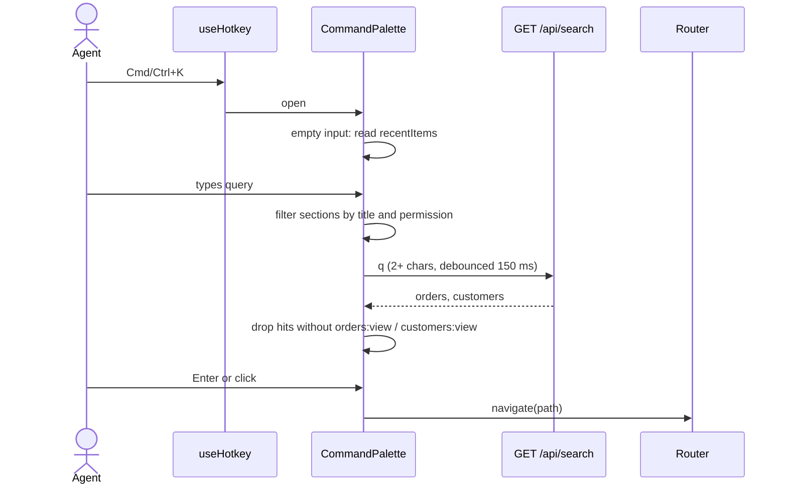

# Command palette (Cmd+K) — Spec

## Summary

A client-only feature: a global Cmd/Ctrl+K hotkey opens a modal built on the existing `Dialog`. Sections come from the `routes` config filtered by `usePermissions()`, orders and customers come from the existing `GET /api/search`, and recently opened items are kept in `localStorage` per user. No backend changes. See the [PRD](./prd.md) for the why.

## Context & current state

- `src/hooks/useHotkey.ts` registers global shortcuts. It ignores key presses while focus is in `input`, `textarea` or `[contenteditable=true]`, and its `meta` option accepts either `metaKey` or `ctrlKey`. Only used for `?` (shortcuts help) in `src/components/layout/Header.tsx`.
- `src/components/layout/Header.tsx` holds the header search: on submit (min 2 characters) it tracks `header_search_submitted` and navigates to `/search?q=…`.
- `src/pages/SearchPage.tsx` calls `searchEntities(q, 50, signal)` and renders links to `/orders/:orderId` and `/customers/:customerId`, tracking `search_result_opened` with `{ type, source: "search_page" }`.
- `src/api/search.ts`: `GET /api/search?q&limit` searches orders by id and customers by id, name and email; p95 ≈ 350 ms, minimum query length 2. Returns `{ orders: OrderHit[], customers: CustomerHit[] }`.
- `src/routes.tsx`: every route has `title`, `permission` and `inNav`. `src/components/layout/Sidebar.tsx` shows routes with `inNav && has(permission)`, which is exactly the set of "sections" an agent may see today.
- `src/auth/usePermissions.ts` loads `GET /api/me` and exposes `has()` and `loaded`; the user `id` is fetched but not exposed.
- `src/components/ui/Dialog.tsx` wraps Radix Dialog (focus trap, Esc, scroll lock) and always renders a visible `title`.
- `src/analytics/track.ts`: `track()` accepts only names from the closed `EventName` union.
- Constraints: `src/App.tsx` does not enforce route permissions, so hiding a section is the palette's own job. Nothing in `src/` filters search hits by `orders:view` / `customers:view`; `/search` requires only `dashboard:view`. There is no feature-flag mechanism and no client-side persistent storage in the app today.

## Proposed design

### Overview



### Components & changes

- `src/hooks/useHotkey.ts` — add option `allowInInputs` (default `false`). The palette shortcut uses `{ meta: true, allowInInputs: true }` so Cmd/Ctrl+K also works while the cursor is in a text field; `?` keeps today's behavior.
- `src/components/layout/Header.tsx` — registers the Cmd/Ctrl+K hotkey, owns the palette `open` state, renders `CommandPalette`, tracks `command_palette_opened`. The header search form stays as is.
- `src/components/command-palette/CommandPalette.tsx` — new. Renders inside `Dialog`: a text input and one list grouped as Recent / Sections / Orders / Customers. ↑/↓ move the active item, Enter or click selects, Esc closes (Radix). Implements the ARIA combobox + listbox pattern (`role="combobox"`, `aria-activedescendant`). On select: `navigate(path)`, close, track.
- `src/components/command-palette/useSectionCommands.ts` — new. `routes.filter(r => r.inNav && has(r.permission))`, the same rule as `Sidebar`, matched against `title` with a case-insensitive substring match. Returns nothing until `loaded` is `true`.
- `src/components/command-palette/useEntitySearch.ts` — new. TanStack Query with key `["palette-search", q]` calling `searchEntities(q, 5, signal)`, enabled when `q.trim().length >= 2`, input debounced by 150 ms; the query `signal` aborts outdated requests. Drops order hits unless `has("orders:view")` and customer hits unless `has("customers:view")` (assumption, see PRD Q4).
- `src/components/command-palette/recentItems.ts` — new. Read/write helpers over `localStorage` plus `useRecordRecent(type, id)`.
- `src/pages/OrderDetailsPage.tsx`, `src/pages/CustomerDetailsPage.tsx` — call `useRecordRecent("order", orderId)` / `useRecordRecent("customer", customerId)` on mount, so any visit to a detail page counts as "opened" (assumption, see PRD Q5).
- `src/auth/usePermissions.ts` — also return `userId` (from the already-loaded `/api/me`) to key the recent items.
- `src/components/layout/ShortcutsHelp.tsx` — add the Cmd/Ctrl+K entry to `SHORTCUTS`; wording comes with the design (PRD Q7 owner).
- `src/analytics/track.ts` — add `command_palette_opened` and `command_palette_item_selected` to `EventName`.

### Data model

Recent items live in `localStorage` under the key `acme-admin:recent:<userId>`:

```ts
interface RecentItem {
  type: "order" | "customer";
  id: string;       // "ORD-10482", "CUS-2210"
  openedAt: number; // epoch ms
}
// value: JSON array of RecentItem, newest first, deduplicated by type + id, at most 5
```

Only type and id are stored, no customer names or emails (assumption, see PRD Q6). The palette shows the stored id. The limit of 5 is an assumption (see PRD Q5).

### API / interfaces

- No new endpoints. The palette reuses `GET /api/search` through `searchEntities(q, limit, signal)` with `limit = 5` (assumption, see PRD Q7).
- `CommandPalette` props: `{ open: boolean; onOpenChange: (open: boolean) => void }`.
- `useHotkey(key, handler, opts)` — `opts` gains `allowInInputs?: boolean`.
- `usePermissions()` returns `{ has, loaded, userId }`.
- Analytics events:
  - `command_palette_opened` — `{ trigger: "hotkey" }`.
  - `command_palette_item_selected` — `{ kind: "section" | "order" | "customer", from_recent: boolean, query_length: number, ms_since_open: number }`.
  - `search_result_opened` — also sent for orders and customers opened from the palette, with `{ type, source: "command_palette" }`, so the PRD share metric splits it by `source`.

## Requirements coverage

| PRD ID | How it's satisfied | Section |
|--------|--------------------|---------|
| R1 | Cmd/Ctrl+K via `useHotkey` with `meta` + `allowInInputs`, registered in `Header` (rendered on every page by `AppLayout`); Esc handled by `Dialog` | Components & changes |
| R2 | `useSectionCommands` matches `routes` titles; Enter/click calls `navigate(path)` | Components & changes |
| R3 | Same filter as `Sidebar`: `inNav && has(permission)`, nothing shown before `loaded` | Components & changes |
| R4 | `useEntitySearch` over `GET /api/search`; selecting navigates straight to `/orders/:orderId` or `/customers/:customerId` | Components & changes, API / interfaces |
| R5 | **Partial:** recent items are stored per browser in `localStorage`, so they don't follow the agent to another computer or browser, and they show ids only, without customer names (see PRD Q6) | Data model |

## Alternatives & decisions

| Decision | Options considered | Chosen | Why |
|----------|-------------------|--------|-----|
| Palette UI | Add the `cmdk` library; build on the existing `Dialog` | Existing `Dialog` + own list | No new dependency; Radix already gives focus trap and Esc. Cost: we implement the combobox ARIA pattern ourselves |
| Section matching | Fuzzy-search library; case-insensitive substring | Substring | Six sections; fuzzy matching adds a dependency for little gain. Easy to swap later |
| Where recent items live | New backend endpoint; `sessionStorage`; `localStorage` per user | `localStorage` per user | No backend work and survives reloads; keying by `userId` keeps agents on a shared computer apart. Cost: no sync across devices (R5 partial) |
| What counts as "opened" | Only palette selections; any visit to a detail page | Any visit to a detail page | Matches "recently opened" in the ticket, including opens from the search page and links. Assumption, see PRD Q5 |
| Shortcut in text fields | Separate keydown listener; extend `useHotkey` | Extend `useHotkey` with `allowInInputs` | One place for global shortcuts; modifier combos don't clash with typing |
| Record permissions | Show all hits; hide by `orders:view` / `customers:view` | Hide | Most conservative until PRD Q4 is answered |
| Request rate | Request on every keystroke; debounce + abort | Debounce 150 ms + abort via `signal` | Search-as-you-type sends far more requests than today's ≈ 4,000 submits a day |

## Edge cases & error handling

- Query shorter than 2 characters → only sections (or recent items if empty); no API call.
- `GET /api/search` fails or times out → sections still shown; the Orders/Customers group shows an error state (wording per design); the palette stays usable.
- Responses arrive out of order → TanStack Query aborts the outdated request through `signal`; only results for the current query are shown.
- Permissions not loaded yet (`loaded === false`) → no sections and no records; they appear once `/api/me` resolves.
- No matches → empty state (wording per design).
- Recent item the agent can no longer access (permission removed) → hidden when the palette renders.
- `localStorage` unavailable, full or holding invalid JSON → recent items are skipped and the stored value is reset; the rest of the palette works.
- Cmd/Ctrl+K while the palette is already open → focus returns to the input; it does not open a second dialog.
- Cmd/Ctrl+K while another dialog (e.g. `ShortcutsHelp`) is open → ignored.
- Ctrl+K on Windows is also a browser shortcut (focus browser search) → `useHotkey` calls `preventDefault()` when the page has focus.
- Enter during IME composition (`e.isComposing`) → ignored, so it doesn't select an item.

## Non-functional

- Accessibility: combobox + listbox roles, active item announced via `aria-activedescendant`, focus trap and return of focus on close from Radix.
- Performance: sections are filtered in memory; record search adds about one request per 150 ms pause in typing, with p95 ≈ 350 ms on the current endpoint.
- Privacy: `localStorage` holds only record types and ids, scoped by `userId`.

## Testing plan

- Unit (Vitest): `useSectionCommands` matching and permission filtering (R2, R3); `recentItems` ordering, deduplication, cap of 5, per-user keys, invalid JSON (R5); `useHotkey` with `allowInInputs`.
- Component (Testing Library, `searchEntities` mocked): Cmd+K and Ctrl+K open the palette, also from a focused input, and Esc closes it (R1); arrow keys + Enter and click navigate to the section, order and customer pages (R2, R4); hits dropped without `orders:view` / `customers:view`; empty input shows recent items (R5); error and empty states.
- Manual: macOS and Windows on the browsers the support team uses, checking that the browser's own Ctrl+K / Cmd+K doesn't fire.

## Rollout & rollback

The app has no feature-flag mechanism, so the palette is gated by a build-time Vite variable `VITE_FEATURE_COMMAND_PALETTE`: when off, the hotkey isn't registered and nothing is rendered. Steps: enable on staging → enable in production for everyone. The header search and the search results page stay unchanged, so agents keep the old path. Rollback: rebuild and deploy with the variable off. Stored recent items are harmless when the feature is off.

## Observability

- `command_palette_opened` and `command_palette_item_selected` (with `ms_since_open`) give the time from opening the palette to opening a record for the PRD time metric.
- `search_result_opened` split by `source` (`search_page` vs `command_palette`) gives the PRD share metric; `header_search_submitted` per day stays the third metric.
- Baseline for the time metric: the gap between `header_search_submitted` and the following `search_result_opened` in the same session. It doesn't include typing time, so it understates today's time.

## Open questions

- [ ] Does `GET /api/search` enforce `orders:view` / `customers:view` on the server, or does it return hits to anyone? — backend team
- [ ] Does `limit` in `GET /api/search` apply per type or to orders and customers combined? — backend team
- [ ] Can `GET /api/search` handle the extra load of search-as-you-type from all agents? — backend team
- [ ] Is there a runtime feature-flag service we should use instead of a build-time variable? — frontend team
- [ ] Can the analytics collector compute the gap between two events in the same session, needed for the time metric and its baseline? — analytics team
- [ ] Which engineer owns this Spec? — frontend team lead
