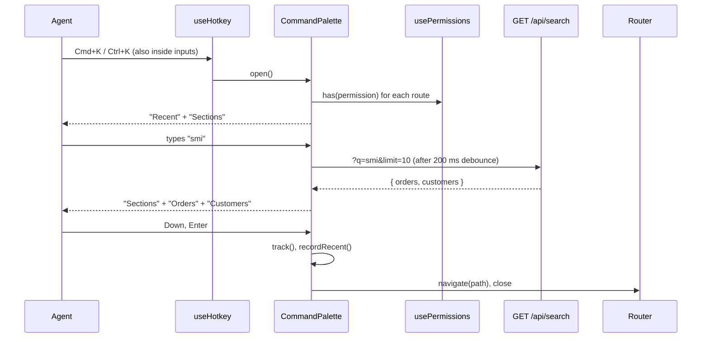

# Command palette (Cmd+K) — Spec

## Summary

A frontend-only feature: a `CommandPalette` dialog mounted in `AppLayout`, opened by a global Cmd+K / Ctrl+K hotkey, that lists sections from the existing route table (filtered by the agent's permissions), orders and customers from the existing `GET /api/search` endpoint, and recently opened items kept in `localStorage`. No backend changes. Gated by a build-time feature flag. See the [PRD](./prd.md) for the why.

## Context & current state

- Global search today: `src/components/layout/Header.tsx` renders a search input; on submit it tracks `header_search_submitted` and navigates to `/search?q=…`. `src/pages/SearchPage.tsx` runs `searchEntities(q, 50)` through TanStack Query and renders links to `/orders/:id` and `/customers/:id`, tracking `search_result_opened` with `source: "search_page"`.
- Search API: `src/api/search.ts` → `GET /api/search?q=<query>&limit=<n>` returns `{ orders: OrderHit[], customers: CustomerHit[] }`; orders match by id, customers by id, name and email; minimum query length 2; p95 ≈ 350 ms. Requests take an `AbortSignal`. There is no endpoint for sections: sections are the frontend route table.
- Sections: `src/routes.tsx` exports `routes: AppRoute[]` with `path`, `title`, `permission`, `inNav`. `src/components/layout/Sidebar.tsx` shows `routes.filter((r) => r.inNav && has(r.permission))`; the same filter yields the palette's section list.
- Permissions: `src/auth/usePermissions.ts` loads `GET /api/me` (`id`, `name`, `permissions`) and exposes `has(p)` and `loaded`. The frontend only hides navigation; nothing in `src/App.tsx` guards routes, so data access is enforced by the backend.
- Hotkeys: `src/hooks/useHotkey.ts` registers a global `keydown` listener with an optional `{ meta: true }` (accepts `metaKey` or `ctrlKey`) but ignores events whose target is an `input`, `textarea` or `[contenteditable=true]`. As is, Cmd+K pressed while typing in the header search would be ignored, which breaks PRD R1.
- Modals: `src/components/ui/Dialog.tsx` wraps `@radix-ui/react-dialog` (focus trap, Esc, scroll lock) and always renders a visible title. `src/components/layout/ShortcutsHelp.tsx` lists shortcuts from a `SHORTCUTS` constant and is opened with `?`.
- Analytics: `src/analytics/track.ts` has a typed `EventName` union; new event names are added there.
- No feature-flag mechanism exists in the app, and nothing persists per-user UI state (no `localStorage` use). No stylesheet lives in `src/`; components use class names such as `dialog-overlay`.
- Tests: `vitest` and `@testing-library/react` are installed (`npm test`), but the repo has no test files yet.

## Proposed design

### Overview



### Components & changes

- `src/flags.ts` — new: `isEnabled("command_palette")` returns `import.meta.env.VITE_FF_COMMAND_PALETTE === "true"`. Build-time, per environment (see *Alternatives & decisions* and Q2).
- `src/hooks/useHotkey.ts` — change: new option `inInputs?: boolean`; when `true`, the `input` / `textarea` / `contenteditable` guard is skipped. Default stays `false`, so `?` behaves as before.
- `src/components/palette/matchSections.ts` — new: `matchSections(routes, has, query)` returns the routes with `inNav && has(permission)` whose `title` contains `query` case-insensitively; an empty query returns all of them.
- `src/components/palette/useRecentItems.ts` — new: reads and writes the `localStorage` key `acme-admin.recent.<userId>`. `record({ type, id, label? })` upserts by `type + id`, moves the item to the front, keeps an existing non-empty label when none is passed, and caps the list at 10. `items` is filtered by `has("orders:view")` / `has("customers:view")`. Everything is a no-op until `usePermissions().loaded`. Also exports `useRecordVisits()`, which watches `useLocation()` and records visits to `/orders/:orderId` and `/customers/:customerId` with the id as label.
- `src/components/palette/CommandPalette.tsx` — new. Built on `@radix-ui/react-dialog` directly, with a visually hidden `Title` "Command palette", an input and a listbox. Owns its open state and registers `useHotkey("k", open, { meta: true, inInputs: true })`; calls `useRecordVisits()`. Groups, in order: "Recent" (empty query only), "Sections", "Orders", "Customers". Query is debounced 200 ms; `useQuery(["palette-search", q])` calls `searchEntities(q, 10, signal)`, enabled when `q.trim().length >= 2` and the agent has `orders:view` or `customers:view`, with `placeholderData: keepPreviousData`. Order hits are shown only with `orders:view`, customer hits only with `customers:view`. Keyboard: ArrowUp / ArrowDown move one active index across all groups, Enter opens the active item, Esc closes (Radix). Opening an item: `track("command_palette_item_opened", …)`, `record()` for orders and customers, `navigate(path)`, close.
- `src/components/layout/AppLayout.tsx` — change: render `<CommandPalette />` when `isEnabled("command_palette")`.
- `src/pages/SearchPage.tsx` — change: on a result click also call `record()` with the hit's label, so items opened from the results page carry a name.
- `src/components/layout/ShortcutsHelp.tsx` — change: when the flag is on, `SHORTCUTS` also contains `{ keys: "Cmd+K / Ctrl+K", description: "Open command palette" }`.
- `src/analytics/track.ts` — change: add `command_palette_opened` and `command_palette_item_opened` to `EventName`.
- Styles: class names `palette-overlay`, `palette-content`, `palette-input`, `palette-group`, `palette-item`, `palette-item--active`, following the existing `dialog-*` convention; final styling comes with the design (PRD Q4).

### Data model

No database changes. One `localStorage` entry per agent, key `acme-admin.recent.<userId>`, value a JSON array of at most 10:

```ts
interface RecentItem {
  type: "order" | "customer";
  id: string;        // "ORD-10482" / "CUS-2210"
  label: string;     // order id, or customer name; never the email
  openedAt: number;  // Date.now()
}
```

### API / interfaces

No new or changed endpoints. The palette calls the existing `GET /api/search?q=<query>&limit=10`.

New analytics events:

- `command_palette_opened` — `{ trigger: "hotkey" }`.
- `command_palette_item_opened` — `{ kind: "section" | "order" | "customer" | "recent", position: number, query_length: number, duration_ms: number }`, where `duration_ms` is the time from opening the palette to selecting the item.

## Requirements coverage

| PRD ID | How it's satisfied | Section |
|--------|--------------------|---------|
| R1 | `useHotkey("k", open, { meta: true, inInputs: true })`; Radix closes on Esc and on overlay click | Components & changes |
| R2 | `matchSections()` over `routes`; Enter or click calls `navigate(route.path)` | Components & changes |
| R3 | Debounced `searchEntities(q, 10)` from 2 characters; hits grouped into "Orders" / "Customers"; Enter or click navigates to `/orders/:id` or `/customers/:id` | Components & changes |
| R4 | Sections come only from `matchSections()`, which applies `has(permission)`; nothing is listed until `loaded`. Assumption (PRD Q5): order and customer hits are hidden the same way, by `has("orders:view")` / `has("customers:view")` | Components & changes |
| R5 | `useRecentItems` shown as "Recent" on an empty query, newest first. Assumption (PRD Q7): at most 10 items, kept per browser in `localStorage`, not synced across devices | Components & changes, Data model |
| R6 | One active index across all groups; ArrowUp / ArrowDown move it, Enter opens it | Components & changes |
| R7 | `SHORTCUTS` entry "Cmd+K / Ctrl+K" — "Open command palette" when the flag is on | Components & changes |

Assumption (PRD Q7): the search request uses `limit=10` and every hit returned is shown; the palette doesn't cap groups further.
Assumption (PRD Q6): the header search and the `/search` page stay unchanged.

## Alternatives & decisions

| Decision | Options considered | Chosen | Why |
|----------|-------------------|--------|-----|
| Hotkey inside text fields | A: `inInputs` option on `useHotkey`; B: a separate `keydown` listener in `CommandPalette`; C: make `useHotkey` always pass meta combos through | A | One hotkey path for the whole app; `?` keeps its current behaviour |
| Dialog base | A: reuse `Dialog` (visible title); B: `@radix-ui/react-dialog` directly with a hidden title; C: add a `hideTitle` prop to `Dialog` | B | The palette's layout (input as header, list body) doesn't fit the generic modal; `Dialog` stays untouched; focus trap and Esc still come from Radix |
| Section source | A: `routes` with `inNav && has(permission)`; B: a separate hard-coded list | A | Same list as the sidebar, so the two can't drift and R4 holds by construction |
| Entity search | A: existing `GET /api/search` with `limit=10`; B: a new palette endpoint; C: a client-side index | A | No backend work; its minimum length and matching fields already match the ticket |
| Recent items storage | A: `localStorage` keyed by user id; B: backend storage; C: in-memory only | A | No backend work, survives reloads; per browser only (PRD Q7) |
| Feature flag | A: build-time `VITE_FF_COMMAND_PALETTE`; B: runtime flag from `/api/me` | A | Nothing exists today and B needs backend work; rollback is a redeploy (Q2) |
| Hit visibility by permission | A: filter client-side with `has()`; B: rely on the backend | A | Conservative (PRD Q5); whether the backend filters is unknown (Q1) |

## Edge cases & error handling

- Permissions not loaded yet (`loaded === false`) → the palette opens with the input only; no sections, hits or recents until loaded.
- Query shorter than 2 characters → sections only, no request.
- Query of 2+ characters but the agent has neither `orders:view` nor `customers:view` → no request, sections only.
- Request in flight → previous results stay visible with a "Searching…" hint; typing again aborts the previous request through the query `signal`.
- `GET /api/search` fails → "Search is unavailable" shown under the sections; sections keep working; the next keystroke retries.
- No section, order or customer matches → "No results for “<query>”".
- Cmd+K while the palette is open → stays open, the input text is selected.
- Ctrl+K on macOS also opens the palette (`useHotkey` treats `metaKey` and `ctrlKey` alike). The browser's own Cmd+K / Ctrl+K is suppressed by `preventDefault()` only while the page has focus.
- Enter with no active item → nothing happens.
- A recent item whose entity no longer exists → navigates to the details page, which shows its own not-found state; the item stays in the list.
- A recent item the agent lost permission for → filtered out at render by `has()`.
- Corrupt or non-JSON `localStorage` value → treated as an empty list and overwritten on the next `record()`.
- Another agent logs in on the same browser → a different key; lists are per user id.

## Non-functional

- Performance: 200 ms debounce plus the endpoint's p95 ≈ 350 ms, so hits normally appear within about 550 ms of the last keystroke; `limit=10` keeps the list short.
- Accessibility: Radix focus trap and Esc; input with `role="combobox"` and `aria-expanded`, list with `role="listbox"`, active item via `aria-activedescendant`; hidden title "Command palette" for screen readers.
- Privacy: recents store ids and names only, never emails, under a per-user key.

## Testing plan

- Unit (`vitest`): `useHotkey` with `inInputs: true` fires while an input is focused and stays ignored without it; `matchSections` filters by permission, `inNav` and query; `useRecentItems` upserts to the front, keeps labels, caps at 10, keys by user, survives corrupt data.
- Component (`@testing-library/react`, `searchEntities` mocked): Cmd+K and Ctrl+K open the palette, also from the header input, Esc closes (R1); "ref" lists "Refunds" and Enter navigates to `/refunds` (R2); hits are grouped and Enter opens `/orders/<id>` (R3); an agent without `refunds:manage` never sees "Refunds" (R4); an empty query lists recents newest first (R5); Down twice then Enter opens the third item (R6); "Searching…", "Search is unavailable" and "No results for “<query>”" states.
- Manual on staging: two accounts with different permissions, macOS and Windows, with the cursor in the header search (R1, R4); the "Keyboard shortcuts" dialog lists the entry (R7).

## Rollout & rollback

Flag `VITE_FF_COMMAND_PALETTE`, off by default. Rollout: staging on → production on after the staging check passes; a build-time flag can't target a subset of agents (Q2). The header search stays as the fallback. Rollback: redeploy with the flag off; nothing else to revert — no migrations, no backend change, and the `localStorage` recents are inert without the palette.

## Observability

`command_palette_opened` and `command_palette_item_opened` (with `duration_ms`) feed the PRD metrics. No new alerts.

## Open questions

- [ ] **Q1.** Does `GET /api/search` filter hits by the caller's permissions? If not, client-side filtering only hides them in the palette, and the `/search` page keeps exposing them as today. — backend team
- [ ] **Q2.** Is there a runtime feature-flag mechanism (for example a `features` field on `/api/me`) to use instead of the build-time `VITE_FF_COMMAND_PALETTE`? Build-time means rollback is a redeploy and no partial rollout. — frontend lead, backend team
- [ ] **Q3.** Do new event names need registering in the analytics collector before they are counted? — analytics
