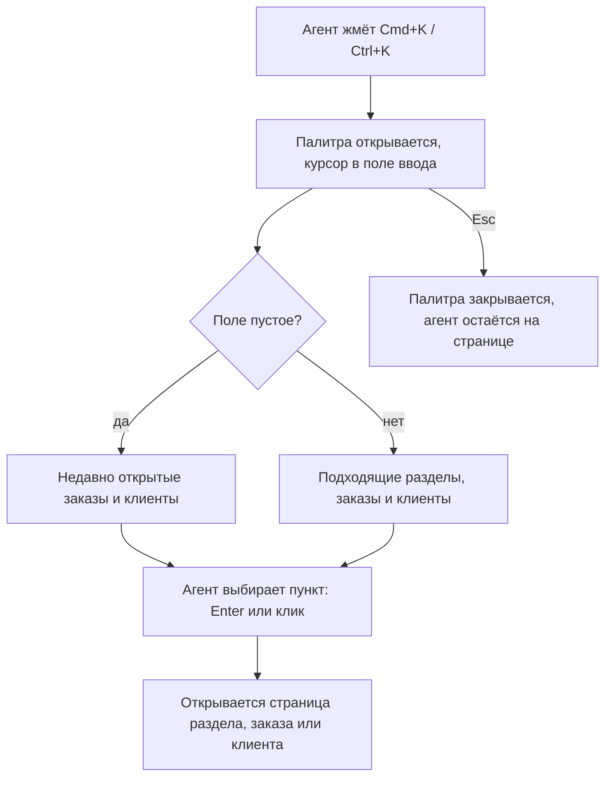

# Command palette (Cmd+K) — PRD

## Кратко

Агенты поддержки получают в админке command palette, рассчитанную на работу с клавиатуры: жмёшь Cmd+K (Ctrl+K на Windows), начинаешь печатать и сразу переходишь в раздел админки, к заказу или к клиенту. Это убирает лишний шаг со страницей результатов поиска, через который агенты проходят тысячи раз в день.

## Проблема

Агенты поддержки целый день переключаются между заказами и клиентами. Сейчас, чтобы открыть заказ, агент кликает в поиск в хедере, вводит номер, ждёт страницу результатов поиска и кликает ещё раз. По аналитике `header_search_submitted` срабатывает около 4 000 раз в день и почти всегда сразу за ним идёт `search_result_opened`. Страница результатов — лишний шаг почти в каждом поиске. Кроме того, агенты часто возвращаются к одним и тем же заказам и клиентам, пока работают с тикетом, и сейчас им приходится каждый раз искать их заново.

Сколько времени сейчас уходит на то, чтобы открыть заказ, мы не знаем: базового значения нет.

## Цели

- Агенты открывают нужный заказ, клиента или раздел админки быстрее, чем сейчас.
- Агенты возвращаются к недавно открытым заказам и клиентам без повторного поиска.

## Вне рамок

- Действия прямо из палитры (например, «сделать возврат по заказу…»). Когда-нибудь хочется, но точно не сейчас.

## Пользователи и сценарии

Пользователи: агенты поддержки, работающие в админке.

- Как агент поддержки, я хочу открыть заказ, введя его номер в палитру, чтобы не проходить через страницу результатов поиска.
- Как агент поддержки, я хочу найти клиента по имени или email с любой страницы, чтобы переключиться, не отрываясь от клавиатуры.
- Как агент поддержки, я хочу перейти в раздел админки (например, «Refunds», «Merchants»), набрав его название.
- Как агент поддержки, я хочу видеть недавно открытые заказы и клиентов, когда открываю палитру, чтобы вернуться к тикету, с которым работаю.

## Требования

| ID | Требование | Приоритет | Критерии приёмки |
|----|------------|-----------|------------------|
| R1 | Агент открывает палитру с любой страницы админки по Cmd+K на macOS или Ctrl+K на Windows и закрывает её по Esc | Must | На каждой странице админки сочетание открывает палитру с курсором в поле ввода; Esc закрывает её, и агент остаётся на той же странице |
| R2 | По мере ввода палитра показывает разделы админки с подходящим названием и открывает выбранный раздел | Must | При вводе «ref» показывается «Refunds»; выбор стрелками + Enter или кликом открывает страницу Refunds |
| R3 | Палитра никогда не показывает разделы, к которым у агента нет доступа | Must | Агент без доступа к Refunds вводит «ref» и не видит пункта «Refunds»; агент с доступом его видит |
| R4 | По мере ввода палитра показывает заказы, найденные по номеру заказа, и клиентов, найденных по номеру клиента, имени или email, и сразу открывает выбранный | Must | При вводе номера существующего заказа показывается этот заказ; его выбор открывает страницу заказа, минуя страницу результатов поиска. То же для клиента, найденного по номеру, имени и email |
| R5 | При пустом поле палитра показывает заказы и клиентов, которые агент открывал последними | Could | После открытия заказа A, а затем клиента B палитра показывает B и A, сначала самый недавний; выбор пункта открывает его страницу |

## Метрики успеха

| Метрика | Базовое значение | Цель | Как измеряем |
|---------|------------------|------|--------------|
| Время, за которое агент открывает нужный заказ или клиента | неизвестно — см. открытые вопросы | неизвестно — см. открытые вопросы | События аналитики; как именно измеряется время, описано в спецификации |
| Доля открытий заказов и клиентов через палитру | 0 | неизвестно — см. открытые вопросы | `search_result_opened` в разбивке по источнику |
| Поисковые запросы из хедера в день | ≈ 4 000 | неизвестно — см. открытые вопросы | `header_search_submitted` |

## Риски и зависимости

- Макетов пока нет, дизайнер подключится позже. Итоговый вид, тексты и пустые состояния / состояния ошибок зависят от дизайна.
- R3 и R4 зависят от существующей модели прав доступа и существующего поиска по заказам и клиентам.

## Сроки

- Хотим в следующем квартале (по ADMIN-231); точную дату сообщат позже.

## Открытые вопросы

- [ ] **Q1.** Кто владелец фичи и кто должен ревьюить PRD и спецификацию? — продакт (автор ADMIN-231)
- [ ] **Q2.** Какие базовое значение и цель по времени открытия заказа или клиента? Подойдёт ли базовое значение из существующей аналитики или нужен отдельный замер до запуска? — продакт (автор ADMIN-231)
- [ ] **Q3.** Какие цели по использованию палитры и по снижению числа поисковых запросов из хедера? — продакт (автор ADMIN-231)
- [ ] **Q4.** Должен ли агент без доступа к заказам или клиентам видеть заказы или клиентов в результатах палитры? Тикет говорит только о разделах. — продакт (автор ADMIN-231)
- [ ] **Q5.** Недавние: сколько пунктов показывать и что считается «открытым» — любой заход на страницу заказа или клиента или только открытие из палитры? — продакт (автор ADMIN-231)
- [ ] **Q6.** Недавние: допустимо ли, что они хранятся отдельно для каждого компьютера и браузера и не синхронизируются между ними? Может ли палитра запоминать имена клиентов на компьютере агента или показывать только номера заказов и клиентов? — продакт (автор ADMIN-231), безопасность
- [ ] **Q7.** Сколько заказов и клиентов палитра должна показывать на один запрос? — дизайнер (TBD)
- [ ] **Q8.** Должен ли ввод имени или email клиента показывать ещё и заказы этого клиента или только самого клиента? — продакт (автор ADMIN-231)
- [ ] **Q9.** Остаются ли поиск в хедере и страница результатов поиска без изменений после запуска? — продакт (автор ADMIN-231)
- [ ] **Q10.** Верно ли выбран приоритет недавних (R5, Could)? — продакт (автор ADMIN-231)
- [ ] **Q11.** Какую именно дату означает «следующий квартал»? — продакт (автор ADMIN-231)
