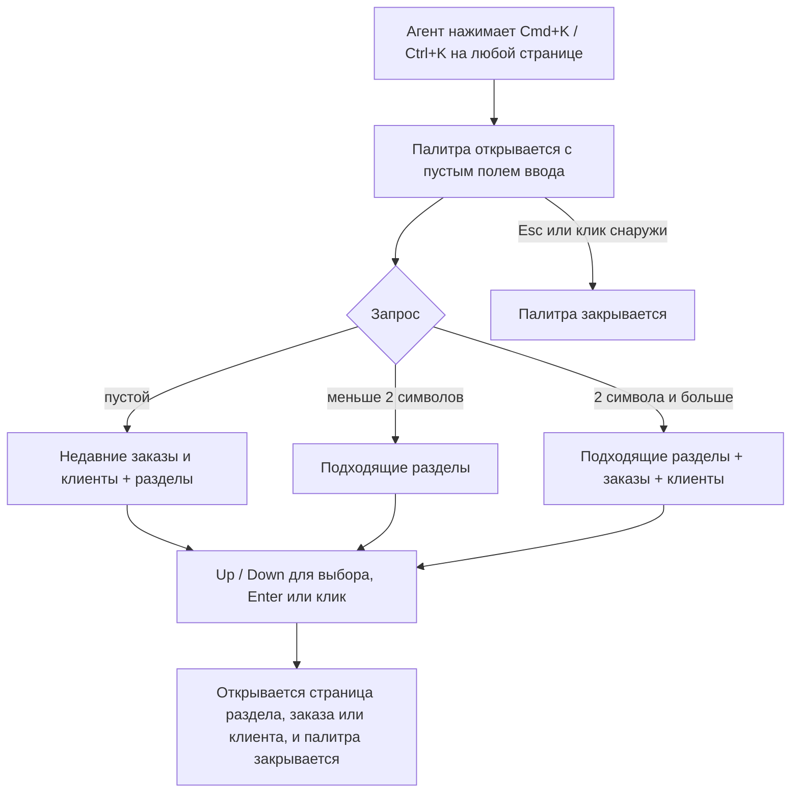

# Командная палитра (Cmd+K) — PRD

## Кратко

Агенты поддержки получают командную палитру: Cmd+K (Ctrl+K на Windows) на любой странице открывает окно, где по мере ввода показываются разделы админки, заказы и клиенты, а Enter открывает выбранное. Она заменяет цепочку «поиск в хедере → страница результатов → клик» для поисков, которые агенты делают весь день, и возвращает к недавно открытым заказам и клиентам без ввода текста.

## Проблема

Агенты поддержки целый день переключаются между заказами и клиентами. Чтобы открыть заказ, сегодня нужно четыре шага: кликнуть в поиск в хедере, ввести номер, дождаться страницы результатов, кликнуть по результату. По аналитике `header_search_submitted` срабатывает около 4 000 раз в день, и почти всегда сразу за ним идёт `search_result_opened`, то есть страница результатов — лишний шаг почти в каждом поиске. Если ничего не делать, агенты продолжат платить этот шаг около 4 000 раз в день. Сколько сейчас занимает один поиск, мы не измеряем (см. Q2).

## Цели

- Агенты добираются до нужного заказа, клиента или раздела за меньше шагов, с любой страницы и не отрывая рук от клавиатуры.
- Возврат к недавно открытому заказу или клиенту не требует ввода текста.

## Вне рамок

- Действия из палитры («Refund order …»): явно отложено на потом.
- Удаление или переделка поиска в хедере и страницы результатов `/search` (см. Q6).
- Поиск по чему-либо, кроме заказов, клиентов и разделов админки (никаких мерчантов, возвратов, настроек).
- Сенсорные и мобильные раскладки: админкой пользуются на десктопе.
- Изменение того, у кого к чему есть доступ: палитра только отражает существующие права.

## Пользователи и сценарии

Основные пользователи — агенты поддержки; сотрудники операционной команды работают в той же админке и получают ту же палитру.

- Как агент поддержки, я хочу нажать Cmd+K и ввести номер заказа, чтобы заказ открылся без страницы результатов.
- Как агент поддержки, я хочу ввести часть имени или email клиента, чтобы клиент открылся напрямую.
- Как агент поддержки, я хочу ввести название раздела («Refunds», «Merchants»), чтобы перейти туда без сайдбара.
- Как агент поддержки, я хочу видеть недавно открытые заказы и клиентов, когда палитра пустая, чтобы вернуться к тикету, над которым работаю.
- Как администратор, я хочу, чтобы агенты видели только разделы, к которым у них есть доступ, чтобы палитра не рекламировала закрытые области.

## Требования

| ID | Требование | Приоритет | Критерии приёмки |
|----|------------|-----------|------------------|
| R1 | Cmd+K (macOS) / Ctrl+K (Windows, Linux) открывает палитру на любой странице, в том числе когда курсор стоит в текстовом поле; Esc закрывает её | Must | На каждой странице, с фокусом в поиске хедера и без него, шорткат открывает палитру; Esc или клик снаружи закрывает её |
| R2 | По мере ввода показываются разделы админки, в названии которых есть введённый текст; Enter или клик переходит туда | Must | Ввод «ref» показывает «Refunds»; Enter открывает `/refunds` |
| R3 | Начиная с 2 символов палитра показывает заказы и клиентов, найденных по номеру заказа, имени или email клиента; Enter или клик открывает страницу деталей | Must | Ввод номера заказа показывает этот заказ, Enter открывает `/orders/<id>`; ввод части email показывает клиента, Enter открывает `/customers/<id>` |
| R4 | Агент никогда не видит разделы, к которым у него нет прав | Must | Агент без `refunds:manage` не может никаким запросом вызвать «Refunds» в палитре |
| R5 | При пустом запросе палитра показывает недавно открытые агентом заказы и клиентов, самые свежие первыми | Should | Открыть два заказа, нажать Cmd+K: оба в списке, последний первым; выбор одного открывает его |
| R6 | По результатам можно ходить с клавиатуры: Up / Down двигает выделение, Enter открывает выделенный элемент | Must | При трёх результатах Down дважды и Enter открывает третий |
| R7 | Шорткат есть в справке по клавиатурным сокращениям («?») | Could | Диалог «Keyboard shortcuts» показывает «Cmd+K / Ctrl+K» с «Open command palette» |

## Метрики успеха

| Метрика | Базовое значение | Цель | Как измеряем |
|---------|------------------|------|--------------|
| Время от открытия палитры до открытия элемента | неизвестно — см. Q2 | неизвестно — см. Q2 | Новое событие `command_palette_item_opened`, свойство `duration_ms` |
| Доля поисков через палитру, а не через поиск в хедере | 0% | неизвестно — см. Q2 | `command_palette_item_opened` против `header_search_submitted` в день |
| Поисков через хедер в день | ≈ 4 000 | неизвестно — см. Q2 | Количество `header_search_submitted` |

## Риски и зависимости

- Макетов пока нет; дизайнер подключится позже (Q4). Палитра выходит с временной раскладкой и текстами за фича-флагом, а финальный дизайн получает в поздней задаче.
- Скорость поиска зависит от существующего эндпоинта `/api/search` (p95 ≈ 350 мс); палитра не может быть быстрее него.
- Права приходят из `/api/me`; пока они не загружены, палитра не должна показывать ничего, что требует прав.

## Сроки

- Хотим в следующем квартале; точная дата уточняется (Q3).

## Открытые вопросы

- [ ] **Q1.** Кто владелец этого PRD и кто его ревьюит? — продакт (автор тикета)
- [ ] **Q2.** Сколько сейчас проходит от начала поиска до открытия результата, и какую цель ставим для палитры и для доли поисков через неё? Можно ли вывести базовое значение из разрыва между `header_search_submitted` и `search_result_opened` в текущей аналитике? — продакт, аналитика
- [ ] **Q3.** Какой точный дедлайн внутри следующего квартала? — продакт
- [ ] **Q4.** Когда появятся макеты, и какие раскладка и тексты финальные? — дизайн
- [ ] **Q5.** Распространяется ли «нет доступа» на результаты по заказам и клиентам, а не только на разделы, то есть должен ли агент без `orders:view` видеть заказы в палитре? Сегодня страница `/search` показывает их всем, у кого есть `dashboard:view`. — продакт
- [ ] **Q6.** Остаётся ли поле поиска в хедере как есть после выхода палитры, или превращается в кнопку, которая открывает палитру? — продакт
- [ ] **Q7.** Сколько недавних элементов и сколько результатов в каждой группе показывать, и допустим ли список «недавних» на уровне браузера (без синхронизации между устройствами агента)? — продакт
