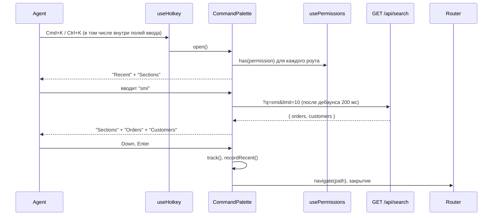

# Командная палитра (Cmd+K) — Спецификация

## Кратко

Чисто фронтендовая фича: диалог `CommandPalette`, смонтированный в `AppLayout` и открываемый глобальным хоткеем Cmd+K / Ctrl+K, показывает разделы из существующей таблицы роутов (отфильтрованные по правам агента), заказы и клиентов из существующего эндпоинта `GET /api/search` и недавно открытые элементы, хранящиеся в `localStorage`. Бэкенд не меняется. Закрыто build-time фича-флагом. Зачем это нужно, описано в [PRD](./prd.md).

## Контекст и текущее состояние

- Глобальный поиск сегодня: `src/components/layout/Header.tsx` рендерит поле поиска; при отправке трекает `header_search_submitted` и переходит на `/search?q=…`. `src/pages/SearchPage.tsx` вызывает `searchEntities(q, 50)` через TanStack Query и рендерит ссылки на `/orders/:id` и `/customers/:id`, трекая `search_result_opened` с `source: "search_page"`.
- API поиска: `src/api/search.ts` → `GET /api/search?q=<query>&limit=<n>` возвращает `{ orders: OrderHit[], customers: CustomerHit[] }`; заказы ищутся по id, клиенты по id, имени и email; минимальная длина запроса 2; p95 ≈ 350 мс. Запросы принимают `AbortSignal`. Эндпоинта для разделов нет: разделы — это таблица роутов на фронтенде.
- Разделы: `src/routes.tsx` экспортирует `routes: AppRoute[]` с `path`, `title`, `permission`, `inNav`. `src/components/layout/Sidebar.tsx` показывает `routes.filter((r) => r.inNav && has(r.permission))`; тот же фильтр даёт список разделов для палитры.
- Права: `src/auth/usePermissions.ts` загружает `GET /api/me` (`id`, `name`, `permissions`) и отдаёт `has(p)` и `loaded`. Фронтенд только прячет навигацию; в `src/App.tsx` роуты ничем не защищены, так что доступ к данным обеспечивает бэкенд.
- Хоткеи: `src/hooks/useHotkey.ts` вешает глобальный слушатель `keydown` с необязательным `{ meta: true }` (принимает `metaKey` или `ctrlKey`), но игнорирует события, цель которых — `input`, `textarea` или `[contenteditable=true]`. В текущем виде Cmd+K, нажатый во время ввода в поиске хедера, будет проигнорирован, что ломает R1 из PRD.
- Модальные окна: `src/components/ui/Dialog.tsx` оборачивает `@radix-ui/react-dialog` (focus trap, Esc, блокировка скролла) и всегда рендерит видимый заголовок. `src/components/layout/ShortcutsHelp.tsx` показывает шорткаты из константы `SHORTCUTS` и открывается по `?`.
- Аналитика: в `src/analytics/track.ts` типизированный union `EventName`; новые имена событий добавляются туда.
- Механизма фича-флагов в приложении нет, и ничто не хранит пользовательское состояние UI (нет использования `localStorage`). В `src/` нет файла стилей; компоненты используют имена классов вроде `dialog-overlay`.
- Тесты: `vitest` и `@testing-library/react` установлены (`npm test`), но файлов тестов в репозитории пока нет.

## Предлагаемое решение

### Обзор



### Компоненты и изменения

- `src/flags.ts` — новый: `isEnabled("command_palette")` возвращает `import.meta.env.VITE_FF_COMMAND_PALETTE === "true"`. Build-time, на каждое окружение (см. *Альтернативы и решения* и Q2).
- `src/hooks/useHotkey.ts` — изменение: новая опция `inInputs?: boolean`; при `true` проверка на `input` / `textarea` / `contenteditable` пропускается. По умолчанию остаётся `false`, так что `?` ведёт себя как раньше.
- `src/components/palette/matchSections.ts` — новый: `matchSections(routes, has, query)` возвращает роуты с `inNav && has(permission)`, чей `title` содержит `query` без учёта регистра; пустой запрос возвращает все.
- `src/components/palette/useRecentItems.ts` — новый: читает и пишет ключ `localStorage` `acme-admin.recent.<userId>`. `record({ type, id, label? })` делает upsert по `type + id`, переносит элемент в начало, сохраняет существующий непустой label, если новый не передан, и ограничивает список 10 элементами. `items` фильтруется по `has("orders:view")` / `has("customers:view")`. Всё бездействует, пока не `usePermissions().loaded`. Также экспортирует `useRecordVisits()`, который следит за `useLocation()` и записывает посещения `/orders/:orderId` и `/customers/:customerId` с id в качестве label.
- `src/components/palette/CommandPalette.tsx` — новый. Построен напрямую на `@radix-ui/react-dialog`, с визуально скрытым `Title` "Command palette", полем ввода и listbox. Владеет своим состоянием открытия и регистрирует `useHotkey("k", open, { meta: true, inInputs: true })`; вызывает `useRecordVisits()`. Группы по порядку: "Recent" (только при пустом запросе), "Sections", "Orders", "Customers". Запрос дебаунсится 200 мс; `useQuery(["palette-search", q])` вызывает `searchEntities(q, 10, signal)`, включён, когда `q.trim().length >= 2` и у агента есть `orders:view` или `customers:view`, с `placeholderData: keepPreviousData`. Заказы показываются только при `orders:view`, клиенты — только при `customers:view`. Клавиатура: ArrowUp / ArrowDown двигают один активный индекс по всем группам, Enter открывает активный элемент, Esc закрывает (Radix). Открытие элемента: `track("command_palette_item_opened", …)`, `record()` для заказов и клиентов, `navigate(path)`, закрытие.
- `src/components/layout/AppLayout.tsx` — изменение: рендерить `<CommandPalette />`, когда `isEnabled("command_palette")`.
- `src/pages/SearchPage.tsx` — изменение: при клике по результату также вызывать `record()` с label результата, чтобы элементы, открытые со страницы результатов, имели имя.
- `src/components/layout/ShortcutsHelp.tsx` — изменение: при включённом флаге `SHORTCUTS` содержит также `{ keys: "Cmd+K / Ctrl+K", description: "Open command palette" }`.
- `src/analytics/track.ts` — изменение: добавить `command_palette_opened` и `command_palette_item_opened` в `EventName`.
- Стили: имена классов `palette-overlay`, `palette-content`, `palette-input`, `palette-group`, `palette-item`, `palette-item--active` по существующей конвенции `dialog-*`; финальная стилизация придёт вместе с дизайном (PRD Q4).

### Модель данных

Изменений в базе данных нет. Одна запись `localStorage` на агента, ключ `acme-admin.recent.<userId>`, значение — JSON-массив не больше 10 элементов:

```ts
interface RecentItem {
  type: "order" | "customer";
  id: string;        // "ORD-10482" / "CUS-2210"
  label: string;     // order id, or customer name; never the email
  openedAt: number;  // Date.now()
}
```

### API / интерфейсы

Новых или изменённых эндпоинтов нет. Палитра вызывает существующий `GET /api/search?q=<query>&limit=10`.

Новые события аналитики:

- `command_palette_opened` — `{ trigger: "hotkey" }`.
- `command_palette_item_opened` — `{ kind: "section" | "order" | "customer" | "recent", position: number, query_length: number, duration_ms: number }`, где `duration_ms` — время от открытия палитры до выбора элемента.

## Покрытие требований

| ID в PRD | Как выполняется | Раздел |
|----------|-----------------|--------|
| R1 | `useHotkey("k", open, { meta: true, inInputs: true })`; Radix закрывает по Esc и по клику на оверлей | Компоненты и изменения |
| R2 | `matchSections()` по `routes`; Enter или клик вызывает `navigate(route.path)` | Компоненты и изменения |
| R3 | Дебаунснутый `searchEntities(q, 10)` начиная с 2 символов; результаты сгруппированы в "Orders" / "Customers"; Enter или клик переходит на `/orders/:id` или `/customers/:id` | Компоненты и изменения |
| R4 | Разделы берутся только из `matchSections()`, который применяет `has(permission)`; пока не `loaded`, ничего не показывается. Допущение (PRD Q5): результаты по заказам и клиентам скрываются так же, через `has("orders:view")` / `has("customers:view")` | Компоненты и изменения |
| R5 | `useRecentItems` показывается как "Recent" при пустом запросе, самые свежие первыми. Допущение (PRD Q7): не больше 10 элементов, хранятся на уровне браузера в `localStorage`, без синхронизации между устройствами | Компоненты и изменения, Модель данных |
| R6 | Один активный индекс по всем группам; ArrowUp / ArrowDown двигают его, Enter открывает | Компоненты и изменения |
| R7 | Запись в `SHORTCUTS` "Cmd+K / Ctrl+K" — "Open command palette" при включённом флаге | Компоненты и изменения |

Допущение (PRD Q7): поисковый запрос использует `limit=10`, и все вернувшиеся результаты показываются; палитра дополнительно группы не ограничивает.
Допущение (PRD Q6): поиск в хедере и страница `/search` остаются без изменений.

## Альтернативы и решения

| Решение | Рассмотренные варианты | Выбрано | Почему |
|---------|------------------------|---------|--------|
| Хоткей внутри текстовых полей | A: опция `inInputs` у `useHotkey`; B: отдельный слушатель `keydown` в `CommandPalette`; C: сделать так, чтобы `useHotkey` всегда пропускал meta-комбинации | A | Один путь для хоткеев во всём приложении; `?` сохраняет текущее поведение |
| База для диалога | A: переиспользовать `Dialog` (видимый заголовок); B: `@radix-ui/react-dialog` напрямую со скрытым заголовком; C: добавить проп `hideTitle` в `Dialog` | B | Раскладка палитры (поле ввода как шапка, список как тело) не ложится на общий модал; `Dialog` не трогаем; focus trap и Esc по-прежнему от Radix |
| Источник разделов | A: `routes` с `inNav && has(permission)`; B: отдельный захардкоженный список | A | Тот же список, что в сайдбаре, поэтому они не разойдутся, и R4 выполняется по построению |
| Поиск сущностей | A: существующий `GET /api/search` с `limit=10`; B: новый эндпоинт для палитры; C: индекс на клиенте | A | Без работы на бэкенде; его минимальная длина и поля поиска уже совпадают с тикетом |
| Хранение недавних | A: `localStorage` с ключом по user id; B: хранение на бэкенде; C: только в памяти | A | Без работы на бэкенде, переживает перезагрузку; только на уровне браузера (PRD Q7) |
| Фича-флаг | A: build-time `VITE_FF_COMMAND_PALETTE`; B: runtime-флаг из `/api/me` | A | Сегодня ничего нет, а B требует работы на бэкенде; откат — это редеплой (Q2) |
| Видимость результатов по правам | A: фильтровать на клиенте через `has()`; B: положиться на бэкенд | A | Консервативно (PRD Q5); фильтрует ли бэкенд, неизвестно (Q1) |

## Граничные случаи и обработка ошибок

- Права ещё не загружены (`loaded === false`) → палитра открывается только с полем ввода; ни разделов, ни результатов, ни недавних, пока не загрузятся.
- Запрос короче 2 символов → только разделы, без запроса к API.
- Запрос от 2 символов, но у агента нет ни `orders:view`, ни `customers:view` → без запроса к API, только разделы.
- Запрос в полёте → предыдущие результаты остаются видны с подсказкой "Searching…"; новый ввод прерывает предыдущий запрос через `signal` запроса.
- `GET /api/search` упал → под разделами показывается "Search is unavailable"; разделы продолжают работать; следующее нажатие клавиши повторяет запрос.
- Ни раздел, ни заказ, ни клиент не найдены → "No results for “<query>”".
- Cmd+K при открытой палитре → остаётся открытой, текст в поле ввода выделяется.
- Ctrl+K на macOS тоже открывает палитру (`useHotkey` не различает `metaKey` и `ctrlKey`). Собственный Cmd+K / Ctrl+K браузера подавляется через `preventDefault()` только пока фокус на странице.
- Enter без активного элемента → ничего не происходит.
- Недавний элемент, сущность которого больше не существует → переход на страницу деталей, которая показывает своё состояние «не найдено»; элемент остаётся в списке.
- Недавний элемент, на который агент потерял права → отфильтровывается при рендере через `has()`.
- Повреждённое или не-JSON значение в `localStorage` → считается пустым списком и перезаписывается при следующем `record()`.
- Другой агент входит в том же браузере → другой ключ; списки хранятся по user id.

## Нефункциональные требования

- Производительность: дебаунс 200 мс плюс p95 эндпоинта ≈ 350 мс, так что результаты обычно появляются примерно через 550 мс после последнего нажатия; `limit=10` держит список коротким.
- Доступность: focus trap и Esc от Radix; поле ввода с `role="combobox"` и `aria-expanded`, список с `role="listbox"`, активный элемент через `aria-activedescendant`; скрытый заголовок "Command palette" для скринридеров.
- Приватность: в недавних хранятся только id и имена, никогда email, под ключом конкретного пользователя.

## План тестирования

- Unit (`vitest`): `useHotkey` с `inInputs: true` срабатывает при фокусе в поле ввода и по-прежнему игнорируется без неё; `matchSections` фильтрует по правам, `inNav` и запросу; `useRecentItems` делает upsert в начало, сохраняет label, ограничивает 10 элементами, разделяет по пользователям, переживает повреждённые данные.
- Компонентные (`@testing-library/react`, `searchEntities` замокан): Cmd+K и Ctrl+K открывают палитру, в том числе из поля в хедере, Esc закрывает (R1); «ref» показывает «Refunds», Enter переходит на `/refunds` (R2); результаты сгруппированы, Enter открывает `/orders/<id>` (R3); агент без `refunds:manage` никогда не видит «Refunds» (R4); пустой запрос показывает недавние, самые свежие первыми (R5); Down дважды и Enter открывает третий элемент (R6); состояния "Searching…", "Search is unavailable" и "No results for “<query>”".
- Ручные на стейджинге: два аккаунта с разными правами, macOS и Windows, с курсором в поиске хедера (R1, R4); диалог «Keyboard shortcuts» показывает запись (R7).

## Раскатка и откат

Флаг `VITE_FF_COMMAND_PALETTE`, по умолчанию выключен. Раскатка: включить на стейджинге → включить в продакшене после прохождения проверки на стейджинге; build-time флаг не может нацелиться на часть агентов (Q2). Поиск в хедере остаётся запасным вариантом. Откат: редеплой с выключенным флагом; больше откатывать нечего — ни миграций, ни изменений бэкенда, а недавние в `localStorage` без палитры бездействуют.

## Наблюдаемость

`command_palette_opened` и `command_palette_item_opened` (с `duration_ms`) питают метрики из PRD. Новых алертов нет.

## Открытые вопросы

- [ ] **Q1.** Фильтрует ли `GET /api/search` результаты по правам вызывающего? Если нет, фильтрация на клиенте лишь прячет их в палитре, а страница `/search` продолжает их показывать, как сегодня. — команда бэкенда
- [ ] **Q2.** Есть ли runtime-механизм фича-флагов (например, поле `features` в `/api/me`), который стоит использовать вместо build-time `VITE_FF_COMMAND_PALETTE`? Build-time означает, что откат — это редеплой, а частичная раскатка невозможна. — фронтенд-лид, команда бэкенда
- [ ] **Q3.** Нужно ли регистрировать новые имена событий в коллекторе аналитики, прежде чем они начнут считаться? — аналитика
