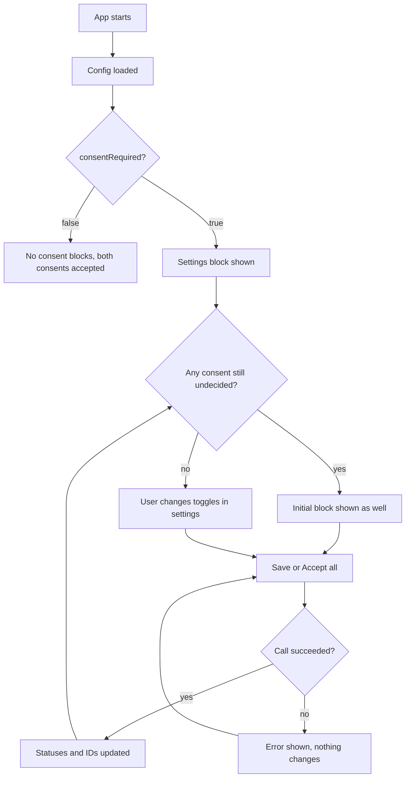

# User identity and tracking consent — PRD

## Summary

The app learns the user's identity from a startup config and asks for marketing and analytics tracking consent in two inline blocks on one page. Every consumer of identity (backend request headers, the analytics collector, the game config) receives the current identity fields at start and after every change. Both the config and the consent call are methods of the host app's native bridge (the ticket says "backend"; the product owner clarified this on 2026-11-02). The bridge isn't ready, so the app works against simulated bridge methods that follow the agreed contract; three debug monitoring blocks show what each consumer received.

## Problem

The app has no notion of user identity and no way to ask for tracking consent, so marketing and analytics tracking cannot depend on the user's decision and requests to the backend carry no identity fields. The ticket (TRACK-12) targets all users of the app but gives no evidence or legal driver for the consent requirement (see Q5). Without the feature the app can't start using tracking IDs when the native bridge ships the real config and consent methods.

## Goals

- The user decides on marketing and analytics tracking separately and can give or revoke each consent at any time.
- Every consumer of identity has the current identity fields at all times, without a page reload.
- The app is ready for the real config and consent methods before the native bridge ships them.

## Non-goals

- Integration with the real native bridge: the config and consent methods are simulated until the bridge ships.
- Actually sending request headers, analytics events or game-config requests: the three consumers only record what they receive.
- Consent categories other than marketing and analytics.
- Consent as a modal, banner or separate screen.
- Keeping the monitoring blocks and the start panel: they are a debug aid and will be removed later (see Q7).
- Final header names: the engineer proposes them in the Spec; the backend confirms them before the real integration.

## Users & scenarios

The user is anyone who opens the app. All consent UI lives on the one page the app has, next to the monitoring blocks.

- As a user, I want to choose marketing and analytics tracking separately when I first open the app, so that I allow only what I'm comfortable with.
- As a user, I want to revoke a consent later in settings, so that my first choice isn't final.
- As a user, I want to accept everything in one click, so that I'm not forced through two toggles.
- As a developer, I want to see what each consumer of identity received and when, so that I can check the flow without the real native bridge.

## Requirements

| ID | Requirement | Priority | Acceptance criteria |
|----|-------------|----------|---------------------|
| R1 | On start the app loads the identity config with seven fields: `marketingTrackingId`, `analyticsTrackingId`, `deviceId`, `temporaryId`, `consentRequired`, `marketingConsentStatus`, `analyticsConsentStatus` (statuses: 0 Declined, 1 Accepted, 2 NotDecided) | Must | With `consentRequired = true` and no saved choice both statuses are NotDecided and both tracking IDs are `null`; `temporaryId` differs between two starts; `deviceId` is the same |
| R2 | With `consentRequired = false` both consents are Accepted, both tracking IDs come in the config and no consent block is shown | Must | Start with `consentRequired = false`: no consent block on the page; the monitoring blocks show both tracking IDs |
| R3 | Initial consent block: shown when `consentRequired = true` and at least one consent is NotDecided; has marketing and analytics toggles with the current statuses, "Save" and "Accept all" | Must | On first start the block is shown with both toggles; after a save that decides both consents the block disappears without a reload |
| R4 | Settings consent block: shown whenever `consentRequired = true`; the user revokes a consent here by switching its toggle off and saving | Must | Switch marketing off and press "Save": marketing becomes Declined and its tracking ID `null`; analytics is unchanged |
| R5 | Saving sends both choices in one call, as the toggles stand: on = Accepted, off = Declined; "Accept all" saves both as Accepted; the two consents are independent | Must | Save with marketing on and analytics off: statuses Accepted and Declined; "Accept all" with both toggles off: both Accepted |
| R6 | Tracking ID rules: Accepted → Accepted keeps the ID; Declined or NotDecided → Accepted issues a new ID, the old one never returns; Declined → `null` | Must | Accept, revoke, accept again: the third ID differs from the first; accept twice in a row: the same ID |
| R7 | A failed consent call changes nothing: statuses and IDs stay as they were, the user sees an error and can retry | Must | Save during a simulated failure: statuses, IDs and monitoring blocks unchanged, an error is shown, the next "Save" works |
| R8 | Every consumer of identity receives all seven identity fields at start and after every change, without a reload; nothing is delivered when no field changed | Must | Monitoring update times change after start and after a save that changed something; a save that changes nothing (Accepted → Accepted for both) leaves them as they were |
| R9 | Three consumers record what they receive: all three record both tracking IDs and `temporaryId`; with `consentRequired = true` also both consent statuses. The analytics collector and the game config record `deviceId` only with `consentRequired = false` and keep `null` as is. Request headers always carry `deviceId` and `consentRequired` (clarified by the product owner on 2026-11-02; the ticket forbade `deviceId` for all three) and drop any header whose value is `null` | Must | With `consentRequired = true`: no `deviceId` in the analytics and game-config blocks, `deviceId` present in the headers block; the headers block has no header for a `null` ID; the analytics and game-config blocks show `null` |
| R10 | Debug monitoring: a config block at the top of the page showing the seven identity fields the app currently holds, and three blocks next to the settings block, one per consumer, showing its current recorded state and the time of the last update | Must | After start the config block shows all seven fields; after each change the config block and the three consumer blocks show the new fields (and a new time) immediately, without a reload |
| R12 | Debug start: the page opens with a start panel holding a `consentRequired` switch and a "Start" button; the config is loaded only when "Start" is pressed, with the switch's value; pressing it again restarts with the current value | Must | Open the page: no config, consent or monitoring blocks until "Start"; start with the switch off: no consent blocks; press "Start" again with it on: the settings block appears without a reload |
| R11 | The app works without the real native bridge: the simulated config and consent methods respond with a delay and remember the user's choice between reloads; the consent method sometimes fails, the config method doesn't fail for now | Must | Reload after accepting: both statuses Accepted with the same IDs and no initial block; a save fails now and then, a start never does |

## Success metrics

| Metric | Baseline | Target | How measured |
|--------|----------|--------|--------------|
| Users who decide both consents in their first session (`consentRequired = true`) | — (new feature) | unknown — see Q6 | unknown — see Q6; the app has no analytics events |

## Risks & dependencies

- Native app team: the real bridge methods for config and consent are in progress; the agreed contract isn't attached to the ticket (Spec Q1). The simulation follows the ticket's field names.
- Design: no mockups for the consent or monitoring blocks (Q4).
- Legal: the driver for the consent requirement is not stated (Q5).

## Open questions

- [ ] **Q1.** Who owns and reviews the PRD, the Spec and the tasks? — product (ticket author)
- [ ] **Q2.** How does a toggle show a NotDecided status, given it only has on and off? The Spec assumes off. — product / design
- [ ] **Q3.** What does the user see while a call is in flight, and when loading the config or saving fails? The Spec assumes disabled buttons while pending, an English error text and a retry. — product / design
- [ ] **Q4.** Final layout and copy of the consent and monitoring blocks, and the UI language: the ticket quotes the buttons in Russian, the docs use provisional English text. — design
- [ ] **Q5.** What drives the consent requirement (law, platform policy, partner), and which users does it affect? — product
- [ ] **Q6.** Which success metric, target and measurement source apply? The app has no analytics events. — product
- [ ] **Q7.** When and under which ticket are the monitoring blocks and the start panel removed? — product
