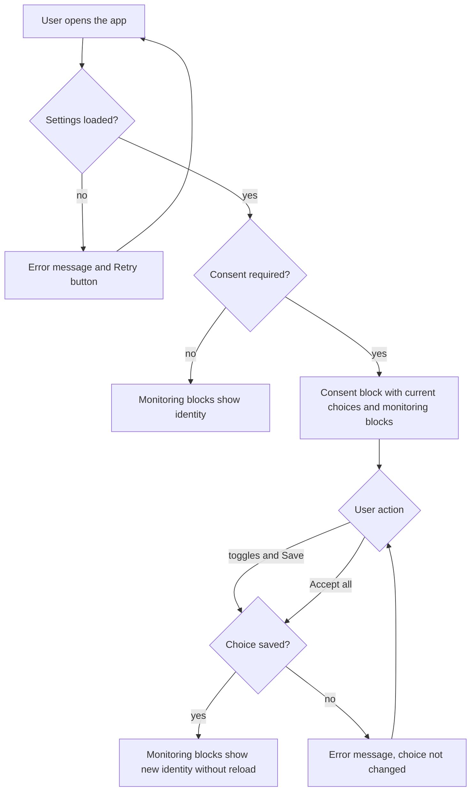

# User identity and tracking consent — PRD

## Summary

The app learns the user's identity from a startup config, asks for marketing and analytics tracking consent in an inline block, and keeps every part of the app that needs identity (request headers, analytics collector, game config) up to date when the user gives or revokes consent. The backend isn't ready, so the app works against a simulated backend that follows the agreed contract; debug monitoring blocks show that the identity reaches every consumer.

## Problem

The app has no user identity and no way to ask for tracking consent. Without it, requests to the backend, the analytics collector and the game config have no identity fields, and marketing and analytics tracking cannot depend on what the user decided. The ticket doesn't say who requires the consent or what evidence drives the request (see Q2).

## Goals

- Users decide on marketing and analytics tracking separately and can change their decision at any time.
- Every consumer of identity has the current identity fields at all times, without a page reload.
- The app is ready for the real config and consent methods before the backend ships them.

## Non-goals

- Integration with the real backend config and consent methods: they are not ready yet.
- Actually sending headers on backend requests or writing to a real analytics collector or game config: the three consumers only record what they receive.
- Consent categories other than marketing and analytics.
- Consent as a modal, banner or separate screen.
- Keeping the monitoring blocks: they are a debug aid and will be removed later in separate work.
- Agreeing on final header names.

## Users & scenarios

- As a user, I want to give or refuse marketing and analytics tracking separately so that I share only what I agree to.
- As a user, I want to revoke a consent I gave earlier from the same block so that I can change my mind.
- As a user, I want my choice remembered after a reload so that I don't decide again.
- As a developer or tester, I want to see what each identity consumer currently holds and when it was last updated so that I can confirm identity reaches all of them.

## Requirements

| ID | Requirement | Priority | Acceptance criteria |
|----|-------------|----------|---------------------|
| R1 | On every start the app takes the user's identity from the startup config: `deviceId` is the same on every start, `temporaryId` is new on every start, and each tracking ID is set only when its consent status is `Accepted` | Must | Reload twice: the monitoring blocks show the same `deviceId` and a different `temporaryId` each time; a consent that is `Declined` or `NotDecided` has its tracking ID `null` |
| R2 | The consent block is part of the page, not a modal, and is shown only when the config says consent is required; when it isn't required the block is hidden and both tracking IDs are set right away | Must | With `consentRequired = true` the block is on the page and the rest of the page stays usable; with `consentRequired = false` there is no block and both tracking IDs are non-`null` in the monitoring blocks |
| R3 | The block has two toggles, marketing and analytics, that show the current consent statuses, plus "Save" and, next to it, "Accept all" | Must | After a reload the toggles match the saved statuses: `Accepted` is on, `Declined` is off; for `NotDecided` see Q6 |
| R4 | "Save" stores each consent separately: a toggle that is on becomes `Accepted` and gets a tracking ID, a toggle that is off becomes `Declined` and its tracking ID is `null` | Must | Turn on only marketing and press "Save": `marketingTrackingId` is non-`null`, `analyticsTrackingId` is `null` |
| R5 | "Accept all" grants both consents | Must | After "Accept all" both toggles are on and both tracking IDs are non-`null` (whether it saves at once: see Q7) |
| R6 | The user revokes each consent through the same block; granting it again after a revoke gives a new tracking ID, not the previous one | Must | Accept marketing and note its ID; turn it off and save: the ID is `null`; turn it on and save: the ID is non-`null` and differs from the noted one |
| R7 | The user's choice survives a reload | Must | Save a choice and reload: the toggles show the saved choice, and an `Accepted` consent keeps the same tracking ID it had before the reload |
| R8 | All three identity consumers receive all identity fields: first at start with the values from the config, then again on every change of any field, without a page reload | Must | Right after start all three monitoring blocks show the config values; after a save that changes a tracking ID, all three show the new value and a new update time with no reload |
| R9 | The request headers consumer holds one header per identity field; a field whose value is `null` has no header | Must | With analytics declined, the request headers block has no analytics tracking header and has all the others |
| R10 | The analytics collector consumer holds all identity fields; `null` is stored as `null` | Must | With analytics declined, the analytics collector block shows `analyticsTrackingId` as `null` |
| R11 | The game config consumer holds all identity fields; `null` is stored as `null` | Must | With analytics declined, the game config block shows `analyticsTrackingId` as `null` |
| R12 | On the same page as the consent block, three monitoring blocks, one per consumer, show its current state and the time of its last update | Must | The page shows "Request headers", "Analytics collector" and "Game config" blocks, each with its current values and last update time |
| R13 | Until the backend is ready, the app works against a simulated backend that follows the agreed contract and behaves like the real one: it answers with a delay, sometimes fails, and remembers the user's choice | Must | Loading and saving show a visible delay; over repeated saves some attempts fail and show an error while nothing changes (what the user sees: see Q10); the saved choice survives a reload |

## Success metrics

| Metric | Baseline | Target | How measured |
|--------|----------|--------|--------------|
| Consent changes reflected in all three monitoring blocks without a reload | none — new app | every change, as soon as it is saved | Acceptance check of R4–R8 by QA |
| Product metric for consent, for example acceptance rate | unknown — see Q12 | unknown — see Q12 | unknown — see Q12 |

## Risks & dependencies

- Backend team: the real config and consent methods. The contract is agreed, but the ticket doesn't attach it.
- Designer joins later: there are no mockups, so the blocks are built with provisional design and text (see Q11).
- Until the monitoring blocks are removed, identity values are visible on the page.

## Open questions

- [ ] **Q1.** Who owns and reviews the PRD, the Spec and the task list? — product
- [ ] **Q2.** Who requires the consent and the identity (legal, marketing, analytics), and what evidence or deadline drives the ticket? — product
- [ ] **Q3.** The ticket contradicts itself for a user who accepted earlier and reloads with consent still required: "If `Accepted`, the ID comes in the config" vs "If `consentRequired = true`, then at start `marketingTrackingId` and `analyticsTrackingId` are `null`". Which rule wins? — product, backend team
- [ ] **Q4.** Which consent statuses does the config return when `consentRequired = false` and both tracking IDs come at once? — product, backend team
- [ ] **Q5.** Is the consent block still shown once the user has decided on both consents, as long as `consentRequired = true`? — product
- [ ] **Q6.** How does a toggle show `NotDecided`: off, like `Declined`, or as a distinct state? — product, designer
- [ ] **Q7.** Does "Accept all" save at once, or only switch both toggles on and wait for "Save"? — product
- [ ] **Q8.** Which page or route holds the consent block and the monitoring blocks? — product
- [ ] **Q9.** Which config fields are the "identity fields" every consumer receives: only `deviceId`, `temporaryId` and the two tracking IDs, or also `consentRequired` and the consent statuses? — product, backend team
- [ ] **Q10.** What does the user see when loading the config fails, and when saving a consent fails? — product, designer
- [ ] **Q11.** Mockups for the consent and monitoring blocks, the UI language and the final UI text ("Save", "Accept all" and the rest)? — designer
- [ ] **Q12.** Is there a product metric for consent beyond the acceptance check, and where would it be measured? — product
