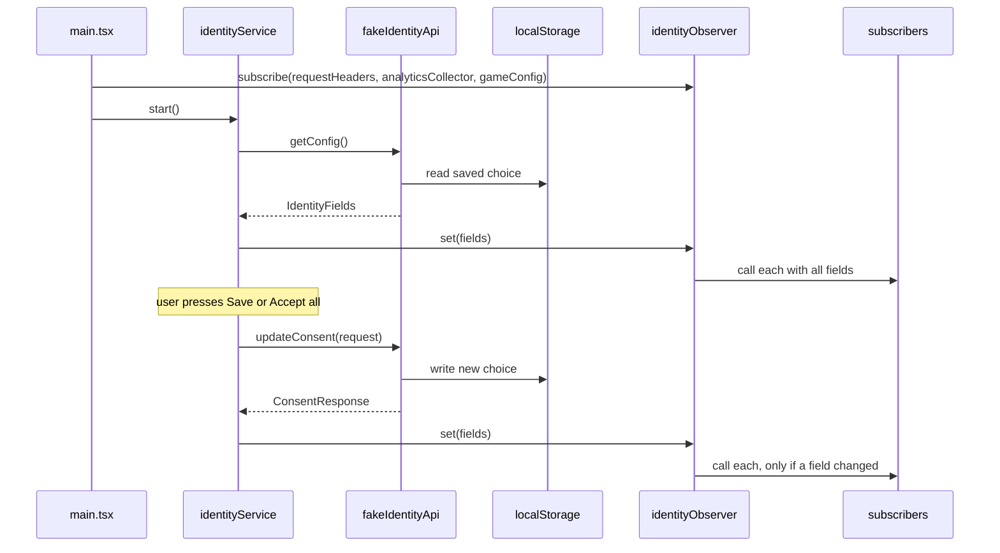
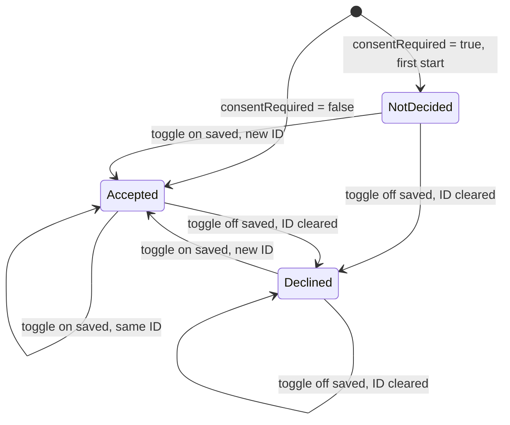

# User identity and tracking consent — Spec

## Summary

An identity service loads the startup config through an `IdentityApi`, pushes the seven identity fields into an identity observer and saves consent through the same API; the observer calls three recording subscribers (request headers, analytics collector, game config) at start and whenever a field changes. Until the backend ships, `IdentityApi` is a fake that keeps the choice in `localStorage` and answers with a delay and occasional errors. The UI is one page with the two consent blocks and the three monitoring blocks. See the [PRD](./prd.md) for the why.

## Context & current state

- The project `playground/app/` is empty: no `package.json`, no source. The playground README describes it as a React + TypeScript frontend, so the first task scaffolds a Vite + React + TypeScript app with Vitest; all paths below are new and relative to `playground/app/`.
- There is no backend. The config and consent methods are in progress and the agreed contract isn't attached to the ticket (Spec Q1); the fake implements the field names of TRACK-12 and the shapes in *API / interfaces*.
- There is no HTTP client, analytics collector or game config in the app, so the three subscribers record what they receive instead of calling real systems.

## Proposed design

### Overview



### Components & changes

- `src/identity/types.ts` — new: `ConsentStatus` (`Declined = 0`, `Accepted = 1`, `NotDecided = 2`), `IdentityFields` (the seven config fields), `ConsentRequest`, `ConsentResponse`.
- `src/identity/identityObserver.ts` — new: `createIdentityObserver()` with `set(fields)`, `get()`, `subscribe(fn)`. `set` stores the fields and calls every subscriber when it is the first set or any of the seven fields differs (strict equality per field); otherwise it does nothing. A subscriber added after the first `set` is called at once with the current fields. `subscribe` and `get` also serve React through `useSyncExternalStore`.
- `src/identity/useIdentity.ts` — new: `useIdentity(observer)`, the `useSyncExternalStore` hook both consent blocks use.
- `src/identity/identityService.ts` — new: `createIdentityService(api, observer)` with `start()` (calls `getConfig`, then `observer.set`) and `saveConsent(request)` (calls `updateConsent`; on success merges the two statuses from the request and the two IDs from the response into the current fields and calls `observer.set`; on failure rethrows and touches nothing).
- `src/api/identityApi.ts` — new: the `IdentityApi` interface; the real backend adapter will implement it later.
- `src/api/fakeIdentityApi.ts` — new: `createFakeIdentityApi(options)`; behaviour in *Data model* and *API / interfaces*.
- `src/subscribers/recorder.ts` — new: `createRecorder(project)` wraps a projection `(fields) => state` into a subscriber that stores the projected state with `updatedAt` and exposes `getSnapshot()` / `subscribe(fn)` for the monitoring UI.
- `src/subscribers/requestHeaders.ts`, `src/subscribers/analyticsCollector.ts`, `src/subscribers/gameConfig.ts` — new: the three projections of *Subscriber fields*.
- `src/ui/ConsentBlock.tsx` — new: one component for both blocks (`variant: 'initial' | 'settings'`); two toggles, "Save", "Accept all", pending and error state.
- `src/ui/MonitoringBlock.tsx` — new: a recorder's state as formatted JSON plus the update time.
- `src/App.tsx` — the page: loading and error state of `start()`, the two consent blocks by their visibility rules, the three monitoring blocks.
- `src/main.tsx` — wiring: creates the fake API, the observer, the service and the three recorders, subscribes the recorders, calls `start()` and renders `App`.

#### Subscriber fields

| Field | All three subscribers | Request headers only |
|-------|-----------------------|----------------------|
| `marketingTrackingId`, `analyticsTrackingId`, `temporaryId` | always | |
| `deviceId` | only when `consentRequired = false` | |
| `marketingConsentStatus`, `analyticsConsentStatus` | only when `consentRequired = true` | |
| `consentRequired` | | always |

The observer still delivers all seven fields; the projection drops `deviceId` when `consentRequired = true`, so it never reaches a recorder's state. Request headers are strings (statuses as `"0"` / `"1"` / `"2"`, `consentRequired` as `"true"` / `"false"`), and a header whose value would be `null` is omitted. The analytics collector and the game config keep `null` values.

Header names (Spec Q3): `X-Marketing-Tracking-Id`, `X-Analytics-Tracking-Id`, `X-Temporary-Id`, `X-Device-Id`, `X-Marketing-Consent-Status`, `X-Analytics-Consent-Status`, `X-Consent-Required`.

#### Visibility and UI behaviour

- Initial block: `consentRequired === true` and at least one status is `NotDecided`. Settings block: `consentRequired === true`. Nothing is shown while `start()` is pending or has failed.
- A toggle is on for `Accepted` and off for `Declined`. **Assumption (PRD Q2):** `NotDecided` shows as off.
- "Save" sends `{ marketing: on ? Accepted : Declined, analytics: … }`; "Accept all" sends both as `Accepted` regardless of the toggles. Both blocks read the statuses from the observer, so a save in one updates the other. After a successful save the toggles are set from the request that was sent, so "Accept all" or a save after a failed one leaves them in step with a status that did not change.
- **Assumption (PRD Q3):** while a call is in flight both buttons are disabled; on failure the block shows "Could not save your choice. Try again." under the buttons and keeps the toggles as the user left them; a failed `start()` shows "Could not load the config." with a "Retry" button that calls `start()` again.
- **Assumption (PRD Q4):** provisional English copy: block titles "Tracking consent" and "Tracking settings", toggle labels "Marketing" and "Analytics", buttons "Save" and "Accept all", monitoring titles "Request headers", "Analytics collector" and "Game config". A late task replaces it with the final design.

### Data model

Status lifecycle of one consent; the other is independent:



Fake storage: the `localStorage` key `track12.identity` holds `{ marketingConsentStatus, analyticsConsentStatus, marketingTrackingId, analyticsTrackingId }`. `deviceId` is the constant `"device-0001"`; `temporaryId` is `crypto.randomUUID()` on every `getConfig`; tracking IDs are `crypto.randomUUID()` when issued.

### API / interfaces

```ts
interface IdentityApi {
  getConfig(): Promise<IdentityFields>;
  updateConsent(request: ConsentRequest): Promise<ConsentResponse>;
}

interface IdentityFields {
  marketingTrackingId: string | null;
  analyticsTrackingId: string | null;
  deviceId: string;
  temporaryId: string;
  consentRequired: boolean;
  marketingConsentStatus: ConsentStatus;
  analyticsConsentStatus: ConsentStatus;
}

interface ConsentRequest { marketing: ConsentStatus; analytics: ConsentStatus } // Accepted or Declined
interface ConsentResponse { marketingTrackingId: string | null; analyticsTrackingId: string | null }
```

Fake behaviour, `createFakeIdentityApi({ consentRequired, delayMs = [300, 1000], errorRate = 0.1, random = Math.random, storage = localStorage })`:

- Every call waits a random `delayMs` and then fails with probability `errorRate` (`Error("Fake backend error")`) before touching storage.
- `getConfig` with `consentRequired = true`: statuses and IDs from storage, or `NotDecided` / `null` when nothing is stored.
- `getConfig` with `consentRequired = false`: both statuses `Accepted`; IDs from storage when present, otherwise issued and stored; stored statuses are ignored.
- `updateConsent`, per field: `Accepted` with stored status `Accepted` → the same ID; `Accepted` otherwise → a new ID; `Declined` → `null`. Both statuses and both IDs are stored together after the error check, so a failing call changes nothing.

Dev switch: `main.tsx` reads `consentRequired` from the URL query (`?consentRequired=false`), default `true`.

## Requirements coverage

| PRD ID | How it's satisfied | Section |
|--------|--------------------|---------|
| R1 | The fake `getConfig` returns the seven fields; `temporaryId` fresh per call, `deviceId` constant | API / interfaces |
| R2 | The fake returns `Accepted` and IDs when `consentRequired = false`; `App` hides both blocks | API / interfaces, Visibility and UI behaviour |
| R3 | `ConsentBlock` variant `initial`, shown by the visibility rule | Visibility and UI behaviour |
| R4 | `ConsentBlock` variant `settings`; off toggle + "Save" sends `Declined` | Visibility and UI behaviour |
| R5 | One `updateConsent` call with both fields; "Accept all" sends both `Accepted` | Visibility and UI behaviour, API / interfaces |
| R6 | ID rules in the fake `updateConsent` | API / interfaces, Data model |
| R7 | The fake fails before storing; the service rethrows without `observer.set`; the block shows the error | Components & changes, Edge cases & error handling |
| R8 | `identityObserver.set` calls subscribers on the first set and only when a field changed | Components & changes |
| R9 | The three projections in *Subscriber fields* | Subscriber fields |
| R10 | `MonitoringBlock` per recorder, re-rendered through `useSyncExternalStore` | Components & changes |
| R11 | The fake with delay, `errorRate` and `localStorage` | API / interfaces |

## Alternatives & decisions

| Decision | Options considered | Chosen | Why |
|----------|-------------------|--------|-----|
| Where the UI reads identity | Separate React state copied from the service; the observer as the store via `useSyncExternalStore` | Observer as the store | One source of truth; both blocks and the monitoring update together with the subscribers |
| Consent statuses after a save | From the response; from the request | From the request | The ticket says the consent method returns only the two tracking IDs; the status follows the request by definition |
| Fake persistence | In memory only; `localStorage` | `localStorage` | The ticket requires the choice to survive a reload |
| Switching `consentRequired` in the fake | Build-time constant; URL query `?consentRequired=false` | URL query, default `true` | Testers check both modes without rebuilding; the value still comes only from the config object |
| Fake delay and error rate | Fixed values; options with defaults 300–1000 ms and 10% | Options with defaults | Tests run with zero delay and no errors; manual testing sees delays and failures |
| Dropping `deviceId` | In the observer; in each subscriber's projection | Projection | The ticket says the observer delivers all seven fields; the rule is about what subscribers write |
| Header names | The ticket leaves them to the engineer | The `X-…` names in *Subscriber fields* | Conventional; confirmed with the backend before the real integration (Spec Q3) |

## Edge cases & error handling

- `start()` fails (fake error) → the page shows "Could not load the config." and "Retry"; no subscriber is called; "Retry" calls `start()` again.
- A save fails → the service rejects, the observer is untouched, the block shows the error and keeps the toggles as the user set them; "Save" and "Accept all" are enabled again.
- A save that changes nothing (both already `Accepted`, both toggles on) → the fake returns the same IDs, `observer.set` sees no change, no subscriber is called, monitoring times stay.
- Both consents `Declined`, both toggles off, "Save" → both stay `Declined` with `null` IDs; no change, no subscriber call.
- A second click while a call is pending → impossible, the buttons are disabled.
- A save in one block → both blocks re-read the statuses from the observer; the initial block disappears once both are decided.
- Reload after accepting → `getConfig` returns the stored `Accepted` and the same IDs; the new `temporaryId` means the subscribers are called at start.
- `consentRequired = false` with a stored `Declined` choice from an earlier run → statuses `Accepted`, IDs issued where missing.
- `localStorage` unavailable or corrupt → the fake behaves as if nothing was stored and keeps the choice in memory for the session.
- A subscriber added after `start()` finished → called at once with the current fields.

## Non-functional

- Privacy: with `consentRequired = true`, `deviceId` never appears in a recorder's state or in the monitoring blocks (R9). Nothing leaves the browser: no request is sent.

## Testing plan

- Unit (Vitest): `identityObserver` (first set calls, a changed field calls, an identical set doesn't, a late subscriber is called); `fakeIdentityApi` (first start, `consentRequired = false`, the ID rules of R6, atomic failure, persistence through a fake storage); `identityService` (start and save paths, a failure leaves the observer untouched); the three projections (both `consentRequired` modes, a `null` header dropped, `null` kept elsewhere).
- Component (Vitest + Testing Library): `ConsentBlock` (visibility per variant, an off toggle saves `Declined`, "Accept all", disabled while pending, error text with toggles kept; R3–R5, R7); `MonitoringBlock` (state and time update; R10).
- Manual, in the browser, in both modes: the PRD acceptance criteria of R1–R11, including a failed save, a revoke-and-accept cycle and a reload.

## Rollout & rollback

The release is the rollout: one frontend deploy, no migrations and no backend change. The consent and monitoring blocks are rendered by `App.tsx`, which is wired in the last task the flow needs, so no half-built UI is reachable. Rollback: redeploy the previous version; the `track12.identity` key stays in `localStorage` unused and is read again on the next rollout. Where the app is deployed is not known (Spec Q2).

## Open questions

- [ ] **Q1.** The agreed backend contract isn't attached to the ticket: do the field names, status codes and the consent method shape match *API / interfaces*? — backend team
- [ ] **Q2.** Where and how is the app deployed? The repo has no pipeline. — TBD
- [ ] **Q3.** Do the header names in *Subscriber fields* suit the backend? — backend team
