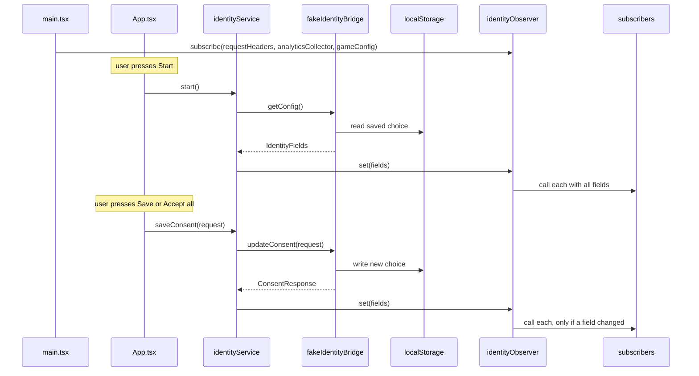
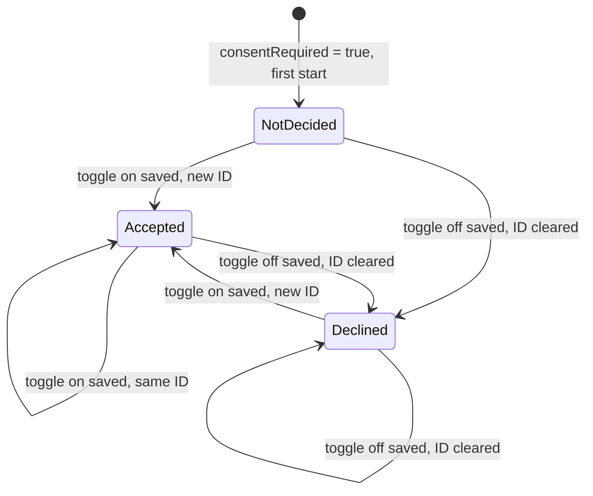

# User identity and tracking consent — Spec

## Summary

An identity service loads the startup config through the native bridge (`IdentityBridge`), pushes the seven identity fields into an identity observer and saves consent through the same bridge; the observer calls three recording subscribers (request headers, analytics collector, game config) at start and whenever a field changes. Until the native bridge ships, `IdentityBridge` is a fake that keeps the choice in `localStorage` and answers with a delay. The UI is one page: a debug start panel, a config block, the two consent blocks and the three monitoring blocks. See the [PRD](./prd.md) for the why.

## Context & current state

- The project `playground/app/` is a Vite + React + TypeScript app with Vitest, scaffolded for this feature (T1): before it the folder was empty, and the playground README described it as a React + TypeScript frontend. All paths below are relative to `playground/app/`; every module in *Components & changes* exists, with its tests next to it.
- There is no native bridge yet: the config and consent methods of the host app are in progress and the agreed contract isn't attached to the ticket (Spec Q1); the fake implements the field names of TRACK-12 and the shapes in *API / interfaces*.
- There is no HTTP client, analytics collector or game config in the app, so the three subscribers record what they receive instead of calling real systems.

## Proposed design

### Overview



### Components & changes

- `src/identity/types.ts` — new: `ConsentStatus` (`Declined = 0`, `Accepted = 1`, `NotDecided = 2`), `IdentityFields` (the seven config fields), `ConsentRequest`, `ConsentResponse`.
- `src/identity/identityObserver.ts` — new: `createIdentityObserver()` with `set(fields)`, `get()`, `subscribe(fn)`. `set` stores the fields and calls every subscriber when it is the first set or any of the seven fields differs (strict equality per field); otherwise it does nothing. A subscriber added after the first `set` is called at once with the current fields. `subscribe` and `get` also serve React through `useSyncExternalStore`.
- `src/identity/useIdentity.ts` — new: `useIdentity(observer)`, the `useSyncExternalStore` hook the consent blocks, the config block and `App` use.
- `src/identity/identityService.ts` — new: `createIdentityService(bridge, observer)` with `start()` (calls `getConfig`, then `observer.set`) and `saveConsent(request)` (calls `updateConsent`; on success merges the two statuses from the request and the two IDs from the response into the current fields and calls `observer.set`; on failure rethrows and touches nothing).
- `src/bridge/identityBridge.ts` — new: the `IdentityBridge` interface, the native bridge contract (config and consent); the real bridge adapter will implement it later.
- `src/bridge/fakeIdentityBridge.ts` — new: `createFakeIdentityBridge(options)`; behaviour in *Data model* and *API / interfaces*. It never fails: the error paths are exercised with stubs in tests.
- `src/subscribers/recorder.ts` — new: `createRecorder(project)` wraps a projection `(fields) => state` into a subscriber that stores the projected state with `updatedAt` and exposes `getSnapshot()` / `subscribe(fn)` for the monitoring UI.
- `src/subscribers/requestHeaders.ts`, `src/subscribers/analyticsCollector.ts`, `src/subscribers/gameConfig.ts` — new: the three projections of *Subscriber fields*.
- `src/ui/ConsentBlock.tsx` — new: one component for both blocks (`variant: 'initial' | 'settings'`); two toggles, "Save", "Accept all", pending and error state.
- `src/ui/MonitoringBlock.tsx` — new: a recorder's state as formatted JSON plus the update time.
- `src/ui/StartPanel.tsx` — new: the debug start panel at the top of the page: a `consentRequired` switch (on by default), a "first start" switch (off by default) and a "Start" button; the button and both switches are disabled while a start is pending.
- `src/ui/ConfigBlock.tsx` — new: the observer's current seven fields as formatted JSON, at the top of the page.
- `src/App.tsx` — the page: the start panel; on "Start" creates the bridge through `createBridge(consentRequired, firstStart)` and a new `identityService`, calls `start()` and keeps its pending and error state; once the observer has fields, the config block, the two consent blocks by their visibility rules and the three monitoring blocks.
- `src/main.tsx` — wiring: creates the observer and the three recorders, subscribes the recorders and renders `App` with `createBridge = (consentRequired, firstStart) => createFakeIdentityBridge({ consentRequired, forgetChoice: firstStart })`.

#### Subscriber fields

| Field | Analytics collector, game config | Request headers |
|-------|----------------------------------|-----------------|
| `marketingTrackingId`, `analyticsTrackingId`, `temporaryId` | always | always |
| `deviceId` | only when `consentRequired = false` | always |
| `marketingConsentStatus`, `analyticsConsentStatus` | only when `consentRequired = true` | only when `consentRequired = true` |
| `consentRequired` | never | always |

The observer still delivers all seven fields; the analytics and game-config projections drop `deviceId` when `consentRequired = true`, so it never reaches their state; the headers projection always carries it (PRD R9). Request headers are strings (statuses as `"0"` / `"1"` / `"2"`, `consentRequired` as `"true"` / `"false"`), and a header whose value would be `null` is omitted. The analytics collector and the game config keep `null` values.

Header names (Spec Q3): `X-Marketing-Tracking-Id`, `X-Analytics-Tracking-Id`, `X-Temporary-Id`, `X-Device-Id`, `X-Marketing-Consent-Status`, `X-Analytics-Consent-Status`, `X-Consent-Required`.

#### Visibility and UI behaviour

- Initial block: `consentRequired === true` and at least one status is `NotDecided`. Settings block: `consentRequired === true`. Nothing but the start panel is shown before "Start" is pressed and while the first `start()` is pending or has failed.
- A toggle is on for `Accepted` and off for `Declined`; `NotDecided` shows as off (PRD Q2).
- "Save" sends `{ marketing: on ? Accepted : Declined, analytics: … }`; "Accept all" sends both as `Accepted` regardless of the toggles. Both blocks read the statuses from the observer, so a save in one updates the other. After a successful save the toggles are set from the request that was sent, so "Accept all" or a save after a failed one leaves them in step with a status that did not change.
- While a call is in flight both buttons are disabled. Error handling is not required for now (PRD Q3); what is built stays as a placeholder: on failure the block shows "Could not save your choice. Try again." under the buttons and keeps the toggles as the user left them, and a failed `start()` shows "Could not load the config." with a "Retry" button that calls `start()` again.
- No mockups or localisation for now (PRD Q4); the English copy ships as is: block titles "Tracking consent" and "Tracking settings", toggle labels "Marketing" and "Analytics", buttons "Save" and "Accept all", monitoring titles "Config", "Request headers", "Analytics collector" and "Game config", and the "Subscribers" block that groups the last three with a line saying they are the identity observer's subscribers.

### Data model

Status lifecycle of one consent; the other is independent:



With `consentRequired = false` there are no consent blocks: both statuses stay `NotDecided` and never change (PRD R2).

Fake storage: the `localStorage` key `track12.identity` holds `{ marketingConsentStatus, analyticsConsentStatus, marketingTrackingId, analyticsTrackingId }`. `deviceId` is the constant `"device-0001"`; `temporaryId` is `crypto.randomUUID()` on every `getConfig`; tracking IDs are `crypto.randomUUID()` when issued.

### API / interfaces

```ts
interface IdentityBridge {
  getConfig(): Promise<IdentityFields>;
  updateConsent(request: ConsentRequest): Promise<ConsentResponse>;
}

interface IdentityFields {
  marketingTrackingId: string | null;
  analyticsTrackingId: string | null;
  deviceId: string;
  temporaryId: string;
  consentRequired: boolean;
  marketingConsentStatus: ConsentStatus;
  analyticsConsentStatus: ConsentStatus;
}

interface ConsentRequest { marketing: ConsentStatus; analytics: ConsentStatus } // Accepted or Declined
interface ConsentResponse { marketingTrackingId: string | null; analyticsTrackingId: string | null }
```

Fake behaviour, `createFakeIdentityBridge({ consentRequired, forgetChoice = false, delayMs = [300, 1000], random = Math.random, storage = localStorage, newId = crypto.randomUUID })`:

- `forgetChoice = true` removes the stored choice on creation, so the next `getConfig` behaves as a first start (PRD R12).
- `storage: null` keeps the choice in memory only; `newId` issues the tracking and temporary IDs (tests pass a counter).
- Every call waits a random `delayMs` and never fails (PRD R11).
- `getConfig` with `consentRequired = true`: statuses and IDs from storage, or `NotDecided` / `null` when nothing is stored.
- `getConfig` with `consentRequired = false`: both statuses `NotDecided` and both IDs `null` (PRD R2); storage is neither read nor written, so a choice stored with `consentRequired = true` is back on the next start in that mode.
- `updateConsent`, per field: `Accepted` with stored status `Accepted` → the same ID; `Accepted` otherwise → a new ID; `Declined` → `null`. Both statuses and both IDs are stored together.

The `consentRequired` passed to the fake is the start panel's switch; the fake reads it from nowhere else.

## Requirements coverage

| PRD ID | How it's satisfied | Section |
|--------|--------------------|---------|
| R1 | The fake `getConfig` returns the seven fields; `temporaryId` fresh per call, `deviceId` constant | API / interfaces |
| R2 | The fake returns `NotDecided` and `null` IDs when `consentRequired = false`; the projections pass `deviceId` to all three subscribers in that mode; `App` hides both blocks | API / interfaces, Subscriber fields, Visibility and UI behaviour |
| R3 | `ConsentBlock` variant `initial`, shown by the visibility rule | Visibility and UI behaviour |
| R4 | `ConsentBlock` variant `settings`; off toggle + "Save" sends `Declined` | Visibility and UI behaviour |
| R5 | One `updateConsent` call with both fields; "Accept all" sends both `Accepted` | Visibility and UI behaviour, API / interfaces |
| R6 | ID rules in the fake `updateConsent` | API / interfaces, Data model |
| R7 | The service rethrows a rejected `updateConsent` without `observer.set`; the block shows the error (verified with a rejecting stub, the fake never fails) | Components & changes, Edge cases & error handling |
| R8 | `identityObserver.set` calls subscribers on the first set and only when a field changed | Components & changes |
| R9 | The three projections in *Subscriber fields* | Subscriber fields |
| R10 | `ConfigBlock` on the observer and `MonitoringBlock` per recorder, re-rendered through `useSyncExternalStore` | Components & changes |
| R11 | The fake with delay and `localStorage` | API / interfaces |
| R12 | `StartPanel` and the start handling in `App`: a new fake bridge and service per "Start"; `forgetChoice` for "first start" | Components & changes, API / interfaces |

## Alternatives & decisions

| Decision | Options considered | Chosen | Why |
|----------|-------------------|--------|-----|
| Where the UI reads identity | Separate React state copied from the service; the observer as the store via `useSyncExternalStore` | Observer as the store | One source of truth; both blocks and the monitoring update together with the subscribers |
| Consent statuses after a save | From the response; from the request | From the request | The ticket says the consent method returns only the two tracking IDs; the status follows the request by definition |
| Fake persistence | In memory only; `localStorage` | `localStorage` | The ticket requires the choice to survive a reload |
| Switching `consentRequired` in the fake | Build-time constant; URL query `?consentRequired=false`; a switch on a debug start panel | Start panel switch, on by default | Testers switch modes and restart without a reload; the value still comes only from the config object |
| Fake delay and errors | Fixed delay; delay option with a 300–1000 ms default; simulated errors | Delay option, no simulated errors | Tests run with zero delay; manual testing sees delays only; the error paths are covered by tests with rejecting stubs (PRD R11) |
| Fake storage with `consentRequired = false` | Store `NotDecided` with the `null` IDs; leave storage alone | Leave storage alone | Nothing is decided by the user in that mode; a stored choice from the other mode stays intact |
| Dropping `deviceId` | In the observer; in each subscriber's projection | Projection | The ticket says the observer delivers all seven fields; the rule is about what subscribers write, and it differs per subscriber (headers always carry it) |
| Header names | The ticket leaves them to the engineer | The `X-…` names in *Subscriber fields* | Conventional; confirmed with the backend before the real integration (Spec Q3) |

## Edge cases & error handling

- `start()` fails (the fake never fails here; the real bridge may) → the page shows "Could not load the config." and "Retry"; no subscriber is called; "Retry" starts again with the switch's current value.
- "Start" pressed while a start is in flight → impossible, the button is disabled.
- "Start" pressed again after a successful start → a new fake bridge and service; the observer gets the new config (a new `temporaryId` at least), so the subscribers are called; a failed restart leaves the previous state on the page and shows the error.
- "Start" with "first start" on → the stored choice is gone before `getConfig`; with `consentRequired` on both statuses are `NotDecided` and both IDs `null`, with it off too.
- A save fails (the fake never fails; the real bridge may) → the service rejects, the observer is untouched, the block shows the error and keeps the toggles as the user set them; "Save" and "Accept all" are enabled again.
- A save that changes nothing (both already `Accepted`, both toggles on) → the fake returns the same IDs, `observer.set` sees no change, no subscriber is called, monitoring times stay.
- Both consents `Declined`, both toggles off, "Save" → both stay `Declined` with `null` IDs; no change, no subscriber call.
- A second click while a call is pending → impossible, the buttons are disabled.
- A save in one block → both blocks re-read the statuses from the observer; the initial block disappears once both are decided.
- Reload after accepting → `getConfig` returns the stored `Accepted` and the same IDs; the new `temporaryId` means the subscribers are called at start.
- `consentRequired = false` with a stored choice from an earlier run → statuses `NotDecided`, IDs `null`; the stored choice is untouched and returns on the next start with `consentRequired = true`.
- `localStorage` unavailable or corrupt → the fake behaves as if nothing was stored and keeps the choice in memory for the session.
- A subscriber added after `start()` finished → called at once with the current fields.
- `start()` called while a start is in flight (the page can't do it: "Start" is disabled while pending; the service doesn't rely on that) → the second call shares the first request; one `getConfig`, one `temporaryId`, one subscriber call.

## Non-functional

- Privacy: with `consentRequired = true`, `deviceId` never appears in the analytics collector or game-config state or blocks; only the request headers carry it (R9). Nothing leaves the browser: no request is sent.

## Testing plan

- Unit (Vitest): `identityObserver` (first set calls, a changed field calls, an identical set doesn't, a late subscriber is called); `fakeIdentityBridge` (first start, `consentRequired = false`, the ID rules of R6, persistence through a fake storage); `identityService` (start and save paths, a failure leaves the observer untouched); the three projections (both `consentRequired` modes, `deviceId` always in the headers and only without `consentRequired` elsewhere, a `null` header dropped, `null` kept elsewhere).
- Component (Vitest + Testing Library): `ConsentBlock` (visibility per variant, an off toggle saves `Declined`, "Accept all", disabled while pending, error text with toggles kept; R3–R5, R7); `MonitoringBlock` (state and time update) and `ConfigBlock` (all seven fields, re-rendered on change; R10).
- Component (Vitest + Testing Library): `App` (nothing but the start panel before "Start", start in both modes, restart in the other mode, "first start" forgets the choice, failed start with "Retry"; R12).
- Manual, in the browser, in both modes: the PRD acceptance criteria of R1–R12 except R7, including a revoke-and-accept cycle and a reload.

## Rollout & rollback

The release is the rollout: one frontend deploy, no migrations and no backend change. The consent and monitoring blocks are rendered by `App.tsx` after "Start" on the debug start panel, which is wired in the last task the flow needs, so no half-built UI is reachable. Rollback: redeploy the previous version; the `track12.identity` key stays in `localStorage` unused and is read again on the next rollout. Where the app is deployed is not known (Spec Q2).

## Open questions

- [ ] **Q1.** The agreed native bridge contract isn't attached to the ticket: do the method names, field names, status codes and the consent method shape match *API / interfaces*? — native app team
- [ ] **Q2.** Where and how is the app deployed? The repo has no pipeline. — TBD
- [ ] **Q3.** Do the header names in *Subscriber fields* suit the backend? — backend team
