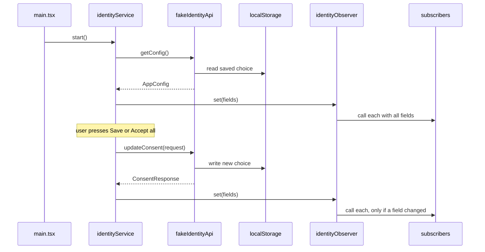
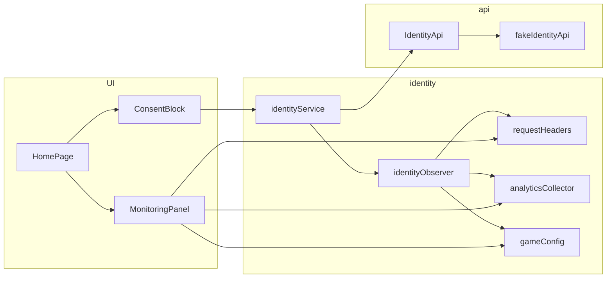
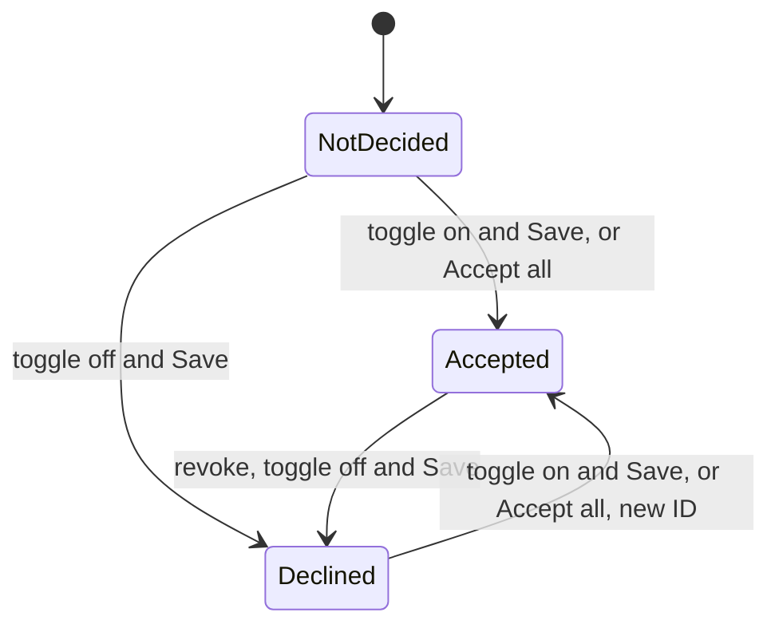

# User identity and tracking consent — Spec

## Summary

An identity service loads the startup config through an `IdentityApi`, writes the identity fields into an identity observer and saves consent choices; the observer calls three recording subscribers (request headers, analytics collector, game config) at start and on every change. Until the backend ships, `IdentityApi` is a fake that keeps the user's choice in `localStorage` and answers with a delay and occasional errors. See the [PRD](./prd.md) for the why.

## Context & current state

- The project `playground/app/` is a new React + Vite + TypeScript app that has no code yet; all paths below are new and relative to it.
- There is no backend: the config and consent methods are not ready, and the agreed contract isn't attached to the ticket (Spec Q1). The fake implements the field names from TRACK-12 and the shapes in *API / interfaces*.
- There is no router, HTTP client, analytics collector or game config in the app yet, so the three subscribers record what they receive instead of calling real systems.

## Proposed design

### Overview





### Components & changes

- `src/identity/types.ts` — new: `ConsentStatus`, `AppConfig`, `IdentityFields`, `ConsentRequest`, `ConsentResponse`.
- `src/api/identityApi.ts` — new: the `IdentityApi` interface; the real backend adapter will implement it later.
- `src/api/fake/fakeIdentityApi.ts` — new: `createFakeIdentityApi(options)`, the fake config and consent methods with the behaviour in *Data model*.
- `src/api/fake/latency.ts` — new: `withLatency(fn, options)` waits a random delay, then fails with `FakeBackendError` at the configured rate before calling `fn`.
- `src/identity/identityObserver.ts` — new: holds the current `IdentityFields` and calls every subscriber on the first `set` and whenever any field changes (`Object.is` per field); a subscriber added later gets the current fields at once; one subscriber throwing doesn't stop the others.
- `src/identity/subscribers/recorder.ts` — new: `createRecordingSubscriber(map)` stores `map(fields)` and the time of the call, and lets the UI subscribe to that state.
- `src/identity/subscribers/requestHeaders.ts` — new: maps identity fields to headers, dropping `null` values. Header names are provisional (Spec Q2): `X-Device-Id`, `X-Temporary-Id`, `X-Marketing-Tracking-Id`, `X-Analytics-Tracking-Id`.
- `src/identity/subscribers/analyticsCollector.ts`, `src/identity/subscribers/gameConfig.ts` — new: store all identity fields under their own names, `null` as is; field names are provisional (Spec Q3).
- `src/identity/identityService.ts` — new: `createIdentityService(api, observer)` with `start()`, `save(choice)`, `acceptAll()`, `getState()` and `subscribe(listener)`; holds `consentRequired`, both consent statuses and the loading and saving state.
- `src/identity/bootstrap.ts` — new: creates the fake API, the observer, the service and the three recorders, and subscribes the recorders before `start()` so their first call carries the config values.
- `src/features/consent/useIdentityState.ts` — new: `useSyncExternalStore` hook over `identityService`.
- `src/features/consent/ConsentBlock.tsx` — new: two `role="switch"` toggles "Marketing" and "Analytics", buttons "Save" and "Accept all"; local toggle state starts from the statuses and resets to them after a successful save. Assumption (PRD Q6): `NotDecided` shows as off, like `Declined`. Layout and UI text here and in the monitoring blocks are provisional until the mockups (PRD Q11).
- `src/features/monitoring/MonitoringPanel.tsx`, `src/features/monitoring/SubscriberMonitor.tsx` — new: blocks "Request headers", "Analytics collector" and "Game config", each listing current values and "Last updated" (local time `HH:mm:ss.SSS`) or "Not updated yet". The folder is self-contained so removing the debug blocks means deleting it and one line in `HomePage.tsx`.
- `src/pages/HomePage.tsx` — new: the only page, at `/`. Assumption (PRD Q8): the consent block and the monitoring blocks live on the app's single page at `/`, with no router. Shows "Loading…", the config error, the consent block (only when `consentRequired` is `true`) and the monitoring panel.
- `src/main.tsx`, `src/App.tsx` — new: `main.tsx` calls `identityService.start()` once before rendering, so React `StrictMode` can't load the config twice.

### Data model

The fake backend keeps one record in `localStorage` under `fakeIdentityBackend.v1`:

| Field | Type | Initial |
|---|---|---|
| `marketingConsentStatus` | `0 \| 1 \| 2` | `2` (`NotDecided`) |
| `analyticsConsentStatus` | `0 \| 1 \| 2` | `2` (`NotDecided`) |
| `marketingTrackingId` | `string \| null` | `null` |
| `analyticsTrackingId` | `string \| null` | `null` |

Fake behaviour:

- `getConfig()` returns `deviceId: "fake-device-id"` (a constant), a new `temporaryId` from `crypto.randomUUID()` on each call, `consentRequired` from options, and the saved statuses with their tracking IDs: an ID only for `Accepted`, `null` otherwise. Assumption (PRD Q3): the status rule wins, so a user who accepted earlier gets the saved ID even when `consentRequired` is `true`; both IDs are `null` at start only while neither consent is `Accepted`, as on a first start.
- Assumption (PRD Q4): with `consentRequired: false`, `getConfig()` returns both statuses `Accepted` with tracking IDs, creating and saving the IDs if they don't exist; the saved statuses are not overwritten.
- `updateConsent(request)` applies each field present: `Accepted` keeps the saved ID if the field was already `Accepted`, otherwise saves a new `crypto.randomUUID()`; `Declined` saves `null`. `NotDecided` is rejected. It returns both current tracking IDs.
- Options, read from Vite env vars in `bootstrap.ts` and injectable in tests: `VITE_FAKE_CONSENT_REQUIRED` (default `true`), `VITE_FAKE_DELAY_MIN_MS` / `VITE_FAKE_DELAY_MAX_MS` (default `300` / `1500`), `VITE_FAKE_ERROR_RATE` (default `0.1`); tests also inject `storage`, `random` and `newId`.

Consent status lifecycle, per field:



### API / interfaces

```ts
// src/identity/types.ts
export const ConsentStatus = { Declined: 0, Accepted: 1, NotDecided: 2 } as const;
export type ConsentStatus = (typeof ConsentStatus)[keyof typeof ConsentStatus];
export type ConsentDecision = typeof ConsentStatus.Accepted | typeof ConsentStatus.Declined;

export interface AppConfig {
  marketingTrackingId: string | null;
  analyticsTrackingId: string | null;
  deviceId: string;
  temporaryId: string;
  consentRequired: boolean;
  marketingConsentStatus: ConsentStatus;
  analyticsConsentStatus: ConsentStatus;
}

export type IdentityFields = Pick<
  AppConfig,
  'deviceId' | 'temporaryId' | 'marketingTrackingId' | 'analyticsTrackingId'
>;

export interface ConsentRequest {
  marketingConsentStatus?: ConsentDecision;
  analyticsConsentStatus?: ConsentDecision;
}

export interface ConsentResponse {
  marketingTrackingId: string | null;
  analyticsTrackingId: string | null;
}

// src/api/identityApi.ts
export interface IdentityApi {
  getConfig(): Promise<AppConfig>;
  updateConsent(request: ConsentRequest): Promise<ConsentResponse>;
}

// src/identity/identityObserver.ts
export type IdentitySubscriber = (fields: IdentityFields) => void;
export interface IdentityObserver {
  set(fields: IdentityFields): void;
  get(): IdentityFields | null;
  subscribe(subscriber: IdentitySubscriber): () => void;
}

// src/identity/identityService.ts
export type IdentityState =
  | { phase: 'loading' }
  | { phase: 'error' }
  | {
      phase: 'ready';
      consentRequired: boolean;
      marketingConsentStatus: ConsentStatus;
      analyticsConsentStatus: ConsentStatus;
      saving: boolean;
      saveError: boolean;
    };
```

Assumption (PRD Q9): `IdentityFields` are `deviceId`, `temporaryId`, `marketingTrackingId` and `analyticsTrackingId`; `consentRequired` and the statuses stay in the service and are not sent to subscribers.

`save({ marketing, analytics })` sends both fields, `Accepted` for a toggle that is on and `Declined` for one that is off, then sets the statuses it sent and the returned IDs. Assumption (PRD Q7): `acceptAll()` saves at once, the same as `save({ marketing: true, analytics: true })`.

## Requirements coverage

| PRD ID | How it's satisfied | Section |
|--------|--------------------|---------|
| R1 | Fake `getConfig()` returns the constant `deviceId`, a new `temporaryId` per call and IDs only for `Accepted`; `start()` writes them into the observer | Data model |
| R2 | `HomePage` renders `ConsentBlock` inline only when `consentRequired` is `true`; the fake returns both IDs when it is `false` | Components & changes, Data model |
| R3 | `ConsentBlock` toggles start from the statuses; `NotDecided` shows as off (PRD Q6) | Components & changes |
| R4 | `save()` sends `Accepted` / `Declined` per toggle; the fake assigns or clears each ID separately | API / interfaces, Data model |
| R5 | `acceptAll()` saves both as `Accepted` | API / interfaces |
| R6 | Same block and `save()`; the fake creates a new ID when a field goes from `Declined` to `Accepted` | Data model |
| R7 | The fake keeps statuses and IDs in `localStorage` and returns them from `getConfig()` | Data model |
| R8 | `identityObserver` calls every subscriber on the first `set` and on any field change; recorders subscribe before `start()` | Components & changes |
| R9 | `requestHeaders` drops `null` fields | Components & changes |
| R10 | `analyticsCollector` stores all fields, `null` as is | Components & changes |
| R11 | `gameConfig` stores all fields, `null` as is | Components & changes |
| R12 | `MonitoringPanel` shows each recorder's state and call time on `HomePage` | Components & changes |
| R13 | **Partial:** delay, error rate and persistence are in the fake; conformance to the agreed contract can't be checked until the contract is shared (Spec Q1) | Data model, API / interfaces |

## Alternatives & decisions

| Decision | Options considered | Chosen | Why |
|----------|-------------------|--------|-----|
| Observer | RxJS `BehaviorSubject`; React context; small custom observer | Custom observer | No dependency; it must work outside React, because headers and other consumers aren't components |
| Where the fake lives | Mock HTTP with MSW; in-app module behind `IdentityApi` | In-app module | The transport and URLs aren't known (Spec Q1); the real adapter replaces the module without touching callers |
| Fake persistence | `sessionStorage`; IndexedDB; `localStorage` | `localStorage` | Survives a reload, synchronous, enough for one small record |
| UI state | Redux or Zustand; `useSyncExternalStore` over the service | `useSyncExternalStore` | No dependency; the service is already an external store |
| When subscribers are called | On every save; only when a field changes | Only when a field changes | TRACK-12 asks for calls "on every change"; a save that changes no field changes nothing |
| Switching fake modes | Debug controls in the UI; Vite env vars | Vite env vars | No extra UI to remove later; tests inject options directly |
| Where `start()` runs | `useEffect` in `App`; once in `main.tsx` | `main.tsx` | `StrictMode` runs effects twice in development, which would load the config twice and give two `temporaryId` values |

## Edge cases & error handling

- Loading the config fails → `phase: 'error'`; the page shows "Couldn't load settings." and "Retry", which calls `start()` again; subscribers are not called and the monitoring blocks show "Not updated yet". Assumption (PRD Q10).
- Saving fails → "Couldn't save your choice. Try again." under the buttons; toggles keep what the user set; statuses, IDs and subscribers don't change. The fake fails before changing anything, so a retry is safe. Assumption (PRD Q10).
- "Save" or "Accept all" pressed while a save is running → buttons and toggles are disabled with "Saving…"; the service also ignores a second call.
- A save that changes no identity field, such as `NotDecided` to `Declined` → statuses update, subscribers are not called.
- Saving an already `Accepted` consent again → the same ID is kept, so it isn't a change.
- `consentRequired` is `false` but the saved statuses say `Declined` → the fake still returns both `Accepted` with IDs and keeps the saved statuses for when it is `true` again. Assumption (PRD Q4).
- Assumption (PRD Q5): the block stays visible while `consentRequired` is `true`, even after both consents are decided, so the user can always revoke.
- `localStorage` is unavailable or holds invalid JSON → the fake starts from the initial record in memory and logs a warning; the choice won't survive a reload.
- A subscriber throws → the observer logs the error and still calls the others.
- A consent changed in another tab → not synced; the next reload picks it up.

## Non-functional

- Privacy: the fake keeps tracking IDs in `localStorage`, and the monitoring blocks show identity values on the page; both are debug-only and go away with the fake and the monitoring folder.
- Accessibility: toggles are labelled `role="switch"` inputs; the save error uses `role="alert"`, "Saving…" uses `role="status"`.

## Testing plan

- Unit (Vitest): `fakeIdentityApi` with injected `storage`, `random` and `newId` and zero delay: constant `deviceId`, new `temporaryId`, IDs only for `Accepted`, new ID after re-grant, same ID when accepted again, persistence across instances, failure leaves the record unchanged, both `consentRequired` modes.
- Unit: `identityObserver` — first call with all fields, every subscriber called on any change, no call without a change, late subscriber gets current fields, a throwing subscriber doesn't stop others.
- Unit: the three subscribers — `null` header dropped; `null` kept in collector and game config; `updatedAt` set on each call.
- Unit: `identityService` with a stub `IdentityApi` — loading, error and retry, `save()`, `acceptAll()`, save error, second call ignored.
- Component (React Testing Library, jsdom): `ConsentBlock` and `MonitoringPanel`.
- Integration: `src/App.test.tsx` with the fake at zero delay and zero error rate verifies PRD R2–R12; rendering again with the same storage verifies R7.
- Manual: `npm run dev` with the default fake (delay and errors) and with `VITE_FAKE_CONSENT_REQUIRED=false`, going through every PRD acceptance criterion.

## Rollout & rollback

The release is the rollout. The app is new, so nothing existing can break and there are no migrations. The consent and monitoring blocks are mounted in `HomePage` last, after the internals are tested. The deploy target isn't known (Spec Q4). Rollback: redeploy the previous version; a leftover `fakeIdentityBackend.v1` record in users' browsers is harmless.

## Open questions

- [ ] **Q1.** Where is the agreed backend contract: method names, transport, the consent request shape and the tracking ID format? The fake assumes the shapes in *API / interfaces*. — backend team
- [ ] **Q2.** What are the final names of the identity headers? — backend team
- [ ] **Q3.** Which field names do the analytics collector and the game config expect? — owners of those systems, TBD
- [ ] **Q4.** Where is the app deployed, and who releases it? — TBD
