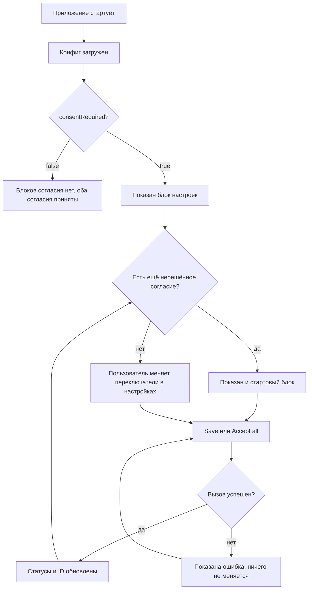

# Identity пользователя и согласие на трекинг — PRD

## Кратко

Приложение узнаёт identity пользователя из стартового конфига и спрашивает согласие на маркетинговый и аналитический трекинг в двух встроенных блоках на одной странице. Каждый потребитель identity (хедеры запросов к бэкенду, коллектор аналитики, гейм-конфиг) получает актуальные поля identity при старте и после каждого изменения. И конфиг, и вызов согласия — методы нативного бриджа хост-приложения (в тикете написано «бэкенд»; продакт уточнил это 2026-11-02). Бридж не готов, поэтому приложение работает с имитацией методов бриджа по согласованному контракту; отладочная панель старта запускает приложение в любом из режимов, а блок конфига и три блока мониторинга показывают, что держит приложение и что получил каждый потребитель.

## Проблема

У приложения нет понятия identity пользователя и нет способа спросить согласие на трекинг, поэтому маркетинговый и аналитический трекинг не могут зависеть от решения пользователя, а запросы к бэкенду не несут полей identity. Тикет (TRACK-12) адресован всем пользователям приложения, но не приводит ни доказательств, ни юридического основания требования о согласии (см. Q5). Без фичи приложение не сможет начать использовать tracking ID, когда нативный бридж выпустит настоящие методы конфига и согласия.

## Цели

- Пользователь решает по маркетинговому и аналитическому трекингу отдельно и может дать или отозвать каждое согласие в любой момент.
- У каждого потребителя identity всегда актуальные поля identity, без перезагрузки страницы.
- Приложение готово к настоящим методам конфига и согласия до того, как их выпустит нативный бридж.

## Вне рамок

- Интеграция с настоящим нативным бриджем: методы конфига и согласия имитируются, пока бридж не готов.
- Реальная отправка хедеров запросов, событий аналитики или запросов гейм-конфига: три потребителя только запоминают, что получили.
- Категории согласия кроме маркетинга и аналитики.
- Согласие в виде модалки, баннера или отдельного экрана.
- Сохранение блока конфига, блоков мониторинга и панели старта: это отладочное средство, его уберут позже (см. Q7).
- Окончательные имена хедеров: инженер предлагает их в спецификации; бэкенд подтверждает их до настоящей интеграции.

## Пользователи и сценарии

Пользователь — любой, кто открывает приложение. Весь UI согласия живёт на единственной странице приложения, рядом с блоками мониторинга.

- Как пользователь, я хочу при первом открытии приложения выбрать маркетинговый и аналитический трекинг по отдельности, чтобы разрешить только то, что меня устраивает.
- Как пользователь, я хочу позже отозвать согласие в настройках, чтобы первый выбор не был окончательным.
- Как пользователь, я хочу принять всё одним кликом, чтобы меня не заставляли проходить через два переключателя.
- Как разработчик, я хочу видеть, что и когда получил каждый потребитель identity, чтобы проверять флоу без настоящего нативного бриджа.

## Требования

| ID | Требование | Приоритет | Критерии приёмки |
|----|------------|-----------|------------------|
| R1 | При старте приложение загружает конфиг identity с семью полями: `marketingTrackingId`, `analyticsTrackingId`, `deviceId`, `temporaryId`, `consentRequired`, `marketingConsentStatus`, `analyticsConsentStatus` (статусы: 0 Declined, 1 Accepted, 2 NotDecided) | Must | При `consentRequired = true` и без сохранённого выбора оба статуса NotDecided и оба tracking ID равны `null`; `temporaryId` различается между двумя стартами; `deviceId` тот же |
| R2 | При `consentRequired = false` оба согласия Accepted, оба tracking ID приходят в конфиге, и блоки согласия не показываются | Must | Старт с `consentRequired = false`: на странице нет блоков согласия; блоки мониторинга показывают оба tracking ID |
| R3 | Стартовый блок согласия: показан при `consentRequired = true` и хотя бы одном согласии NotDecided; содержит переключатели marketing и analytics с текущими статусами, "Save" и "Accept all" | Must | При первом старте блок показан с обоими переключателями; после сохранения, которое решает оба согласия, блок исчезает без перезагрузки |
| R4 | Блок настроек согласия: показан всегда при `consentRequired = true`; здесь пользователь отзывает согласие, выключая его переключатель и сохраняя | Must | Выключить marketing и нажать "Save": marketing становится Declined, его tracking ID — `null`; analytics не меняется |
| R5 | Сохранение отправляет оба выбора одним вызовом, как стоят переключатели: включён = Accepted, выключен = Declined; "Accept all" сохраняет оба как Accepted; два согласия независимы | Must | Сохранить с включённым marketing и выключенным analytics: статусы Accepted и Declined; "Accept all" при обоих выключенных переключателях: оба Accepted |
| R6 | Правила tracking ID: Accepted → Accepted сохраняет ID; Declined или NotDecided → Accepted выдаёт новый ID, прежний больше не возвращается; Declined → `null` | Must | Принять, отозвать, принять снова: третий ID отличается от первого; принять два раза подряд: тот же ID |
| R7 | Неудачный вызов согласия ничего не меняет: статусы и ID остаются прежними. Показывать ошибку пользователю пока не требуется (Q3) | Must | Если вызов согласия падает: статусы, ID и блоки мониторинга не меняются, следующий "Save" работает; имитация никогда не падает, поэтому это проверяется автотестами, а не вручную |
| R8 | Каждый потребитель identity получает все семь полей identity при старте и после каждого изменения, без перезагрузки; если ни одно поле не изменилось, ничего не доставляется | Must | Время обновления в мониторинге меняется после старта и после сохранения, которое что-то изменило; сохранение без изменений (Accepted → Accepted для обоих) оставляет его прежним |
| R9 | Три потребителя запоминают, что получили: все три пишут оба tracking ID и `temporaryId`; при `consentRequired = true` ещё оба статуса согласия. Коллектор аналитики и гейм-конфиг пишут `deviceId` только при `consentRequired = false` и оставляют `null` как есть. Хедеры запросов всегда несут `deviceId` и `consentRequired` (продакт уточнил 2026-11-02; тикет запрещал `deviceId` всем трём) и убирают любой хедер со значением `null` | Must | При `consentRequired = true`: в блоках аналитики и гейм-конфига нет `deviceId`, в блоке хедеров `deviceId` есть; в блоке хедеров нет хедера для `null` ID; блоки аналитики и гейм-конфига показывают `null` |
| R10 | Отладочный мониторинг: блок конфига наверху страницы с семью полями identity, которые приложение держит сейчас, и три блока рядом с блоком настроек, по одному на потребителя, с его текущим запомненным состоянием и временем последнего обновления | Must | После старта блок конфига показывает все семь полей; после каждого изменения блок конфига и три блока потребителей сразу показывают новые поля (и новое время), без перезагрузки |
| R11 | Приложение работает без настоящего нативного бриджа: имитированные методы конфига и согласия отвечают с задержкой и помнят выбор пользователя между перезагрузками; пока они никогда не падают | Must | Перезагрузка после принятия: оба статуса Accepted с теми же ID и без стартового блока; ни сохранение, ни старт никогда не падают |
| R12 | Отладочный старт: страница открывается с панелью старта, где есть переключатель `consentRequired`, переключатель "first start" и кнопка "Start"; конфиг загружается только по нажатию "Start" со значениями переключателей; "first start" заставляет имитацию забыть сохранённый выбор, как будто пользователь ещё не решал; повторное нажатие "Start" перезапускает с текущими значениями | Must | Открыть страницу: до "Start" нет блоков конфига, согласия и мониторинга; старт с выключенным `consentRequired`: блоков согласия нет; нажать "Start" снова с включённым: блок настроек появляется без перезагрузки; принять оба, затем "Start" с включённым "first start": оба статуса NotDecided, оба ID `null`, стартовый блок снова виден |

## Метрики успеха

| Метрика | Базовое значение | Цель | Как измеряем |
|---------|------------------|------|--------------|
| Пользователи, решившие оба согласия в первой сессии (`consentRequired = true`) | — (новая фича) | неизвестно — см. Q6 | неизвестно — см. Q6; в приложении нет событий аналитики |

## Риски и зависимости

- Команда нативного приложения: настоящие методы бриджа для конфига и согласия в работе; согласованный контракт к тикету не приложен (Spec Q1). Имитация следует именам полей из тикета.
- Дизайн: макетов и локализации пока нет по решению (Q4); в релиз идут временные английские тексты.
- Юридические требования: основание требования о согласии не указано (Q5).

## Открытые вопросы

- [x] **Q1.** Кто владелец и ревьюеры PRD, спецификации и задач? — продакт (автор тикета). Ответ 2026-11-02: владелец a.fedorovskyi для всех трёх документов; ревьюеры пока не названы.
- [x] **Q2.** Как переключатель показывает статус NotDecided, если у него есть только «включён» и «выключен»? Спецификация предполагает «выключен». — продакт / дизайн. Ответ 2026-11-02: как выключенный.
- [x] **Q3.** Что видит пользователь, пока вызов выполняется, и когда загрузка конфига или сохранение падает? Спецификация предполагает отключённые кнопки на время ожидания, текст ошибки на английском и повтор. — продакт / дизайн. Ответ 2026-11-02: обработка ошибок пока не нужна; что уже сделано, остаётся заглушкой до настоящего бриджа.
- [x] **Q4.** Окончательные макет и тексты блоков согласия и мониторинга и язык UI: тикет приводит кнопки по-русски, документы используют временные английские тексты. — дизайн. Ответ 2026-11-02: макеты и локализация пока не нужны; временные английские тексты остаются.
- [ ] **Q5.** Чем обусловлено требование о согласии (закон, политика платформы, партнёр) и каких пользователей оно касается? — продакт
- [ ] **Q6.** Какие метрика успеха, цель и источник измерения применимы? В приложении нет событий аналитики. — продакт
- [ ] **Q7.** Когда и в рамках какого тикета убираются блок конфига, блоки мониторинга и панель старта? — продакт
