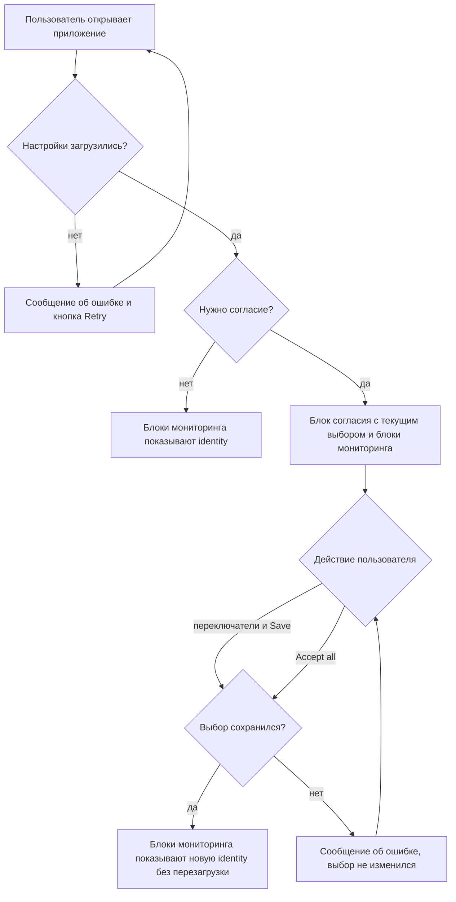

# Identity пользователя и согласие на трекинг — PRD

## Кратко

Приложение получает identity пользователя из конфига при старте, спрашивает согласие на маркетинговый и аналитический трекинг во встроенном в страницу блоке и держит в актуальном состоянии все части приложения, которым нужна identity (хедеры запросов, коллектор аналитики, гейм-конфиг), когда пользователь даёт или отзывает согласие. Бэкенд ещё не готов, поэтому приложение работает с имитацией бэкенда по согласованному контракту; отладочные блоки мониторинга показывают, что identity доходит до каждого потребителя.

## Проблема

У приложения нет identity пользователя и нет способа спросить согласие на трекинг. Без этого в запросах к бэкенду, в коллекторе аналитики и в гейм-конфиге нет identity-полей, а маркетинговый и аналитический трекинг не может зависеть от решения пользователя. В тикете не сказано, кому нужно это согласие и какие данные стоят за запросом (см. Q2).

## Цели

- Пользователь решает по маркетинговому и аналитическому трекингу отдельно и может изменить решение в любой момент.
- У каждого потребителя identity всегда актуальные identity-поля, без перезагрузки страницы.
- Приложение готово к настоящим методам конфига и согласия до того, как бэкенд их выпустит.

## Вне рамок

- Интеграция с настоящими методами конфига и согласия на бэкенде: они ещё не готовы.
- Настоящая отправка хедеров в запросах к бэкенду и запись в настоящий коллектор аналитики или гейм-конфиг: три потребителя только запоминают, что им пришло.
- Категории согласия, кроме маркетинга и аналитики.
- Согласие в виде модалки, баннера или отдельного экрана.
- Сохранение блоков мониторинга: это отладочный инструмент, его уберут позже отдельной работой.
- Согласование окончательных имён хедеров.

## Пользователи и сценарии

- Как пользователь, я хочу дать или не дать согласие на маркетинговый и аналитический трекинг отдельно, чтобы делиться только тем, на что я согласен.
- Как пользователь, я хочу отозвать данное ранее согласие через тот же блок, чтобы иметь возможность передумать.
- Как пользователь, я хочу, чтобы мой выбор сохранялся после перезагрузки, чтобы не решать заново.
- Как разработчик или тестировщик, я хочу видеть, что сейчас лежит у каждого потребителя identity и когда он обновлялся последний раз, чтобы убедиться, что identity доходит до всех.

## Требования

| ID | Требование | Приоритет | Критерии приёмки |
|----|------------|-----------|------------------|
| R1 | При каждом старте приложение берёт identity пользователя из конфига: `deviceId` одинаковый при каждом старте, `temporaryId` новый при каждом старте, а каждый tracking ID задан, только если статус его согласия `Accepted` | Must | Перезагрузить дважды: блоки мониторинга каждый раз показывают тот же `deviceId` и другой `temporaryId`; у согласия в статусе `Declined` или `NotDecided` tracking ID равен `null` |
| R2 | Блок согласия — часть страницы, а не модалка, и показывается, только если конфиг говорит, что согласие нужно; если не нужно, блок скрыт, а оба tracking ID заданы сразу | Must | При `consentRequired = true` блок есть на странице, и остальная страница остаётся доступной; при `consentRequired = false` блока нет, а оба tracking ID в блоках мониторинга не `null` |
| R3 | В блоке два переключателя, маркетинг и аналитика, которые показывают текущие статусы согласий, кнопка «Save» и рядом с ней «Accept all» | Must | После перезагрузки переключатели совпадают с сохранёнными статусами: `Accepted` включён, `Declined` выключен; про `NotDecided` см. Q6 |
| R4 | «Save» сохраняет каждое согласие отдельно: включённый переключатель становится `Accepted` и получает tracking ID, выключенный становится `Declined`, и его tracking ID равен `null` | Must | Включить только маркетинг и нажать «Save»: `marketingTrackingId` не `null`, `analyticsTrackingId` равен `null` |
| R5 | «Accept all» даёт оба согласия | Must | После «Accept all» оба переключателя включены, и оба tracking ID не `null` (сохраняет ли кнопка сразу: см. Q7) |
| R6 | Пользователь отзывает каждое согласие через тот же блок; если после отзыва дать согласие снова, приходит новый tracking ID, а не прежний | Must | Принять маркетинг и запомнить его ID; выключить и сохранить: ID равен `null`; включить и сохранить: ID не `null` и отличается от запомненного |
| R7 | Выбор пользователя сохраняется после перезагрузки | Must | Сохранить выбор и перезагрузить: переключатели показывают сохранённый выбор, а у согласия `Accepted` тот же tracking ID, что был до перезагрузки |
| R8 | Все три потребителя identity получают все identity-поля: сначала при старте, со значениями из конфига, затем при каждом изменении любого поля, без перезагрузки страницы | Must | Сразу после старта все три блока мониторинга показывают значения из конфига; после сохранения, которое меняет tracking ID, все три показывают новое значение и новое время обновления без перезагрузки |
| R9 | Потребитель хедеров запросов хранит по одному хедеру на каждое identity-поле; для поля со значением `null` хедера нет | Must | При отказе от аналитики в блоке хедеров запросов нет хедера аналитического tracking ID, а все остальные есть |
| R10 | Потребитель коллектора аналитики хранит все identity-поля; `null` хранится как `null` | Must | При отказе от аналитики блок коллектора аналитики показывает `analyticsTrackingId` равным `null` |
| R11 | Потребитель гейм-конфига хранит все identity-поля; `null` хранится как `null` | Must | При отказе от аналитики блок гейм-конфига показывает `analyticsTrackingId` равным `null` |
| R12 | На той же странице, что и блок согласия, три блока мониторинга, по одному на потребителя, показывают его текущее состояние и время последнего обновления | Must | На странице есть блоки «Request headers», «Analytics collector» и «Game config», в каждом текущие значения и время последнего обновления |
| R13 | Пока бэкенд не готов, приложение работает с имитацией бэкенда, которая следует согласованному контракту и ведёт себя как настоящий бэкенд: отвечает с задержкой, иногда возвращает ошибку и помнит выбор пользователя | Must | Загрузка и сохранение идут с заметной задержкой; при повторных сохранениях часть попыток завершается ошибкой, которая показывается пользователю, и ничего не меняется (что видит пользователь: см. Q10); сохранённый выбор переживает перезагрузку |

## Метрики успеха

| Метрика | Базовое значение | Цель | Как измеряем |
|---------|------------------|------|--------------|
| Изменения согласия отражаются во всех трёх блоках мониторинга без перезагрузки | нет — новое приложение | каждое изменение, сразу после сохранения | Приёмочная проверка R4–R8 силами QA |
| Продуктовая метрика по согласию, например доля принявших | неизвестно — см. Q12 | неизвестно — см. Q12 | неизвестно — см. Q12 |

## Риски и зависимости

- Команда бэкенда: настоящие методы конфига и согласия. Контракт согласован, но к тикету не приложен.
- Дизайнер подключится позже: макетов нет, поэтому блоки делаются с временным дизайном и текстами (см. Q11).
- Пока блоки мониторинга не убраны, значения identity видны на странице.

## Открытые вопросы

- [ ] **Q1.** Кто владелец и ревьюеры PRD, спецификации и списка задач? — продакт
- [ ] **Q2.** Кому нужны согласие и identity (юристам, маркетингу, аналитике), и какие данные или дедлайн стоят за тикетом? — продакт
- [ ] **Q3.** Тикет противоречит сам себе для пользователя, который раньше дал согласие и перезагружает страницу, когда согласие всё ещё требуется: «Если `Accepted`, то ID приходит в конфиге» и «Если `consentRequired = true`, то на старте `marketingTrackingId` и `analyticsTrackingId` равны `null`». Какое правило главнее? — продакт, команда бэкенда
- [ ] **Q4.** Какие статусы согласий возвращает конфиг при `consentRequired = false`, когда оба tracking ID приходят сразу? — продакт, команда бэкенда
- [ ] **Q5.** Показывается ли блок согласия после того, как пользователь решил по обоим согласиям, пока `consentRequired = true`? — продакт
- [ ] **Q6.** Как переключатель показывает `NotDecided`: выключенным, как `Declined`, или отдельным состоянием? — продакт, дизайнер
- [ ] **Q7.** «Accept all» сохраняет сразу или только включает оба переключателя и ждёт «Save»? — продакт
- [ ] **Q8.** На какой странице или маршруте находятся блок согласия и блоки мониторинга? — продакт
- [ ] **Q9.** Какие поля конфига считаются «identity-полями», которые получает каждый потребитель: только `deviceId`, `temporaryId` и два tracking ID или ещё `consentRequired` и статусы согласий? — продакт, команда бэкенда
- [ ] **Q10.** Что видит пользователь, если не удалось загрузить конфиг и если не удалось сохранить согласие? — продакт, дизайнер
- [ ] **Q11.** Макеты блока согласия и блоков мониторинга, язык интерфейса и окончательные тексты («Save», «Accept all» и остальные)? — дизайнер
- [ ] **Q12.** Есть ли продуктовая метрика по согласию помимо приёмочной проверки, и где её измерять? — продакт
