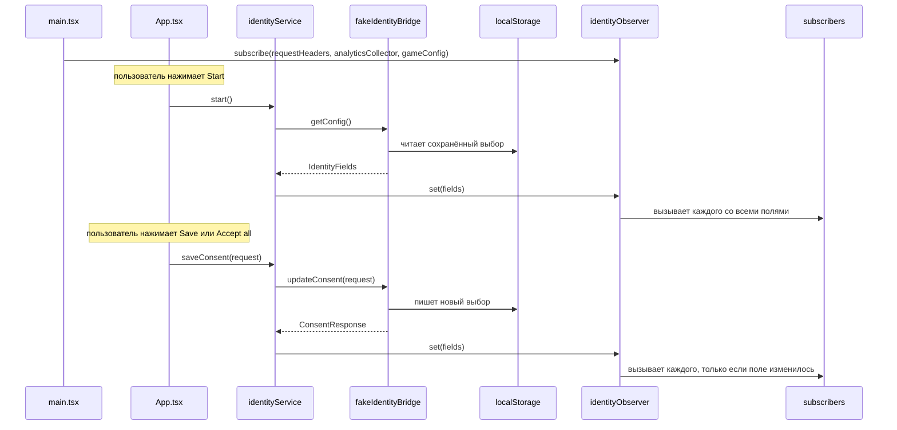
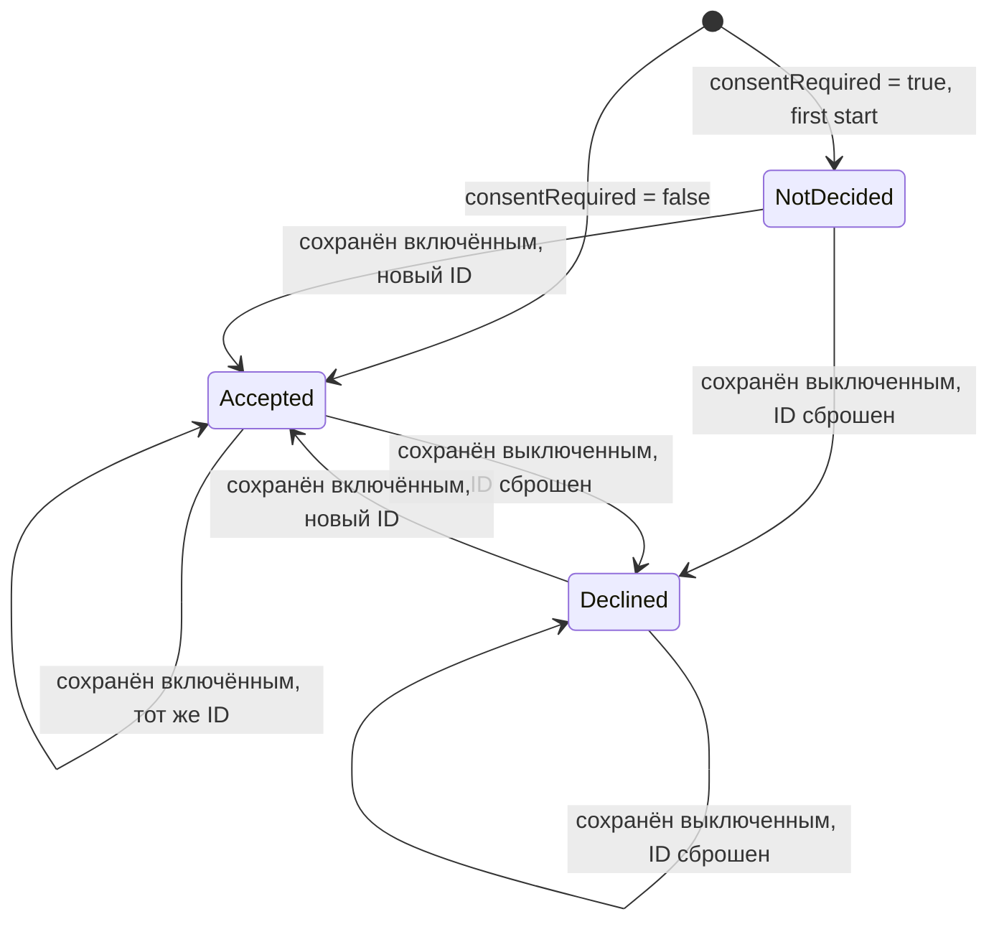

# Identity пользователя и согласие на трекинг — Спецификация

## Кратко

Сервис identity загружает стартовый конфиг через нативный бридж (`IdentityBridge`), кладёт семь полей identity в обсервер identity и сохраняет согласие через тот же бридж; обсервер вызывает трёх запоминающих подписчиков (хедеры запросов, коллектор аналитики, гейм-конфиг) при старте и при каждом изменении поля. Пока нативный бридж не готов, `IdentityBridge` — фейк, который хранит выбор в `localStorage` и отвечает с задержкой. UI — одна страница: отладочная панель старта, блок конфига, два блока согласия и три блока мониторинга. Зачем это нужно, описано в [PRD](./prd.md).

## Контекст и текущее состояние

- Проект `playground/app/` — приложение Vite + React + TypeScript с Vitest, каркас которого создан для этой фичи (T1): до неё папка была пуста, а README playground описывал её как фронтенд на React + TypeScript. Все пути ниже указаны относительно `playground/app/`; каждый модуль из раздела «Компоненты и изменения» существует, тесты лежат рядом с ним.
- Нативного бриджа пока нет: методы конфига и согласия хост-приложения в работе, согласованный контракт к тикету не приложен (Spec Q1); фейк реализует имена полей из TRACK-12 и форматы из раздела «API / интерфейсы».
- В приложении нет HTTP-клиента, коллектора аналитики и гейм-конфига, поэтому три подписчика запоминают, что получили, вместо вызова реальных систем.

## Предлагаемое решение

### Обзор



### Компоненты и изменения

- `src/identity/types.ts` — новый: `ConsentStatus` (`Declined = 0`, `Accepted = 1`, `NotDecided = 2`), `IdentityFields` (семь полей конфига), `ConsentRequest`, `ConsentResponse`.
- `src/identity/identityObserver.ts` — новый: `createIdentityObserver()` с `set(fields)`, `get()`, `subscribe(fn)`. `set` сохраняет поля и вызывает каждого подписчика, если это первый set или любое из семи полей отличается (строгое равенство по полю); иначе ничего не делает. Подписчик, добавленный после первого `set`, сразу вызывается с текущими полями. `subscribe` и `get` также обслуживают React через `useSyncExternalStore`.
- `src/identity/useIdentity.ts` — новый: `useIdentity(observer)`, хук `useSyncExternalStore`, которым пользуются блоки согласия, блок конфига и `App`.
- `src/identity/identityService.ts` — новый: `createIdentityService(bridge, observer)` со `start()` (вызывает `getConfig`, затем `observer.set`) и `saveConsent(request)` (вызывает `updateConsent`; при успехе сливает два статуса из запроса и два ID из ответа в текущие поля и вызывает `observer.set`; при ошибке пробрасывает её и ничего не трогает).
- `src/bridge/identityBridge.ts` — новый: интерфейс `IdentityBridge`, контракт нативного бриджа (конфиг и согласие); адаптер настоящего бриджа реализует его позже.
- `src/bridge/fakeIdentityBridge.ts` — новый: `createFakeIdentityBridge(options)`; поведение в разделах «Модель данных» и «API / интерфейсы». Он никогда не падает: пути ошибок проверяются стабами в тестах.
- `src/subscribers/recorder.ts` — новый: `createRecorder(project)` оборачивает проекцию `(fields) => state` в подписчика, который хранит спроецированное состояние с `updatedAt` и отдаёт `getSnapshot()` / `subscribe(fn)` для UI мониторинга.
- `src/subscribers/requestHeaders.ts`, `src/subscribers/analyticsCollector.ts`, `src/subscribers/gameConfig.ts` — новые: три проекции из раздела «Поля подписчиков».
- `src/ui/ConsentBlock.tsx` — новый: один компонент для обоих блоков (`variant: 'initial' | 'settings'`); два переключателя, "Save", "Accept all", состояния ожидания и ошибки.
- `src/ui/MonitoringBlock.tsx` — новый: состояние рекордера в виде форматированного JSON плюс время обновления.
- `src/ui/StartPanel.tsx` — новый: отладочная панель старта наверху страницы: переключатель `consentRequired` (по умолчанию включён), переключатель "first start" (по умолчанию выключен) и кнопка "Start", отключённая, пока старт выполняется.
- `src/ui/ConfigBlock.tsx` — новый: текущие семь полей обсервера в виде форматированного JSON, наверху страницы.
- `src/App.tsx` — страница: панель старта; по "Start" создаёт бридж через `createBridge(consentRequired, firstStart)` и новый `identityService`, вызывает `start()` и держит его состояния ожидания и ошибки; как только у обсервера есть поля, показывает блок конфига, два блока согласия по правилам видимости и три блока мониторинга.
- `src/main.tsx` — сборка: создаёт обсервер и три рекордера, подписывает рекордеры и рендерит `App` с `createBridge = (consentRequired, firstStart) => createFakeIdentityBridge({ consentRequired, forgetChoice: firstStart })`.

#### Поля подписчиков

| Поле | Коллектор аналитики, гейм-конфиг | Хедеры запросов |
|------|----------------------------------|-----------------|
| `marketingTrackingId`, `analyticsTrackingId`, `temporaryId` | всегда | всегда |
| `deviceId` | только при `consentRequired = false` | всегда |
| `marketingConsentStatus`, `analyticsConsentStatus` | только при `consentRequired = true` | только при `consentRequired = true` |
| `consentRequired` | никогда | всегда |

Обсервер по-прежнему доставляет все семь полей; проекции аналитики и гейм-конфига отбрасывают `deviceId` при `consentRequired = true`, так что он никогда не попадает в их состояние; проекция хедеров несёт его всегда (PRD R9). Хедеры запросов — строки (статусы как `"0"` / `"1"` / `"2"`, `consentRequired` как `"true"` / `"false"`), а хедер, значение которого было бы `null`, не добавляется. Коллектор аналитики и гейм-конфиг сохраняют значения `null`.

Имена хедеров (Spec Q3): `X-Marketing-Tracking-Id`, `X-Analytics-Tracking-Id`, `X-Temporary-Id`, `X-Device-Id`, `X-Marketing-Consent-Status`, `X-Analytics-Consent-Status`, `X-Consent-Required`.

#### Видимость и поведение UI

- Стартовый блок: `consentRequired === true` и хотя бы один статус `NotDecided`. Блок настроек: `consentRequired === true`. До нажатия "Start", а также пока первый `start()` выполняется или упал, показывается только панель старта.
- Переключатель включён при `Accepted` и выключен при `Declined`; `NotDecided` показывается как выключенный (PRD Q2).
- "Save" отправляет `{ marketing: on ? Accepted : Declined, analytics: … }`; "Accept all" отправляет оба как `Accepted` независимо от переключателей. Оба блока читают статусы из обсервера, поэтому сохранение в одном обновляет другой. После успешного сохранения переключатели выставляются по отправленному запросу, поэтому "Accept all" или сохранение после упавшего не рассинхронизирует их со статусом, который не изменился.
- Пока вызов выполняется, обе кнопки отключены. Обработка ошибок пока не требуется (PRD Q3); сделанное остаётся заглушкой: при ошибке блок показывает "Could not save your choice. Try again." под кнопками и оставляет переключатели как их выставил пользователь, а упавший `start()` показывает "Could not load the config." с кнопкой "Retry", которая снова вызывает `start()`.
- Макеты и локализация пока не нужны (PRD Q4); английские тексты идут как есть: заголовки блоков "Tracking consent" и "Tracking settings", подписи переключателей "Marketing" и "Analytics", кнопки "Save" и "Accept all", заголовки мониторинга "Config", "Request headers", "Analytics collector" и "Game config".

### Модель данных

Жизненный цикл статуса одного согласия; второе независимо:



Хранилище фейка: ключ `localStorage` `track12.identity` содержит `{ marketingConsentStatus, analyticsConsentStatus, marketingTrackingId, analyticsTrackingId }`. `deviceId` — константа `"device-0001"`; `temporaryId` — `crypto.randomUUID()` при каждом `getConfig`; tracking ID — `crypto.randomUUID()` при выдаче.

### API / интерфейсы

```ts
interface IdentityBridge {
  getConfig(): Promise<IdentityFields>;
  updateConsent(request: ConsentRequest): Promise<ConsentResponse>;
}

interface IdentityFields {
  marketingTrackingId: string | null;
  analyticsTrackingId: string | null;
  deviceId: string;
  temporaryId: string;
  consentRequired: boolean;
  marketingConsentStatus: ConsentStatus;
  analyticsConsentStatus: ConsentStatus;
}

interface ConsentRequest { marketing: ConsentStatus; analytics: ConsentStatus } // Accepted or Declined
interface ConsentResponse { marketingTrackingId: string | null; analyticsTrackingId: string | null }
```

Поведение фейка, `createFakeIdentityBridge({ consentRequired, forgetChoice = false, delayMs = [300, 1000], random = Math.random, storage = localStorage, newId = crypto.randomUUID })`:

- `forgetChoice = true` удаляет сохранённый выбор при создании, поэтому следующий `getConfig` ведёт себя как первый старт (PRD R12).
- `storage: null` хранит выбор только в памяти; `newId` выдаёт tracking ID и временные ID (тесты передают счётчик).
- Каждый вызов ждёт случайную задержку из `delayMs` и никогда не падает (PRD R11).
- `getConfig` при `consentRequired = true`: статусы и ID из хранилища или `NotDecided` / `null`, если ничего не сохранено.
- `getConfig` при `consentRequired = false`: оба статуса `Accepted`; ID из хранилища, если есть, иначе выдаются и сохраняются; сохранённые статусы игнорируются.
- `updateConsent`, по каждому полю: `Accepted` при сохранённом статусе `Accepted` → тот же ID; `Accepted` в остальных случаях → новый ID; `Declined` → `null`. Оба статуса и оба ID сохраняются вместе.

`consentRequired` для фейка — это переключатель панели старта; больше фейк его ниоткуда не читает.

## Покрытие требований

| ID в PRD | Как выполняется | Раздел |
|----------|-----------------|--------|
| R1 | Фейковый `getConfig` возвращает семь полей; `temporaryId` новый при каждом вызове, `deviceId` константа | API / интерфейсы |
| R2 | Фейк возвращает `Accepted` и ID при `consentRequired = false`; `App` скрывает оба блока | API / интерфейсы, Видимость и поведение UI |
| R3 | `ConsentBlock` с вариантом `initial`, показан по правилу видимости | Видимость и поведение UI |
| R4 | `ConsentBlock` с вариантом `settings`; выключенный переключатель + "Save" отправляет `Declined` | Видимость и поведение UI |
| R5 | Один вызов `updateConsent` с обоими полями; "Accept all" отправляет оба `Accepted` | Видимость и поведение UI, API / интерфейсы |
| R6 | Правила ID в фейковом `updateConsent` | API / интерфейсы, Модель данных |
| R7 | Сервис пробрасывает отклонённый `updateConsent` без `observer.set`; блок показывает ошибку (проверяется стабом с отказом, фейк никогда не падает) | Компоненты и изменения, Граничные случаи и обработка ошибок |
| R8 | `identityObserver.set` вызывает подписчиков при первом set и только если поле изменилось | Компоненты и изменения |
| R9 | Три проекции из раздела «Поля подписчиков» | Поля подписчиков |
| R10 | `ConfigBlock` на обсервере и `MonitoringBlock` на каждый рекордер, перерисовываются через `useSyncExternalStore` | Компоненты и изменения |
| R11 | Фейк с задержкой и `localStorage` | API / интерфейсы |
| R12 | `StartPanel` и обработка старта в `App`: новые фейковый бридж и сервис на каждый "Start"; `forgetChoice` для "first start" | Компоненты и изменения, API / интерфейсы |

## Альтернативы и решения

| Решение | Рассмотренные варианты | Выбрано | Почему |
|---------|------------------------|---------|--------|
| Откуда UI читает identity | Отдельное состояние React, скопированное из сервиса; обсервер как стор через `useSyncExternalStore` | Обсервер как стор | Один источник истины; оба блока и мониторинг обновляются вместе с подписчиками |
| Статусы согласия после сохранения | Из ответа; из запроса | Из запроса | По тикету метод согласия возвращает только два tracking ID; статус по определению следует за запросом |
| Хранение в фейке | Только в памяти; `localStorage` | `localStorage` | Тикет требует, чтобы выбор переживал перезагрузку |
| Переключение `consentRequired` в фейке | Константа на этапе сборки; query-строка URL `?consentRequired=false`; переключатель на отладочной панели старта | Переключатель панели старта, по умолчанию включён | Тестировщики переключают режимы и перезапускают без перезагрузки; значение по-прежнему приходит только из объекта конфига |
| Задержка и ошибки фейка | Фиксированная задержка; опция задержки со значением по умолчанию 300–1000 мс; имитация ошибок | Опция задержки, без имитации ошибок | Тесты идут без задержки; ручное тестирование видит только задержки; пути ошибок покрыты тестами со стабами с отказом (PRD R11) |
| Отбрасывание `deviceId` | В обсервере; в проекции каждого подписчика | Проекция | По тикету обсервер доставляет все семь полей; правило касается того, что пишут подписчики, и у подписчиков оно разное (хедеры несут его всегда) |
| Имена хедеров | Тикет оставляет их на усмотрение инженера | Имена `X-…` из раздела «Поля подписчиков» | Общепринятые; подтверждаются с бэкендом до настоящей интеграции (Spec Q3) |

## Граничные случаи и обработка ошибок

- `start()` падает (фейк здесь не падает никогда; настоящий бридж может) → страница показывает "Could not load the config." и "Retry"; ни один подписчик не вызывается; "Retry" запускает снова с текущим значением переключателя.
- "Start" нажат, пока старт выполняется → невозможно, кнопка отключена.
- "Start" нажат снова после успешного старта → новые фейковый бридж и сервис; обсервер получает новый конфиг (как минимум новый `temporaryId`), поэтому подписчики вызываются; упавший перезапуск оставляет на странице прежнее состояние и показывает ошибку.
- "Start" с включённым "first start" → сохранённый выбор удалён до `getConfig`; при включённом `consentRequired` оба статуса `NotDecided` и оба ID `null`, при выключенном выдаются новые ID.
- Сохранение падает (фейк никогда не падает; настоящий бридж может) → сервис отклоняет промис, обсервер не тронут, блок показывает ошибку и оставляет переключатели как их выставил пользователь; "Save" и "Accept all" снова включены.
- Сохранение без изменений (оба уже `Accepted`, оба переключателя включены) → фейк возвращает те же ID, `observer.set` не видит изменений, ни один подписчик не вызывается, время в мониторинге не меняется.
- Оба согласия `Declined`, оба переключателя выключены, "Save" → оба остаются `Declined` с `null` ID; изменений нет, подписчики не вызываются.
- Второй клик, пока вызов выполняется → невозможен, кнопки отключены.
- Сохранение в одном блоке → оба блока заново читают статусы из обсервера; стартовый блок исчезает, как только оба решены.
- Перезагрузка после принятия → `getConfig` возвращает сохранённые `Accepted` и те же ID; новый `temporaryId` означает, что подписчики вызываются при старте.
- `consentRequired = false` при сохранённом с прошлого запуска выборе `Declined` → статусы `Accepted`, ID выдаются там, где их нет.
- `localStorage` недоступен или испорчен → фейк ведёт себя так, будто ничего не сохранено, и держит выбор в памяти на время сессии.
- Подписчик добавлен после завершения `start()` → сразу вызывается с текущими полями.
- `start()` вызван, пока старт ещё выполняется (React StrictMode в разработке монтирует дважды) → второй вызов делит запрос с первым; один `getConfig`, один `temporaryId`, один вызов подписчиков.

## Нефункциональные требования

- Приватность: при `consentRequired = true` `deviceId` никогда не появляется в состоянии и блоках коллектора аналитики и гейм-конфига; его несут только хедеры запросов (R9). Ничего не покидает браузер: запросы не отправляются.

## План тестирования

- Unit (Vitest): `identityObserver` (первый set вызывает, изменённое поле вызывает, идентичный set не вызывает, поздний подписчик вызывается); `fakeIdentityBridge` (первый старт, `consentRequired = false`, правила ID из R6, сохранение через фейковое хранилище); `identityService` (пути старта и сохранения, сбой не трогает обсервер); три проекции (оба режима `consentRequired`, `deviceId` всегда в хедерах и только без `consentRequired` в остальных, хедер с `null` отброшен, `null` сохранён в остальных).
- Компонентные (Vitest + Testing Library): `ConsentBlock` (видимость по варианту, выключенный переключатель сохраняет `Declined`, "Accept all", отключение на время ожидания, текст ошибки с сохранёнными переключателями; R3–R5, R7); `MonitoringBlock` (обновление состояния и времени) и `ConfigBlock` (все семь полей, перерисовка при изменении; R10).
- Компонентные (Vitest + Testing Library): `App` (до "Start" только панель старта, старт в обоих режимах, перезапуск в другом режиме, "first start" забывает выбор, упавший старт с "Retry"; R12).
- Ручные, в браузере, в обоих режимах: критерии приёмки R1–R12 из PRD кроме R7, включая цикл «отозвать и принять» и перезагрузку.

## Раскатка и откат

Раскатка — это сам релиз: один деплой фронтенда, без миграций и изменений бэкенда. Блоки согласия и мониторинга рендерит `App.tsx` после "Start" на отладочной панели старта, которая собирается в последней задаче, нужной флоу, так что недостроенный UI недоступен. Откат: задеплоить предыдущую версию; ключ `track12.identity` остаётся в `localStorage` неиспользуемым и читается снова при следующей раскатке. Где деплоится приложение, неизвестно (Spec Q2).

## Открытые вопросы

- [ ] **Q1.** Согласованный контракт нативного бриджа к тикету не приложен: совпадают ли имена методов, имена полей, коды статусов и формат метода согласия с разделом «API / интерфейсы»? — команда нативного приложения
- [ ] **Q2.** Где и как деплоится приложение? В репозитории нет пайплайна. — TBD
- [ ] **Q3.** Подходят ли бэкенду имена хедеров из раздела «Поля подписчиков»? — команда бэкенда
