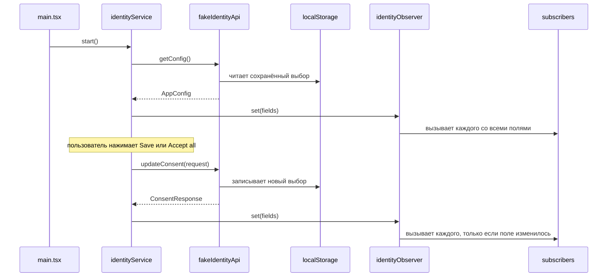
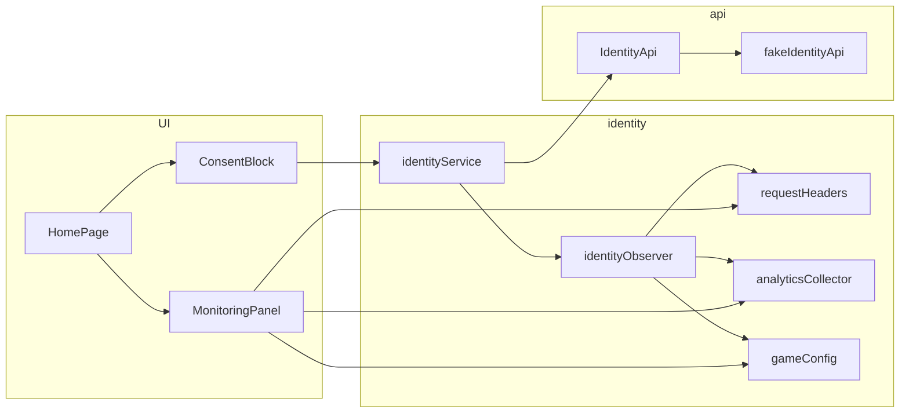
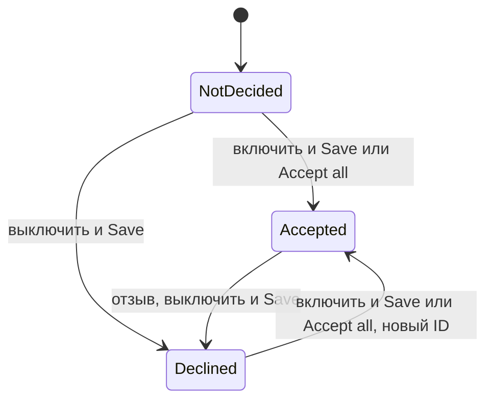

# Identity пользователя и согласие на трекинг — Спецификация

## Кратко

Identity-сервис загружает конфиг при старте через `IdentityApi`, записывает identity-поля в обсервер identity и сохраняет выбор согласий; обсервер вызывает трёх записывающих подписчиков (хедеры запросов, коллектор аналитики, гейм-конфиг) при старте и при каждом изменении. Пока бэкенд не выпущен, `IdentityApi` — это фейк, который хранит выбор пользователя в `localStorage` и отвечает с задержкой и иногда с ошибкой. Зачем это нужно, описано в [PRD](./prd.md).

## Контекст и текущее состояние

- Проект `playground/app/` — новое приложение на React + Vite + TypeScript, кода в нём пока нет; все пути ниже новые и указаны относительно него.
- Бэкенда нет: методы конфига и согласия не готовы, а согласованный контракт к тикету не приложен (Spec Q1). Фейк реализует имена полей из TRACK-12 и форматы из раздела «API / интерфейсы».
- В приложении пока нет роутера, HTTP-клиента, коллектора аналитики и гейм-конфига, поэтому три подписчика запоминают, что им пришло, а не вызывают настоящие системы.

## Предлагаемое решение

### Обзор





### Компоненты и изменения

- `src/identity/types.ts` — новый: `ConsentStatus`, `AppConfig`, `IdentityFields`, `ConsentRequest`, `ConsentResponse`.
- `src/api/identityApi.ts` — новый: интерфейс `IdentityApi`; позже его реализует адаптер настоящего бэкенда.
- `src/api/fake/fakeIdentityApi.ts` — новый: `createFakeIdentityApi(options)`, фейковые методы конфига и согласия с поведением из раздела «Модель данных».
- `src/api/fake/latency.ts` — новый: `withLatency(fn, options)` ждёт случайную задержку, затем с заданной вероятностью завершается ошибкой `FakeBackendError`, не вызывая `fn`.
- `src/identity/identityObserver.ts` — новый: хранит текущие `IdentityFields` и вызывает каждого подписчика при первом `set` и при изменении любого поля (`Object.is` для каждого поля); подписчик, добавленный позже, сразу получает текущие поля; если один подписчик бросил исключение, остальные всё равно вызываются.
- `src/identity/subscribers/recorder.ts` — новый: `createRecordingSubscriber(map)` хранит `map(fields)` и время вызова и даёт интерфейсу подписаться на это состояние.
- `src/identity/subscribers/requestHeaders.ts` — новый: превращает identity-поля в хедеры, отбрасывая значения `null`. Имена хедеров временные (Spec Q2): `X-Device-Id`, `X-Temporary-Id`, `X-Marketing-Tracking-Id`, `X-Analytics-Tracking-Id`.
- `src/identity/subscribers/analyticsCollector.ts`, `src/identity/subscribers/gameConfig.ts` — новые: хранят все identity-поля под их собственными именами, `null` как есть; имена полей временные (Spec Q3).
- `src/identity/identityService.ts` — новый: `createIdentityService(api, observer)` с `start()`, `save(choice)`, `acceptAll()`, `getState()` и `subscribe(listener)`; хранит `consentRequired`, оба статуса согласий и состояние загрузки и сохранения.
- `src/identity/bootstrap.ts` — новый: создаёт фейковый API, обсервер, сервис и три записывающих подписчика и подписывает их до `start()`, чтобы их первый вызов пришёл со значениями из конфига.
- `src/features/consent/useIdentityState.ts` — новый: хук на `useSyncExternalStore` поверх `identityService`.
- `src/features/consent/ConsentBlock.tsx` — новый: два переключателя `role="switch"` «Marketing» и «Analytics», кнопки «Save» и «Accept all»; локальное состояние переключателей берётся из статусов и сбрасывается к ним после успешного сохранения. Допущение (PRD Q6): `NotDecided` показывается выключенным, как `Declined`. Вёрстка и тексты здесь и в блоках мониторинга временные, пока нет макетов (PRD Q11).
- `src/features/monitoring/MonitoringPanel.tsx`, `src/features/monitoring/SubscriberMonitor.tsx` — новые: блоки «Request headers», «Analytics collector» и «Game config», в каждом текущие значения и «Last updated» (локальное время `HH:mm:ss.SSS`) или «Not updated yet». Папка самодостаточна, поэтому убрать отладочные блоки — значит удалить её и одну строку в `HomePage.tsx`.
- `src/pages/HomePage.tsx` — новый: единственная страница, на `/`. Допущение (PRD Q8): блок согласия и блоки мониторинга находятся на единственной странице приложения по адресу `/`, без роутера. Показывает «Loading…», ошибку загрузки конфига, блок согласия (только когда `consentRequired` равен `true`) и панель мониторинга.
- `src/main.tsx`, `src/App.tsx` — новые: `main.tsx` один раз вызывает `identityService.start()` до рендера, чтобы React `StrictMode` не мог загрузить конфиг дважды.

### Модель данных

Фейковый бэкенд хранит одну запись в `localStorage` под ключом `fakeIdentityBackend.v1`:

| Поле | Тип | Начальное значение |
|---|---|---|
| `marketingConsentStatus` | `0 \| 1 \| 2` | `2` (`NotDecided`) |
| `analyticsConsentStatus` | `0 \| 1 \| 2` | `2` (`NotDecided`) |
| `marketingTrackingId` | `string \| null` | `null` |
| `analyticsTrackingId` | `string \| null` | `null` |

Поведение фейка:

- `getConfig()` возвращает `deviceId: "fake-device-id"` (константа), новый `temporaryId` из `crypto.randomUUID()` при каждом вызове, `consentRequired` из настроек и сохранённые статусы с их tracking ID: ID только для `Accepted`, иначе `null`. Допущение (PRD Q3): главнее правило статуса, поэтому пользователь, который раньше дал согласие, получает сохранённый ID, даже когда `consentRequired` равен `true`; оба ID равны `null` при старте, только пока ни одно согласие не `Accepted`, как при первом старте.
- Допущение (PRD Q4): при `consentRequired: false` `getConfig()` возвращает оба статуса `Accepted` с tracking ID, создавая и сохраняя ID, если их ещё нет; сохранённые статусы не перезаписываются.
- `updateConsent(request)` применяет каждое переданное поле: `Accepted` оставляет сохранённый ID, если поле уже было `Accepted`, иначе сохраняет новый `crypto.randomUUID()`; `Declined` сохраняет `null`. `NotDecided` отклоняется. Возвращает оба текущих tracking ID.
- Настройки читаются из env-переменных Vite в `bootstrap.ts` и подставляются напрямую в тестах: `VITE_FAKE_CONSENT_REQUIRED` (по умолчанию `true`), `VITE_FAKE_DELAY_MIN_MS` / `VITE_FAKE_DELAY_MAX_MS` (по умолчанию `300` / `1500`), `VITE_FAKE_ERROR_RATE` (по умолчанию `0.1`); тесты также подставляют `storage`, `random` и `newId`.

Жизненный цикл статуса согласия, для каждого поля:



### API / интерфейсы

```ts
// src/identity/types.ts
export const ConsentStatus = { Declined: 0, Accepted: 1, NotDecided: 2 } as const;
export type ConsentStatus = (typeof ConsentStatus)[keyof typeof ConsentStatus];
export type ConsentDecision = typeof ConsentStatus.Accepted | typeof ConsentStatus.Declined;

export interface AppConfig {
  marketingTrackingId: string | null;
  analyticsTrackingId: string | null;
  deviceId: string;
  temporaryId: string;
  consentRequired: boolean;
  marketingConsentStatus: ConsentStatus;
  analyticsConsentStatus: ConsentStatus;
}

export type IdentityFields = Pick<
  AppConfig,
  'deviceId' | 'temporaryId' | 'marketingTrackingId' | 'analyticsTrackingId'
>;

export interface ConsentRequest {
  marketingConsentStatus?: ConsentDecision;
  analyticsConsentStatus?: ConsentDecision;
}

export interface ConsentResponse {
  marketingTrackingId: string | null;
  analyticsTrackingId: string | null;
}

// src/api/identityApi.ts
export interface IdentityApi {
  getConfig(): Promise<AppConfig>;
  updateConsent(request: ConsentRequest): Promise<ConsentResponse>;
}

// src/identity/identityObserver.ts
export type IdentitySubscriber = (fields: IdentityFields) => void;
export interface IdentityObserver {
  set(fields: IdentityFields): void;
  get(): IdentityFields | null;
  subscribe(subscriber: IdentitySubscriber): () => void;
}

// src/identity/identityService.ts
export type IdentityState =
  | { phase: 'loading' }
  | { phase: 'error' }
  | {
      phase: 'ready';
      consentRequired: boolean;
      marketingConsentStatus: ConsentStatus;
      analyticsConsentStatus: ConsentStatus;
      saving: boolean;
      saveError: boolean;
    };
```

Допущение (PRD Q9): `IdentityFields` — это `deviceId`, `temporaryId`, `marketingTrackingId` и `analyticsTrackingId`; `consentRequired` и статусы остаются в сервисе и подписчикам не передаются.

`save({ marketing, analytics })` отправляет оба поля: `Accepted` для включённого переключателя и `Declined` для выключенного, затем запоминает отправленные статусы и вернувшиеся ID. Допущение (PRD Q7): `acceptAll()` сохраняет сразу, так же как `save({ marketing: true, analytics: true })`.

## Покрытие требований

| ID в PRD | Как выполняется | Раздел |
|----------|-----------------|--------|
| R1 | Фейковый `getConfig()` возвращает постоянный `deviceId`, новый `temporaryId` при каждом вызове и ID только для `Accepted`; `start()` записывает их в обсервер | Модель данных |
| R2 | `HomePage` рендерит `ConsentBlock` внутри страницы, только когда `consentRequired` равен `true`; при `false` фейк возвращает оба ID | Компоненты и изменения, Модель данных |
| R3 | Переключатели `ConsentBlock` берут начальное состояние из статусов; `NotDecided` показывается выключенным (PRD Q6) | Компоненты и изменения |
| R4 | `save()` отправляет `Accepted` / `Declined` по каждому переключателю; фейк задаёт или сбрасывает каждый ID отдельно | API / интерфейсы, Модель данных |
| R5 | `acceptAll()` сохраняет оба как `Accepted` | API / интерфейсы |
| R6 | Тот же блок и `save()`; фейк создаёт новый ID, когда поле переходит из `Declined` в `Accepted` | Модель данных |
| R7 | Фейк хранит статусы и ID в `localStorage` и возвращает их из `getConfig()` | Модель данных |
| R8 | `identityObserver` вызывает каждого подписчика при первом `set` и при изменении любого поля; записывающие подписчики подписываются до `start()` | Компоненты и изменения |
| R9 | `requestHeaders` отбрасывает поля со значением `null` | Компоненты и изменения |
| R10 | `analyticsCollector` хранит все поля, `null` как есть | Компоненты и изменения |
| R11 | `gameConfig` хранит все поля, `null` как есть | Компоненты и изменения |
| R12 | `MonitoringPanel` показывает на `HomePage` состояние и время вызова каждого записывающего подписчика | Компоненты и изменения |
| R13 | **Частично:** задержка, доля ошибок и сохранение выбора есть в фейке; соответствие согласованному контракту нельзя проверить, пока контракт не прислали (Spec Q1) | Модель данных, API / интерфейсы |

## Альтернативы и решения

| Решение | Рассмотренные варианты | Выбрано | Почему |
|---------|------------------------|---------|--------|
| Обсервер | RxJS `BehaviorSubject`; React context; небольшой свой обсервер | Свой обсервер | Без зависимостей; он должен работать вне React, потому что хедеры и другие потребители — не компоненты |
| Где живёт фейк | Мокать HTTP через MSW; модуль в приложении за `IdentityApi` | Модуль в приложении | Транспорт и URL неизвестны (Spec Q1); настоящий адаптер заменит модуль, не затрагивая вызывающий код |
| Хранение в фейке | `sessionStorage`; IndexedDB; `localStorage` | `localStorage` | Переживает перезагрузку, синхронный, его хватает для одной маленькой записи |
| Состояние интерфейса | Redux или Zustand; `useSyncExternalStore` поверх сервиса | `useSyncExternalStore` | Без зависимостей; сервис и так внешнее хранилище |
| Когда вызываются подписчики | При каждом сохранении; только при изменении поля | Только при изменении поля | TRACK-12 требует вызова «при каждом изменении»; сохранение, которое не меняет ни одного поля, ничего не меняет |
| Переключение режимов фейка | Отладочные контролы в интерфейсе; env-переменные Vite | Env-переменные Vite | Нет лишнего интерфейса, который потом убирать; тесты подставляют настройки напрямую |
| Где вызывается `start()` | `useEffect` в `App`; один раз в `main.tsx` | `main.tsx` | В режиме разработки `StrictMode` запускает эффекты дважды: конфиг загрузился бы два раза, и получилось бы два значения `temporaryId` |

## Граничные случаи и обработка ошибок

- Не удалось загрузить конфиг → `phase: 'error'`; страница показывает «Couldn't load settings.» и «Retry», которая снова вызывает `start()`; подписчики не вызываются, а блоки мониторинга показывают «Not updated yet». Допущение (PRD Q10).
- Не удалось сохранить → под кнопками «Couldn't save your choice. Try again.»; переключатели остаются такими, как их выставил пользователь; статусы, ID и подписчики не меняются. Фейк падает до каких-либо изменений, поэтому повтор безопасен. Допущение (PRD Q10).
- «Save» или «Accept all» нажали, пока идёт сохранение → кнопки и переключатели неактивны, показывается «Saving…»; сервис тоже игнорирует второй вызов.
- Сохранение не меняет ни одного identity-поля, например переход из `NotDecided` в `Declined` → статусы обновляются, подписчики не вызываются.
- Повторное сохранение уже `Accepted` согласия → ID остаётся прежним, так что это не изменение.
- `consentRequired` равен `false`, а сохранённые статусы — `Declined` → фейк всё равно возвращает оба `Accepted` с ID и сохраняет статусы на случай, когда снова будет `true`. Допущение (PRD Q4).
- Допущение (PRD Q5): блок остаётся на странице, пока `consentRequired` равен `true`, даже когда по обоим согласиям уже есть решение, чтобы пользователь всегда мог отозвать согласие.
- `localStorage` недоступен или содержит некорректный JSON → фейк начинает с начальной записи в памяти и пишет предупреждение в лог; выбор не переживёт перезагрузку.
- Подписчик бросил исключение → обсервер логирует ошибку и всё равно вызывает остальных.
- Согласие изменили в другой вкладке → не синхронизируется; следующая перезагрузка его подхватит.

## Нефункциональные требования

- Приватность: фейк хранит tracking ID в `localStorage`, а блоки мониторинга показывают значения identity на странице; и то и другое только для отладки и уйдёт вместе с фейком и папкой мониторинга.
- Доступность: переключатели — подписанные поля `role="switch"`; ошибка сохранения использует `role="alert"`, «Saving…» — `role="status"`.

## План тестирования

- Unit (Vitest): `fakeIdentityApi` с подставленными `storage`, `random` и `newId` и нулевой задержкой: постоянный `deviceId`, новый `temporaryId`, ID только для `Accepted`, новый ID после повторного согласия, тот же ID при повторном принятии, сохранение между экземплярами, ошибка не меняет запись, оба режима `consentRequired`.
- Unit: `identityObserver` — первый вызов со всеми полями, все подписчики вызываются при любом изменении, без изменения вызова нет, поздний подписчик получает текущие поля, подписчик с исключением не мешает остальным.
- Unit: три подписчика — хедер для `null` отбрасывается; `null` сохраняется в коллекторе и гейм-конфиге; `updatedAt` задаётся при каждом вызове.
- Unit: `identityService` с заглушкой `IdentityApi` — загрузка, ошибка и повтор, `save()`, `acceptAll()`, ошибка сохранения, второй вызов игнорируется.
- Компонентные (React Testing Library, jsdom): `ConsentBlock` и `MonitoringPanel`.
- Интеграционные: `src/App.test.tsx` с фейком без задержки и без ошибок проверяет R2–R12 из PRD; повторный рендер с тем же хранилищем проверяет R7.
- Ручные: `npm run dev` с фейком по умолчанию (задержка и ошибки) и с `VITE_FAKE_CONSENT_REQUIRED=false`, проход по всем критериям приёмки из PRD.

## Раскатка и откат

Раскатка — это сам релиз. Приложение новое, поэтому сломать существующее нечего, миграций нет. Блок согласия и блоки мониторинга монтируются в `HomePage` последними, после того как внутренние части протестированы. Куда деплоится приложение, неизвестно (Spec Q4). Откат: задеплоить предыдущую версию; оставшаяся в браузерах пользователей запись `fakeIdentityBackend.v1` безвредна.

## Открытые вопросы

- [ ] **Q1.** Где согласованный контракт с бэкендом: имена методов, транспорт, формат запроса согласия и формат tracking ID? Фейк предполагает форматы из раздела «API / интерфейсы». — команда бэкенда
- [ ] **Q2.** Какие окончательные имена у identity-хедеров? — команда бэкенда
- [ ] **Q3.** Какие имена полей ждут коллектор аналитики и гейм-конфиг? — владельцы этих систем, TBD
- [ ] **Q4.** Куда деплоится приложение и кто его выпускает? — TBD
