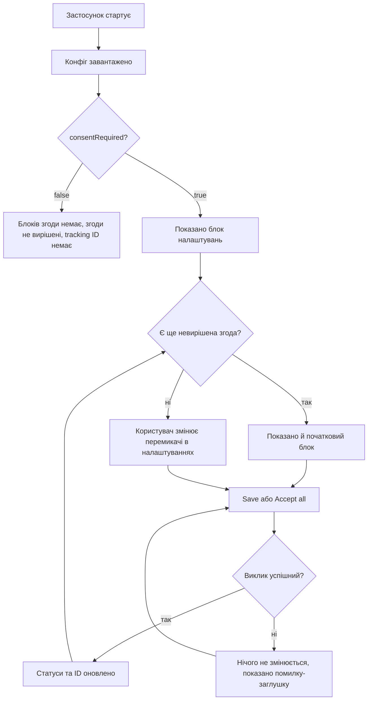

# Identity користувача та згода на трекінг — PRD

## Коротко

Застосунок дізнається identity користувача зі стартового конфігу та запитує згоду на маркетинговий і аналітичний трекінг у двох блоках прямо на одній сторінці. Кожен споживач identity (заголовки запитів до бекенду, колектор аналітики, ігровий конфіг) отримує актуальні поля identity на старті та після кожної зміни. І конфіг, і виклик згоди — методи нативного бриджа хост-застосунку (у тікеті написано «бекенд»; продакт уточнив це 2026-11-02). Бридж не готовий, тому застосунок працює з імітованими методами бриджа, які дотримуються погодженого контракту; налагоджувальна панель старту запускає застосунок у будь-якому з двох режимів, а блок конфігу та три блоки моніторингу показують, що тримає застосунок і що отримав кожен споживач.

## Проблема

У застосунку немає поняття identity користувача і немає способу запитати згоду на трекінг, тому маркетинговий і аналітичний трекінг не можуть залежати від рішення користувача, а запити до бекенду не несуть полів identity. Тікет (TRACK-12) стосується всіх користувачів застосунку, але не наводить ні доказів, ні юридичної підстави вимоги про згоду (див. PRD Q5). Без фічі застосунок не зможе почати використовувати tracking ID, коли нативний бридж випустить справжні методи конфігу та згоди.

## Цілі

- Користувач вирішує щодо маркетингового й аналітичного трекінгу окремо та може дати або відкликати кожну згоду будь-коли.
- Кожен споживач identity завжди має актуальні поля identity, без перезавантаження сторінки.
- Застосунок готовий до справжніх методів конфігу та згоди до того, як нативний бридж їх випустить.

## Поза межами

- Інтеграція зі справжнім нативним бриджем: методи конфігу та згоди імітуються, доки бридж не вийде.
- Реальне надсилання заголовків запитів, подій аналітики чи запитів ігрового конфігу: три споживачі лише записують, що отримали.
- Категорії згоди, крім маркетингу й аналітики.
- Згода у вигляді модального вікна, банера чи окремого екрана.
- Залишити блок конфігу, блоки моніторингу та панель старту: це налагоджувальний засіб, їх приберуть пізніше (див. PRD Q7).
- Остаточні назви заголовків: інженер пропонує їх у специфікації; бекенд підтверджує їх до справжньої інтеграції.

## Користувачі та сценарії

Користувач — будь-хто, хто відкриває застосунок. Увесь UI згоди живе на єдиній сторінці застосунку, поруч із блоками моніторингу.

- Як користувач, я хочу під час першого відкриття застосунку обрати маркетинговий і аналітичний трекінг окремо, щоб дозволити лише те, що мене влаштовує.
- Як користувач, я хочу пізніше відкликати згоду в налаштуваннях, щоб перший вибір не був остаточним.
- Як користувач, я хочу прийняти все одним кліком, щоб мене не змушували проходити через два перемикачі.
- Як розробник, я хочу бачити, що і коли отримав кожен споживач identity, щоб перевіряти флоу без справжнього нативного бриджа.

## Вимоги

| ID | Вимога | Пріоритет | Критерії приймання |
|----|--------|-----------|--------------------|
| R1 | На старті застосунок завантажує конфіг identity із сімома полями: `marketingTrackingId`, `analyticsTrackingId`, `deviceId`, `temporaryId`, `consentRequired`, `marketingConsentStatus`, `analyticsConsentStatus` (статуси: 0 Declined, 1 Accepted, 2 NotDecided) | Must | Із `consentRequired = true` і без збереженого вибору обидва статуси NotDecided, а обидва tracking ID дорівнюють `null`; `temporaryId` відрізняється між двома стартами; `deviceId` той самий |
| R2 | Із `consentRequired = false` обидві згоди залишаються NotDecided, tracking ID не видаються (обидва `null`), усі три споживачі отримують `deviceId`, і жоден блок згоди не показується (продакт уточнив 2026-11-02; до того обидві згоди були Accepted і видавалися обидва tracking ID) | Must | Старт із `consentRequired = false`: на сторінці немає блоків згоди; блок конфігу показує обидва статуси як NotDecided (2), а обидва tracking ID як `null`; блоки аналітики та ігрового конфігу показують `deviceId` і `null` ID; у блоці заголовків є `deviceId` і немає заголовків tracking ID |
| R3 | Початковий блок згоди: показується, коли `consentRequired = true` і хоча б одна згода NotDecided; містить перемикачі маркетингу й аналітики з поточними статусами, «Save» і «Accept all» | Must | На першому старті блок показано з обома перемикачами; після збереження, яке вирішує обидві згоди, блок зникає без перезавантаження |
| R4 | Блок згоди в налаштуваннях: показується завжди, коли `consentRequired = true`; тут користувач відкликає згоду, вимикаючи її перемикач і зберігаючи | Must | Вимкнути перемикач маркетингу й натиснути «Save»: маркетинг стає Declined, а його tracking ID — `null`; аналітика не змінюється |
| R5 | Збереження надсилає обидва вибори одним викликом, за поточним положенням перемикачів: увімкнено = Accepted, вимкнено = Declined; «Accept all» зберігає обидві як Accepted; дві згоди незалежні | Must | Зберегти з увімкненим маркетингом і вимкненою аналітикою: статуси Accepted і Declined; «Accept all» з обома вимкненими перемикачами: обидві Accepted |
| R6 | Правила tracking ID: Accepted → Accepted зберігає ID; Declined або NotDecided → Accepted видає новий ID, старий більше ніколи не повертається; Declined → `null` | Must | Прийняти, відкликати, прийняти знову: третій ID відрізняється від першого; прийняти двічі поспіль: той самий ID |
| R7 | Невдалий виклик згоди нічого не змінює: статуси та ID залишаються, як були. Показувати помилку користувачеві поки не потрібно (Q3) | Must | Якщо виклик згоди падає: статуси, ID і блоки моніторингу не змінюються, а наступний «Save» працює; імітація ніколи не падає, тому це перевіряється автотестами, а не вручну |
| R8 | Кожен споживач identity отримує всі сім полів identity на старті та після кожної зміни, без перезавантаження; якщо жодне поле не змінилося, нічого не доставляється | Must | Часи оновлення в блоках моніторингу змінюються після старту та після збереження, яке щось змінило; збереження, яке нічого не змінює (Accepted → Accepted для обох), залишає їх як були |
| R9 | Три споживачі записують, що отримали: усі три записують обидва tracking ID і `temporaryId`; із `consentRequired = true` — ще й обидва статуси згоди. Колектор аналітики та ігровий конфіг записують `deviceId` лише з `consentRequired = false` і залишають `null` як є. Заголовки запитів завжди несуть `deviceId` і `consentRequired` (продакт уточнив 2026-11-02; тікет забороняв `deviceId` усім трьом) і відкидають будь-який заголовок зі значенням `null` | Must | Із `consentRequired = true`: у блоках аналітики та ігрового конфігу немає `deviceId`, у блоці заголовків `deviceId` є; у блоці заголовків немає заголовка для `null` ID; блоки аналітики та ігрового конфігу показують `null` |
| R10 | Налагоджувальний моніторинг: блок конфігу вгорі сторінки із сімома полями identity, які застосунок зараз тримає, і три блоки поруч із блоком налаштувань, по одному на споживача, з його поточним записаним станом і часом останнього оновлення | Should | Після старту блок конфігу показує всі сім полів; після кожної зміни блок конфігу та три блоки споживачів одразу показують нові поля (і новий час), без перезавантаження |
| R11 | Застосунок працює без справжнього нативного бриджа: імітовані методи конфігу та згоди відповідають із затримкою і пам’ятають вибір користувача між перезавантаженнями; поки що вони ніколи не падають | Must | Перезавантажити після прийняття і натиснути «Start» із вимкненим «first start»: обидва статуси Accepted із тими самими ID і без початкового блока; жодне збереження чи старт ніколи не падає |
| R12 | Налагоджувальний старт: сторінка відкривається з панеллю старту, де є перемикач `consentRequired`, перемикач «first start» і кнопка «Start»; конфіг завантажується лише після натискання «Start», зі значеннями перемикачів; «first start» змушує імітацію забути збережений вибір, ніби користувач ніколи не вирішував; повторне натискання «Start» перезапускає з поточними значеннями | Should | Відкрити сторінку: до «Start» немає блоків конфігу, згоди та моніторингу; старт із вимкненим `consentRequired`: блоків згоди немає; натиснути «Start» знову з увімкненим: блок налаштувань з’являється без перезавантаження; прийняти обидві, потім «Start» з увімкненим «first start»: обидва статуси NotDecided, обидва ID `null`, початковий блок знову на місці |

## Метрики успіху

| Метрика | Базове значення | Ціль | Як вимірюємо |
|---------|-----------------|------|--------------|
| Користувачі, які вирішили обидві згоди в першій сесії (`consentRequired = true`) | — (нова фіча) | невідомо — див. PRD Q6 | невідомо — див. PRD Q6; у застосунку немає подій аналітики |

## Ризики та залежності

- Команда нативного застосунку: справжні методи бриджа для конфігу та згоди в роботі; погоджений контракт до тікета не додано (Spec Q1). Імітація дотримується назв полів із тікета.
- Дизайн: макетів і локалізації поки немає, за рішенням (Q4); у реліз ідуть тимчасові англійські тексти.
- Юридична сторона: підстава вимоги про згоду не вказана (Q5).

## Відкриті питання

- [x] **Q1.** Хто власник і рев’юери PRD, специфікації та завдань? — продакт (автор тікета). Відповідь 2026-11-02: власник a.fedorovskyi для всіх трьох документів; рев’юерів поки не названо.
- [x] **Q2.** Як перемикач показує статус NotDecided, якщо в нього є лише положення увімкнено та вимкнено? Специфікація припускає положення вимкнено. — продакт / дизайн. Відповідь 2026-11-02: як вимкнений.
- [x] **Q3.** Що бачить користувач, поки виклик виконується, і коли завантаження конфігу або збереження падає? Специфікація припускає неактивні кнопки на час очікування, текст помилки англійською та повтор. — продакт / дизайн. Відповідь 2026-11-02: обробка помилок поки не потрібна; те, що вже зроблено, залишається заглушкою до справжнього бриджа.
- [x] **Q4.** Остаточне компонування й тексти блоків згоди та моніторингу, а також мова UI: тікет наводить кнопки російською, документи використовують тимчасові англійські тексти. — дизайн. Відповідь 2026-11-02: макетів і локалізації поки не буде; тимчасові англійські тексти залишаються.
- [ ] **Q5.** Чим зумовлена вимога про згоду (закон, політика платформи, партнер) і яких користувачів вона стосується? — продакт
- [ ] **Q6.** Які метрика успіху, ціль і джерело вимірювання застосовні? У застосунку немає подій аналітики. — продакт
- [ ] **Q7.** Коли та в межах якого тікета прибираються блок конфігу, блоки моніторингу та панель старту? — продакт
