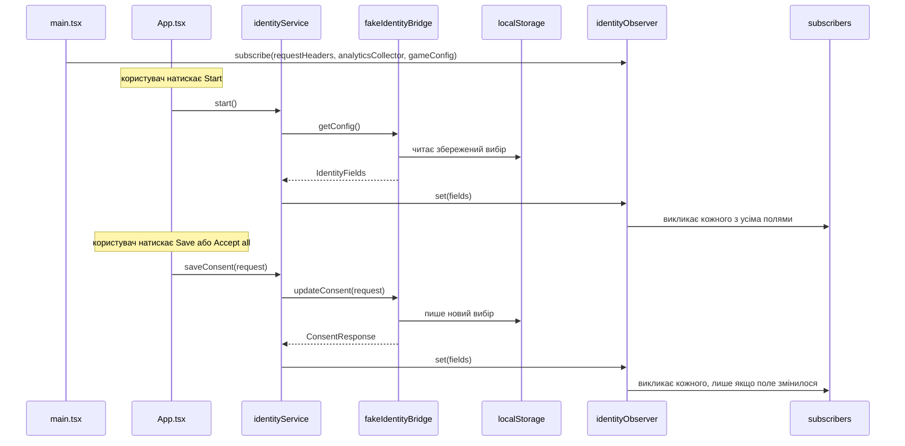
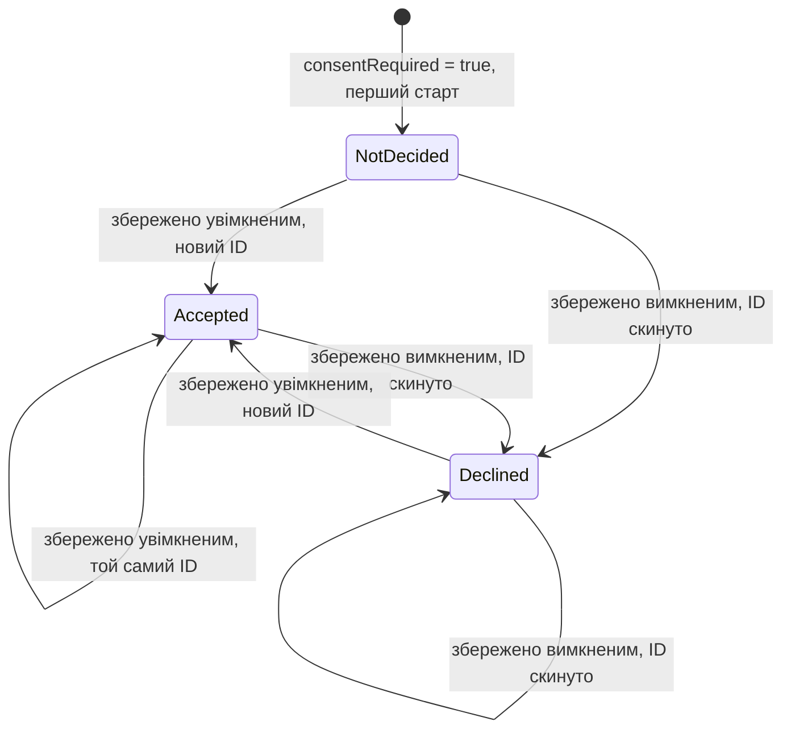

# Identity користувача та згода на трекінг — Специфікація

## Коротко

Сервіс identity завантажує стартовий конфіг через нативний бридж (`IdentityBridge`), кладе сім полів identity в обсервер identity та зберігає згоду через той самий бридж; обсервер викликає трьох підписників-рекордерів (заголовки запитів, колектор аналітики, ігровий конфіг) на старті та щоразу, коли змінюється поле. Доки нативний бридж не вийде, `IdentityBridge` — це фейк, який тримає вибір у `localStorage` і відповідає із затримкою. UI — одна сторінка: налагоджувальна панель старту, блок конфігу, два блоки згоди та три блоки моніторингу. Навіщо це потрібно, описано в [PRD](./prd.md).

## Контекст і поточний стан

- Проєкт `playground/app/` — застосунок Vite + React + TypeScript із Vitest, каркас якого створено для цієї фічі (T1): до неї папка була порожня, а README playground описував її як фронтенд на React + TypeScript. Усі шляхи нижче вказані відносно `playground/app/`; кожен модуль із розділу «Компоненти та зміни» існує, тести лежать поруч із ним.
- Нативного бриджа ще немає: методи конфігу та згоди хост-застосунку в роботі, а погоджений контракт до тікета не додано (Spec Q1); фейк реалізує назви полів із TRACK-12 і формати з розділу «API / інтерфейси».
- У застосунку немає HTTP-клієнта, колектора аналітики та ігрового конфігу, тому три підписники записують, що отримали, замість того щоб викликати справжні системи.

## Пропоноване рішення

### Огляд



### Компоненти та зміни

- `src/identity/types.ts` — новий: `ConsentStatus` (`Declined = 0`, `Accepted = 1`, `NotDecided = 2`), `IdentityFields` (сім полів конфігу), `ConsentRequest`, `ConsentResponse`.
- `src/identity/identityObserver.ts` — новий: `createIdentityObserver()` із `set(fields)`, `get()`, `subscribe(fn)`. `set` зберігає поля та викликає кожного підписника, якщо це перший set або будь-яке із семи полів відрізняється (строга рівність по кожному полю); інакше нічого не робить. Підписник, доданий після першого `set`, одразу викликається з поточними полями. `subscribe` і `get` також обслуговують React через `useSyncExternalStore`.
- `src/identity/useIdentity.ts` — новий: `useIdentity(observer)`, хук `useSyncExternalStore`, яким користуються блоки згоди, блок конфігу та `App`.
- `src/identity/identityService.ts` — новий: `createIdentityService(bridge, observer)` зі `start()` (викликає `getConfig`, потім `observer.set`) і `saveConsent(request)` (викликає `updateConsent`; в разі успіху записує в поточні поля два статуси із запиту та два ID з відповіді й викликає `observer.set`; в разі помилки кидає її далі й нічого не чіпає).
- `src/bridge/identityBridge.ts` — новий: інтерфейс `IdentityBridge`, контракт нативного бриджа (конфіг і згода); адаптер справжнього бриджа реалізує його пізніше.
- `src/bridge/fakeIdentityBridge.ts` — новий: `createFakeIdentityBridge(options)`; поведінка описана в розділах «Модель даних» і «API / інтерфейси». Він ніколи не падає: шляхи помилок перевіряються стабами в тестах.
- `src/subscribers/recorder.ts` — новий: `createRecorder(project)` загортає проєкцію `(fields) => state` у підписника, який зберігає спроєктований стан з `updatedAt` і віддає `getSnapshot()` / `subscribe(fn)` для UI моніторингу.
- `src/subscribers/requestHeaders.ts`, `src/subscribers/analyticsCollector.ts`, `src/subscribers/gameConfig.ts` — нові: три проєкції з розділу «Поля підписників».
- `src/ui/ConsentBlock.tsx` — новий: один компонент для обох блоків (`variant: 'initial' | 'settings'`); два перемикачі, «Save», «Accept all», стани очікування та помилки.
- `src/ui/MonitoringBlock.tsx` — новий: стан рекордера у вигляді форматованого JSON плюс час оновлення.
- `src/ui/StartPanel.tsx` — новий: налагоджувальна панель старту вгорі сторінки: перемикач `consentRequired` (за замовчуванням увімкнений), перемикач «first start» (за замовчуванням вимкнений) і кнопка «Start»; кнопка й обидва перемикачі неактивні, поки старт виконується.
- `src/ui/ConfigBlock.tsx` — новий: поточні сім полів обсервера у вигляді форматованого JSON, вгорі сторінки.
- `src/App.tsx` — сторінка: панель старту; після «Start» створює бридж через `createBridge(consentRequired, firstStart)` і новий `identityService`, викликає `start()` і тримає його стани очікування та помилки; щойно в обсервера є поля — блок конфігу, два блоки згоди за їхніми правилами видимості та три блоки моніторингу.
- `src/main.tsx` — зв’язування: створює обсервер і три рекордери, підписує рекордери та рендерить `App` із `createBridge = (consentRequired, firstStart) => createFakeIdentityBridge({ consentRequired, forgetChoice: firstStart })`.

#### Поля підписників

| Поле | Колектор аналітики, ігровий конфіг | Заголовки запитів |
|------|------------------------------------|-------------------|
| `marketingTrackingId`, `analyticsTrackingId`, `temporaryId` | завжди | завжди |
| `deviceId` | лише коли `consentRequired = false` | завжди |
| `marketingConsentStatus`, `analyticsConsentStatus` | лише коли `consentRequired = true` | лише коли `consentRequired = true` |
| `consentRequired` | ніколи | завжди |

Обсервер і далі доставляє всі сім полів; проєкції аналітики та ігрового конфігу відкидають `deviceId`, коли `consentRequired = true`, тож він ніколи не потрапляє в їхній стан; проєкція заголовків несе його завжди (PRD R9). Заголовки запитів — рядки (статуси як `"0"` / `"1"` / `"2"`, `consentRequired` як `"true"` / `"false"`), а заголовок, значення якого було б `null`, пропускається. Колектор аналітики та ігровий конфіг зберігають значення `null`.

Назви заголовків (Spec Q3): `X-Marketing-Tracking-Id`, `X-Analytics-Tracking-Id`, `X-Temporary-Id`, `X-Device-Id`, `X-Marketing-Consent-Status`, `X-Analytics-Consent-Status`, `X-Consent-Required`.

#### Видимість і поведінка UI

- Початковий блок: `consentRequired === true` і хоча б один статус `NotDecided`. Блок налаштувань: `consentRequired === true`. До натискання «Start», а також поки перший `start()` виконується або якщо він упав, показується лише панель старту.
- Перемикач увімкнений для `Accepted` і вимкнений для `Declined`; `NotDecided` показується як вимкнений (PRD Q2).
- «Save» надсилає `{ marketing: on ? Accepted : Declined, analytics: … }`; «Accept all» надсилає обидва як `Accepted` незалежно від перемикачів. Обидва блоки читають статуси з обсервера, тому збереження в одному оновлює інший. Після успішного збереження перемикачі виставляються за надісланим запитом, тому «Accept all» або збереження після невдалого залишає їх узгодженими зі статусом, який не змінився.
- Поки виклик виконується, обидві кнопки неактивні. Обробка помилок поки не потрібна (PRD Q3); те, що зроблено, залишається заглушкою: у разі помилки блок показує «Could not save your choice. Try again.» під кнопками й залишає перемикачі так, як їх залишив користувач, а невдалий `start()` показує «Could not load the config.» із кнопкою «Retry», яка знову викликає `start()`.
- Макетів і локалізації поки не буде (PRD Q4); англійські тексти йдуть як є: назви блоків «Tracking consent» і «Tracking settings», підписи перемикачів «Marketing» і «Analytics», кнопки «Save» і «Accept all», назви блоків моніторингу «Config», «Request headers», «Analytics collector» і «Game config», а також блок «Subscribers», який об’єднує три останні з рядком про те, що це підписники обсервера identity.

### Модель даних

Життєвий цикл статусу однієї згоди; друга незалежна:



Із `consentRequired = false` блоків згоди немає: обидва статуси залишаються `NotDecided` і ніколи не змінюються (PRD R2).

Сховище фейка: ключ `localStorage` `track12.identity` містить `{ marketingConsentStatus, analyticsConsentStatus, marketingTrackingId, analyticsTrackingId }`. `deviceId` — константа `"device-0001"`; `temporaryId` — `crypto.randomUUID()` на кожному `getConfig`; tracking ID — `crypto.randomUUID()` під час видачі.

### API / інтерфейси

```ts
interface IdentityBridge {
  getConfig(): Promise<IdentityFields>;
  updateConsent(request: ConsentRequest): Promise<ConsentResponse>;
}

interface IdentityFields {
  marketingTrackingId: string | null;
  analyticsTrackingId: string | null;
  deviceId: string;
  temporaryId: string;
  consentRequired: boolean;
  marketingConsentStatus: ConsentStatus;
  analyticsConsentStatus: ConsentStatus;
}

interface ConsentRequest { marketing: ConsentStatus; analytics: ConsentStatus } // Accepted or Declined
interface ConsentResponse { marketingTrackingId: string | null; analyticsTrackingId: string | null }
```

Поведінка фейка, `createFakeIdentityBridge({ consentRequired, forgetChoice = false, delayMs = [300, 1000], random = Math.random, storage = localStorage, newId = crypto.randomUUID })`:

- `forgetChoice = true` видаляє збережений вибір під час створення, тому наступний `getConfig` поводиться як перший старт (PRD R12).
- `storage: null` тримає вибір лише в пам’яті; `newId` видає tracking ID і тимчасові ID (тести передають лічильник).
- Кожен виклик чекає випадкову затримку з `delayMs` і ніколи не падає (PRD R11).
- `getConfig` із `consentRequired = true`: статуси та ID зі сховища або `NotDecided` / `null`, якщо нічого не збережено.
- `getConfig` із `consentRequired = false`: обидва статуси `NotDecided` і обидва ID `null` (PRD R2); сховище не читається й не пишеться, тож вибір, збережений із `consentRequired = true`, повертається на наступному старті в тому режимі.
- `updateConsent`, по кожному полю: `Accepted` за збереженого статусу `Accepted` → той самий ID; `Accepted` в інших випадках → новий ID; `Declined` → `null`. Обидва статуси й обидва ID зберігаються разом.

`consentRequired`, який передається фейку, — це перемикач панелі старту; більше фейк його нізвідки не читає.

## Покриття вимог

| ID у PRD | Як виконується | Розділ |
|----------|----------------|--------|
| R1 | Фейковий `getConfig` повертає сім полів; `temporaryId` новий на кожен виклик, `deviceId` константа | API / інтерфейси |
| R2 | Фейк повертає `NotDecided` і `null` ID, коли `consentRequired = false`; у цьому режимі проєкції передають `deviceId` усім трьом підписникам; `App` ховає обидва блоки | API / інтерфейси, Поля підписників, Видимість і поведінка UI |
| R3 | `ConsentBlock` з варіантом `initial`, показується за правилом видимості | Видимість і поведінка UI |
| R4 | `ConsentBlock` з варіантом `settings`; вимкнений перемикач + «Save» надсилає `Declined` | Видимість і поведінка UI |
| R5 | Один виклик `updateConsent` з обома полями; «Accept all» надсилає обидва `Accepted` | Видимість і поведінка UI, API / інтерфейси |
| R6 | Правила ID у фейковому `updateConsent` | API / інтерфейси, Модель даних |
| R7 | Сервіс кидає далі помилку відхиленого `updateConsent` без `observer.set`; блок показує помилку (перевіряється стабом, що відхиляє; фейк ніколи не падає) | Компоненти та зміни, Граничні випадки та обробка помилок |
| R8 | `identityObserver.set` викликає підписників на першому set і лише коли поле змінилося | Компоненти та зміни |
| R9 | Три проєкції з розділу «Поля підписників» | Поля підписників |
| R10 | `ConfigBlock` на обсервері та `MonitoringBlock` на кожен рекордер, перемальовуються через `useSyncExternalStore` | Компоненти та зміни |
| R11 | Фейк із затримкою та `localStorage` | API / інтерфейси |
| R12 | `StartPanel` і обробка старту в `App`: новий фейковий бридж і сервіс на кожен «Start»; `forgetChoice` для «first start» | Компоненти та зміни, API / інтерфейси |

## Альтернативи та рішення

| Рішення | Розглянуті варіанти | Обрано | Чому |
|---------|---------------------|--------|------|
| Звідки UI читає identity | Окремий стан React, скопійований із сервісу; обсервер як стор через `useSyncExternalStore` | Обсервер як стор | Одне джерело істини; обидва блоки й моніторинг оновлюються разом із підписниками |
| Статуси згоди після збереження | З відповіді; із запиту | Із запиту | За тікетом метод згоди повертає лише два tracking ID; статус за визначенням іде за запитом |
| Де фейк зберігає вибір | Лише в пам’яті; `localStorage` | `localStorage` | Тікет вимагає, щоб вибір переживав перезавантаження |
| Перемикання `consentRequired` у фейку | Константа на етапі збірки; URL-параметр `?consentRequired=false`; перемикач на налагоджувальній панелі старту | Перемикач панелі старту, за замовчуванням увімкнений | Тестувальники перемикають режими та перезапускають без перезавантаження; значення, як і раніше, приходить лише з об’єкта конфігу |
| Затримка та помилки фейка | Фіксована затримка; опція затримки з типовим значенням 300–1000 мс; імітація помилок | Опція затримки, без імітації помилок | Тести йдуть із нульовою затримкою; ручне тестування бачить лише затримки; шляхи помилок покриті тестами зі стабами, що відхиляють (PRD R11) |
| Сховище фейка з `consentRequired = false` | Зберігати `NotDecided` з `null` ID; не чіпати сховище | Не чіпати сховище | У цьому режимі користувач нічого не вирішує; збережений вибір з іншого режиму залишається недоторканим |
| Відкидання `deviceId` | В обсервері; у проєкції кожного підписника | Проекція | За тікетом обсервер доставляє всі сім полів; правило стосується того, що записують підписники, і в кожного підписника воно своє (заголовки несуть його завжди) |
| Назви заголовків | Тікет залишає їх на розсуд інженера | Назви `X-…` з розділу «Поля підписників» | Загальноприйняті; підтверджуються з бекендом до справжньої інтеграції (Spec Q3) |

## Граничні випадки та обробка помилок

- `start()` падає (фейк тут ніколи не падає; справжній бридж може) → сторінка показує «Could not load the config.» і «Retry»; жоден підписник не викликається; «Retry» запускає знову з поточним значенням перемикача.
- «Start» натиснуто, поки старт виконується → неможливо, кнопка неактивна.
- «Start» натиснуто знову після успішного старту → новий фейковий бридж і сервіс; обсервер отримує новий конфіг (щонайменше новий `temporaryId`), тому підписники викликаються; невдалий перезапуск залишає на сторінці попередній стан і показує помилку.
- «Start» з увімкненим «first start» → збережений вибір зникає до `getConfig`; з увімкненим `consentRequired` обидва статуси `NotDecided` і обидва ID `null`, з вимкненим — так само.
- Збереження падає (фейк ніколи не падає; справжній бридж може) → сервіс відхиляє проміс, обсервер не зачеплено, блок показує помилку й залишає перемикачі так, як їх виставив користувач; «Save» і «Accept all» знову активні.
- Збереження, яке нічого не змінює (обидві вже `Accepted`, обидва перемикачі увімкнені) → фейк повертає ті самі ID, `observer.set` не бачить змін, жоден підписник не викликається, час у моніторингу не змінюється.
- Обидві згоди `Declined`, обидва перемикачі вимкнені, «Save» → обидві залишаються `Declined` з `null` ID; змін немає, підписники не викликаються.
- Другий клік, поки виклик виконується → неможливий, кнопки неактивні.
- Збереження в одному блоці → обидва блоки заново читають статуси з обсервера; початковий блок зникає, щойно обидві вирішено.
- Перезавантаження після прийняття → `getConfig` повертає збережені `Accepted` і ті самі ID; новий `temporaryId` означає, що підписники викликаються на старті.
- `consentRequired = false` зі збереженим вибором із попереднього запуску → статуси `NotDecided`, ID `null`; збережений вибір не чіпається й повертається на наступному старті з `consentRequired = true`.
- `localStorage` недоступний або пошкоджений → фейк поводиться так, ніби нічого не збережено, і тримає вибір у пам’яті на час сесії.
- Підписник, доданий після завершення `start()` → одразу викликається з поточними полями.
- `start()` викликано, поки старт ще виконується (сторінка так не може: «Start» неактивна, поки старт триває; сервіс на це не покладається) → другий виклик ділить запит із першим; один `getConfig`, один `temporaryId`, один виклик підписників.

## Нефункціональні вимоги

- Приватність: із `consentRequired = true` `deviceId` ніколи не з’являється в стані та блоках колектора аналітики й ігрового конфігу; його несуть лише заголовки запитів (R9). Ніщо не покидає браузер: жоден запит не надсилається.

## План тестування

- Unit (Vitest): `identityObserver` (перший set викликає, змінене поле викликає, ідентичний set не викликає, пізній підписник викликається); `fakeIdentityBridge` (перший старт, `consentRequired = false`, правила ID з R6, збереження через фейкове сховище); `identityService` (шляхи старту та збереження, збій залишає обсервер недоторканим); три проєкції (обидва режими `consentRequired`, `deviceId` завжди в заголовках і лише без `consentRequired` в інших, заголовок із `null` відкинуто, `null` збережено в інших).
- Компонентні (Vitest + Testing Library): `ConsentBlock` (видимість за варіантом, вимкнений перемикач зберігає `Declined`, «Accept all», неактивність на час очікування, текст помилки з незміненими перемикачами; R3–R5, R7); `MonitoringBlock` (оновлення стану та часу) і `ConfigBlock` (усі сім полів, перемальовування після зміни; R10).
- Компонентні (Vitest + Testing Library): `App` (до «Start» лише панель старту, старт в обох режимах, перезапуск в іншому режимі, «first start» забуває вибір, невдалий старт із «Retry»; R12).
- Ручні, у браузері, в обох режимах: критерії приймання R1–R12 із PRD, крім R7, включно з циклом «відкликати й прийняти» та перезавантаженням.

## Розгортання та відкат

Розгортання — це сам реліз: один деплой фронтенду, без міграцій і змін бекенду. Блоки згоди та моніторингу рендерить `App.tsx` після «Start» на налагоджувальній панелі старту, яка підключається в останньому із завдань, потрібних флоу, тож недобудований UI недоступний. Відкат: задеплоїти попередню версію; ключ `track12.identity` залишається в `localStorage` невикористаним і читається знову під час наступного розгортання. Де деплоїться застосунок, невідомо (Spec Q2).

## Відкриті питання

- [ ] **Q1.** Погоджений контракт нативного бриджа до тікета не додано: чи збігаються назви методів, назви полів, коди статусів і формат методу згоди з розділом «API / інтерфейси»? — команда нативного застосунку
- [ ] **Q2.** Де і як деплоїться застосунок? У репозиторії немає пайплайну. — TBD
- [ ] **Q3.** Чи підходять бекенду назви заголовків із розділу «Поля підписників»? — команда бекенду
