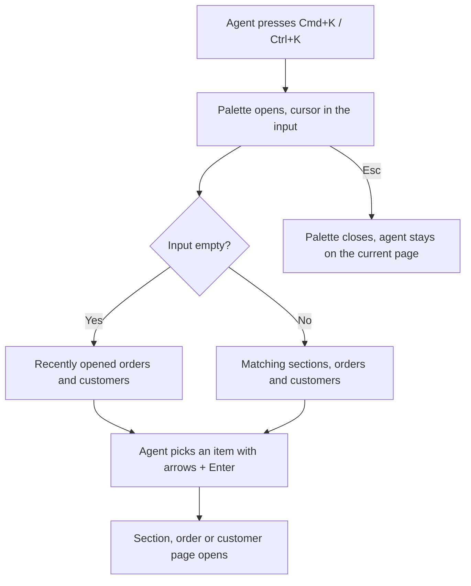

# Command palette (Cmd+K) — PRD

## Summary

Support agents get a keyboard-driven command palette in Acme Admin: press Cmd+K (Ctrl+K on Windows), type, and jump straight to an admin section, an order or a customer. The goal is to cut the time agents spend opening the order or customer they need by removing the search results page from the flow.

## Problem

Support agents switch between orders and customers all day. To open an order today they click the header search, type the number, wait for the search results page and click again. Analytics shows `header_search_submitted` about 4 000 times a day, and it is almost always followed immediately by `search_result_opened`: agents already know what they want, so the results page is an extra step on one of their most frequent actions. Agents also often come back to the same orders and customers, and today they have to search for them again each time.

How much time this costs is not measured yet (see Open questions). If we do nothing, every one of those ~4 000 daily lookups keeps paying for the extra page load and click.

## Goals

- Agents open the order or customer they need faster than with the header search.
- Agents reach any admin section they have access to without the mouse.
- Agents get back to recently opened orders and customers without searching again.

## Non-goals

- Actions from the palette (e.g. "Refund order…"). Wanted eventually, not in this iteration.
- Searching entities other than orders and customers (e.g. individual merchants or refunds).
- Final visual design: there are no mockups yet; the designer joins later (see Risks & dependencies).

## Users & scenarios

Users: support agents working in Acme Admin on macOS and Windows.

- As a support agent, I want to open an order by typing its number into a palette so that I don't have to go through the search results page.
- As a support agent, I want to find a customer by name or email from anywhere in the admin so that I can open their page in one step.
- As a support agent, I want to jump to a section (e.g. Refunds, Merchants) from the keyboard so that I don't have to reach for the sidebar.
- As a support agent who keeps coming back to the same ticket, I want to see my recently opened orders and customers as soon as I open the palette so that I can return to them without typing.

## Requirements

| ID | Requirement | Priority | Acceptance criteria |
|----|-------------|----------|---------------------|
| R1 | Agent can open the palette from any admin page with Cmd+K on macOS or Ctrl+K on Windows, and close it with Esc | Must | On every admin page the shortcut opens the palette with the cursor in its input; Esc closes it and the agent stays on the same page |
| R2 | While the agent types, the palette shows matching admin sections; Enter opens the selected section | Must | Typing "ref" lists "Refunds"; selecting it with the arrow keys and pressing Enter opens the Refunds page; the whole flow works without the mouse |
| R3 | While the agent types, the palette shows orders and customers found by number, name or email; Enter opens the selected order or customer | Must | Typing an existing order number lists that order; typing an existing customer's name or email lists that customer; Enter opens the order or customer page directly, without the search results page |
| R4 | The palette never shows sections the agent has no access to | Must | An agent without access to Refunds who types "ref" sees no "Refunds" item; the sections listed match the sections in that agent's sidebar |
| R5 | With an empty input, the palette shows the agent's recently opened orders and customers | Should | After opening an order, opening the palette with an empty input lists that order first; selecting it with Enter opens it |

## Success metrics

| Metric | Baseline | Target | How measured |
|--------|----------|--------|--------------|
| Median time from starting a lookup to the order or customer page opening | unknown — see Open questions | unknown — see Open questions | Analytics events for the header search and the palette |
| Share of order and customer opens that come from the palette | 0 | unknown — see Open questions | `search_result_opened` split by source |
| Header search submissions per day | ≈ 4 000 | unknown — see Open questions | `header_search_submitted` |

## Risks & dependencies

- Design: no mockups yet; the designer joins later. Building before mockups risks rework of the palette's look.
- Search: R3 depends on the existing order and customer search; whether it can find orders by customer name or email is not confirmed (see Open questions).
- Cmd+K / Ctrl+K is also a browser shortcut on some browsers; the palette has to take priority inside Acme Admin.

## Timeline

- Target: next quarter, per the ticket. Exact date to be confirmed by the product owner (see Open questions).

## Open questions

- [ ] Who owns this PRD and who should review it? — product (ticket author)
- [ ] What is the current median time to open an order or customer? Agree to measure it before launch with existing analytics. — product + analytics
- [ ] What improvement in that time counts as success, and what share of opens should come from the palette? — product
- [ ] Should orders also be found by the customer's name or email, or is the order number enough? — product
- [ ] Should orders and customers also be hidden from agents who have no access to the Orders or Customers pages, or does R4 apply to sections only? — product
- [ ] Do the header search and the search results page stay as they are after launch, or should they change or go away? — product
- [ ] How many recent items should the palette show, and should "recent" include orders and customers opened by any route (lists, links), or only via the palette? — product
- [ ] Should recent items follow the agent across browsers and devices? — product
- [ ] What is the exact deadline next quarter, and what drives it? — product
- [ ] Who is the designer and when will mockups be ready? — product / design
