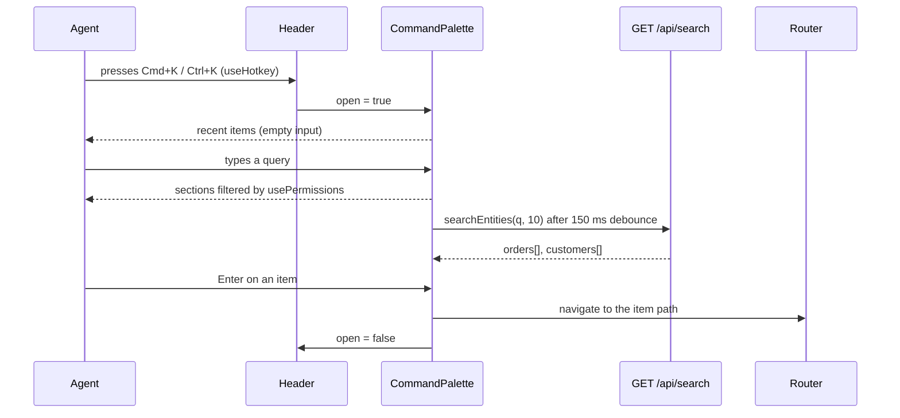

# Command palette (Cmd+K) — Spec

## Summary

A frontend-only change: a `CommandPalette` dialog mounted in `Header`, opened by a global Cmd+K / Ctrl+K hotkey. It lists sections from the existing `routes` config (filtered by `usePermissions`, like `Sidebar`), orders and customers from the existing `GET /api/search`, and recently opened orders and customers kept in `localStorage`. No backend changes. See the [PRD](./prd.md) for the why.

## Context & current state

- **Routes and permissions.** `src/routes.tsx` declares every page as `AppRoute` with `title`, `permission` and `inNav`. `Sidebar` (`src/components/layout/Sidebar.tsx`) shows `routes.filter((r) => r.inNav && has(r.permission))`. `App.tsx` does not guard routes by permission; filtering happens only in navigation UI.
- **Permissions hook.** `usePermissions()` (`src/auth/usePermissions.ts`) loads `GET /api/me` and returns `has()` and `loaded`. It does not expose the user id.
- **Search.** `searchEntities(q, limit, signal)` (`src/api/search.ts`) calls `GET /api/search`: orders are matched by id only, customers by id, name and email; min query length 2; p95 ≈ 350 ms. Response: `{ orders: OrderHit[], customers: CustomerHit[] }`. Whether `limit` applies per group or in total is not documented.
- **Header search.** `Header` (`src/components/layout/Header.tsx`) submits to `/search?q=…` and fires `header_search_submitted`; `SearchPage` (`src/pages/SearchPage.tsx`) fires `search_result_opened` with `source: "search_page"` when a hit is clicked.
- **Hotkeys.** `useHotkey(key, handler, { meta })` (`src/hooks/useHotkey.ts`) listens on `window` and ignores events whose target is inside `input, textarea, [contenteditable=true]`. Today it is used only for `?` → `ShortcutsHelp`, owned by `Header`.
- **Dialogs.** `Dialog` (`src/components/ui/Dialog.tsx`) wraps `@radix-ui/react-dialog` (focus trap, Esc, scroll lock) and always renders a visible title.
- **Analytics.** `track()` (`src/analytics/track.ts`) accepts a closed `EventName` union.
- **Other constraints.** Detail pages `OrderDetailsPage` and `CustomerDetailsPage` are stubs today. There is no feature-flag service and no e2e test setup in the repo; tests run on `vitest` + `@testing-library/react`.

## Proposed design

### Overview



The palette shows up to four groups, in this order: **Recent** (only when the input is empty), **Sections**, **Orders**, **Customers**. Arrow keys move the selection across groups, Enter opens the selected item, Esc closes the palette.

### Components & changes

- `src/components/command-palette/CommandPalette.tsx` — new. Renders the existing `Dialog` with a `cmdk` `Command` list inside (`shouldFilter={false}`, since we filter sections ourselves and entities come pre-filtered from the server). On select: record the recent item (for orders and customers), fire analytics, `navigate()`, close.
- `src/components/command-palette/usePaletteItems.ts` — new. Builds the groups:
  - Sections: `routes.filter((r) => r.inNav && has(r.permission))`, then a case-insensitive substring match of the query on `title`. Same filter as `Sidebar`, so R4 holds by construction. Nothing is shown until `loaded` is true.
  - Orders and customers: `useQuery({ queryKey: ["palette-search", q], queryFn: ({ signal }) => searchEntities(q, 10, signal), enabled: q.length >= 2, placeholderData: keepPreviousData })` on a query debounced by 150 ms; the UI shows at most 5 hits per group. The Orders group is shown only if `has("orders:view")` and the Customers group only if `has("customers:view")`, because their items lead to routes that declare those permissions (pending the PRD open question on entity visibility).
  - Recent: read from `recentItems.ts`, filtered by the same `orders:view` / `customers:view` checks.
- `src/components/command-palette/recentItems.ts` — new. `getRecentItems(userId)`, `recordRecentItem(userId, item)`; stores up to `RECENT_LIMIT = 5` items (pending the PRD open question on the count), newest first, de-duplicated by `type` + `id`. A write without `label` keeps an existing label.
- `src/components/command-palette/useRecordRecentItem.ts` — new. Called from `OrderDetailsPage` (`orderId` param) and `CustomerDetailsPage` (`customerId` param), so items opened by any route count as recent (pending the PRD open question). The palette and `SearchPage` pass a `label` from the hit when they record before navigating.
- `src/hooks/useHotkey.ts` — add an `allowInInputs?: boolean` option that skips the input/textarea/contenteditable check, so Cmd+K also works while the cursor is in the header search or in the palette's own input. Existing `?` behaviour is unchanged.
- `src/components/layout/Header.tsx` — add `paletteOpen` state next to `helpOpen`; register `useHotkey("k", toggle, { meta: true, allowInInputs: true })`. The hotkey toggles the palette; if `ShortcutsHelp` is open, it closes first. Mounting is gated by `import.meta.env.VITE_COMMAND_PALETTE`.
- `src/components/layout/ShortcutsHelp.tsx` — add an entry for Cmd+K / Ctrl+K to `SHORTCUTS`.
- `src/components/ui/Dialog.tsx` — add an optional `hideTitle` prop that renders the title visually hidden (still read by screen readers); the palette has no visible title.
- `src/auth/usePermissions.ts` — also return `userId` (`data?.id`), used to scope recent items per user.
- `src/analytics/track.ts` — add `command_palette_opened` and `command_palette_item_selected` to `EventName`.
- `package.json` — add the `cmdk` dependency.

### Data model

No server-side changes. Recent items live in `localStorage` under the key `acme-admin:recent:<userId>` as a JSON array:

```ts
interface RecentItem {
  type: "order" | "customer";
  id: string;        // "ORD-10482", "CUS-2210"
  label?: string;    // e.g. customer name; falls back to id
  openedAt: number;  // epoch ms
}
```

### API / interfaces

- Uses the existing `GET /api/search?q=&limit=` via `searchEntities`; no new endpoints.
- New analytics events:
  - `command_palette_opened` — no props.
  - `command_palette_item_selected` — `{ type: "section" | "order" | "customer", origin: "recent" | "query", ms_since_open: number, query_length: number }`.
- When an order or customer is opened from the palette, it also fires the existing `search_result_opened` with `{ type, source: "command_palette" }`, so existing search dashboards can compare it with `source: "search_page"`.

## Requirements coverage

| PRD ID | How it's satisfied | Section |
|--------|--------------------|---------|
| R1 | `useHotkey` with `meta` + `allowInInputs` in `Header`; Esc and focus handling from Radix via `Dialog` | Components & changes |
| R2 | Sections built from `routes`, filtered by query; `cmdk` keyboard navigation; `navigate()` on Enter | Components & changes |
| R3 | Debounced `searchEntities`; Enter navigates to `/orders/:orderId` or `/customers/:customerId`, bypassing `SearchPage`. Partial: orders are found by id only, because `GET /api/search` matches orders by id; finding orders by customer name or email depends on the PRD open question | Components & changes |
| R4 | Same filter as `Sidebar` (`inNav && has(permission)`); nothing shown until permissions are `loaded` | Components & changes |
| R5 | `recentItems.ts` in `localStorage`, recorded from detail pages; Recent group shown when the input is empty | Data model |

## Alternatives & decisions

| Decision | Options considered | Chosen | Why |
|----------|-------------------|--------|-----|
| Palette list UI | Hand-rolled ARIA combobox on `Dialog`; `cmdk` inside `Dialog` | `cmdk` inside `Dialog` | `cmdk` gives keyboard navigation, grouping and combobox ARIA out of the box and is built on Radix, which we already use. Cost: one new dependency. Hand-rolling the a11y pattern correctly is more code and more risk |
| Search trigger | Request on every keystroke; debounce 150 ms + abort; search only on Enter | Debounce 150 ms + abort via `signal` | Keeps request volume reasonable at ~350 ms p95 while still feeling instant; search on Enter would bring back the extra step the PRD removes |
| Recent items storage | `localStorage` per user; new backend endpoint; `sessionStorage` | `localStorage` per user | No backend change needed, survives reloads. Does not follow the agent across devices; revisit if the PRD open question says it should |
| Where to record recents | Only on palette selection; on detail page visit | Detail page visit (`useRecordRecentItem`) | Covers every route to an order or customer (lists, links, search page, palette), matching "agents return to the same ticket"; switching to palette-only is a one-line change |
| Hotkey inside inputs | Keep the current input check; add `allowInInputs` option | `allowInInputs` option | Agents are often typing in the header search; a palette that doesn't open there would fail R1 on the most common screen |
| Feature flag | No flag; build-time env flag `VITE_COMMAND_PALETTE` | Build-time env flag | No runtime flag service exists in the repo; an env flag lets us ship to staging first and disable without reverting code |

## Edge cases & error handling

- Query shorter than 2 characters → only sections (and Recent when empty); no request to `GET /api/search`.
- `GET /api/search` fails → Orders and Customers groups show an inline "Search unavailable" row; sections keep working.
- Slow response while the agent keeps typing → previous request aborted via `signal`; previous results stay visible (`keepPreviousData`) with a loading indicator.
- No matches anywhere → single "No results" row.
- Permissions not loaded yet → no sections and no entity groups; they appear when `loaded` becomes true.
- Agent lost access to orders or customers → recent items of that type are hidden, not deleted.
- `localStorage` unavailable, full or holding invalid JSON → treated as empty; writes are wrapped in `try/catch`.
- Selected item is the current page → palette closes, no navigation.
- Browser shortcut on Ctrl+K (address/search bar on some Windows browsers) → the handler calls `preventDefault()`; verified in manual testing.
- Order number typed without the `ORD-` prefix → behaviour depends on `GET /api/search`; see Open questions.

## Non-functional

- **Accessibility.** Combobox/listbox roles and `aria-activedescendant` from `cmdk`; focus trap and focus return from Radix; visually hidden dialog title.
- **Privacy.** Recent items may store customer names in `localStorage` on shared support machines; keys are scoped by user id but not cleared on logout. Needs a security sign-off (see Open questions); fallback is to store ids only.
- **Performance.** At most one in-flight search request per palette; results cached by TanStack Query (`staleTime` 30 s from `main.tsx`).

## Testing plan

- **Unit (`vitest`).** `recentItems.ts`: ordering, de-duplication, `RECENT_LIMIT`, per-user keys, invalid JSON. `useHotkey`: `allowInInputs` on and off, `meta` with both `metaKey` and `ctrlKey`. Section filtering by query and permission.
- **Component (`@testing-library/react`, `MemoryRouter`, mocked `searchEntities` and `/api/me`).**
  - R1: Cmd+K and Ctrl+K open the palette from the page body and from the header search input; Esc closes it and the route is unchanged.
  - R2: typing "ref" lists "Refunds"; arrow keys + Enter navigate to `/refunds`.
  - R3: a mocked order hit and customer hit appear; Enter navigates to `/orders/ORD-10482` and `/customers/CUS-2210` without visiting `/search`.
  - R4: with `refunds:manage` missing, "ref" shows no "Refunds"; the section list equals the `Sidebar` list for the same permissions.
  - R5: after rendering `OrderDetailsPage` for `ORD-10482`, the palette with an empty input lists it first.
- **Manual.** macOS (Chrome, Safari, Firefox) and Windows (Chrome, Edge, Firefox): shortcut wins over browser shortcuts; screen reader smoke test. There is no e2e setup in the repo, so the end-to-end flow is checked manually on staging.

## Rollout & rollback

1. Merge behind `VITE_COMMAND_PALETTE` (off by default).
2. Enable on staging; QA plus a few support agents use it.
3. Enable in the production build.

Rollback: rebuild and deploy with `VITE_COMMAND_PALETTE` off, or revert the deploy. No migrations; leftover `localStorage` keys are inert. The header search and `SearchPage` are untouched, so agents always keep the old flow.

## Observability

- Palette share of opens: `search_result_opened` split by `source` (`command_palette` vs `search_page`).
- Time to open via the palette: `ms_since_open` on `command_palette_item_selected`.
- Header search volume: `header_search_submitted`, as today.
- Baseline for the header flow: existing events only give the time from `header_search_submitted` to `search_result_opened`, not from the start of the lookup; see Open questions.

## Open questions

- [ ] Who owns this Spec and who reviews it? — engineering lead
- [ ] Does `GET /api/search` enforce permissions server-side, and does it match order numbers typed without the `ORD-` prefix? — backend owner of `/api/search`
- [ ] Is `limit` in `GET /api/search` applied per group or in total? — backend owner of `/api/search`
- [ ] Is a runtime feature-flag service available, so we can roll out to a subset of agents instead of using `VITE_COMMAND_PALETTE`? — engineering lead
- [ ] Is storing customer names in `localStorage` for recent items acceptable on shared support machines, or should we store ids only? — security
- [ ] Should we add a `header_search_focused` event now to measure the PRD baseline from the start of the lookup? — analytics
- [ ] Should the Orders and Customers groups stay hidden for agents without `orders:view` / `customers:view`, as the design does now? Follows from the PRD question on R4. — product
