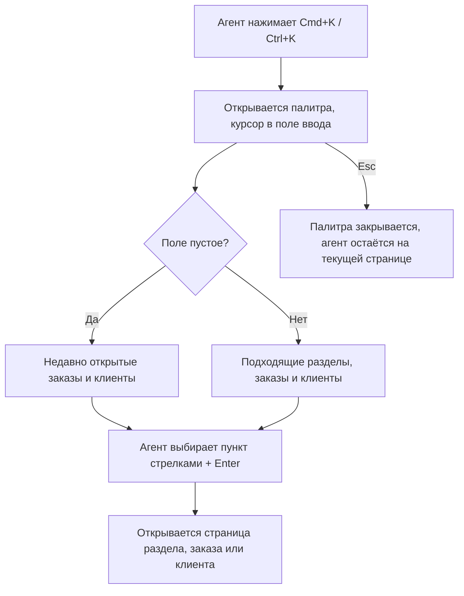

# Командная палитра (Cmd+K) — PRD

## Кратко

Агенты поддержки получают в Acme Admin командную палитру, которой управляют с клавиатуры: нажимаешь Cmd+K (Ctrl+K на Windows), печатаешь и сразу переходишь в раздел админки, к заказу или к клиенту. Цель — сократить время, за которое агент открывает нужный заказ или клиента, убрав из флоу страницу результатов поиска.

## Проблема

Агенты поддержки целый день переключаются между заказами и клиентами. Чтобы открыть заказ сейчас, нужно кликнуть в поиск в хедере, ввести номер, дождаться страницы результатов и кликнуть ещё раз. По аналитике `header_search_submitted` срабатывает около 4 000 раз в день, и почти всегда сразу за ним идёт `search_result_opened`: агент уже знает, что ищет, так что страница результатов — лишний шаг в одном из самых частых его действий. Кроме того, агенты часто возвращаются к одним и тем же заказам и клиентам и сейчас каждый раз ищут их заново.

Сколько времени это стоит, пока не измерено (см. открытые вопросы). Если ничего не делать, каждый из ~4 000 ежедневных поисков по-прежнему будет платить за лишнюю загрузку страницы и лишний клик.

## Цели

- Агенты открывают нужный заказ или клиента быстрее, чем через поиск в хедере.
- Агенты попадают в любой доступный им раздел админки без мыши.
- Агенты возвращаются к недавно открытым заказам и клиентам без повторного поиска.

## Вне рамок

- Действия из палитры (например, «Сделать возврат по заказу…»). Хотим когда-нибудь, но не в этой итерации.
- Поиск сущностей, кроме заказов и клиентов (например, отдельных мерчантов или возвратов).
- Финальный визуальный дизайн: макетов пока нет, дизайнер подключится позже (см. «Риски и зависимости»).

## Пользователи и сценарии

Пользователи: агенты поддержки, работающие в Acme Admin на macOS и Windows.

- Как агент поддержки, я хочу открыть заказ, введя его номер в палитру, чтобы не проходить через страницу результатов поиска.
- Как агент поддержки, я хочу найти клиента по имени или email из любого места админки, чтобы открыть его страницу за один шаг.
- Как агент поддержки, я хочу переходить в раздел (например, Refunds, Merchants) с клавиатуры, чтобы не тянуться к сайдбару.
- Как агент поддержки, который постоянно возвращается к одному и тому же тикету, я хочу видеть недавно открытые заказы и клиентов сразу при открытии палитры, чтобы вернуться к ним, ничего не печатая.

## Требования

| ID | Требование | Приоритет | Критерии приёмки |
|----|------------|-----------|------------------|
| R1 | Агент может открыть палитру с любой страницы админки сочетанием Cmd+K на macOS или Ctrl+K на Windows и закрыть её по Esc | Must | На любой странице админки сочетание открывает палитру с курсором в поле ввода; Esc закрывает её, и агент остаётся на той же странице |
| R2 | Пока агент печатает, палитра показывает подходящие разделы админки; Enter открывает выбранный раздел | Must | При вводе «ref» в списке есть «Refunds»; выбор стрелками и Enter открывает страницу Refunds; весь флоу проходится без мыши |
| R3 | Пока агент печатает, палитра показывает заказы и клиентов, найденных по номеру, имени или email; Enter открывает выбранный заказ или клиента | Must | При вводе номера существующего заказа в списке есть этот заказ; при вводе имени или email существующего клиента в списке есть этот клиент; Enter открывает страницу заказа или клиента напрямую, без страницы результатов поиска |
| R4 | Палитра никогда не показывает разделы, к которым у агента нет доступа | Must | Агент без доступа к Refunds при вводе «ref» не видит пункта «Refunds»; набор разделов совпадает с разделами в сайдбаре этого агента |
| R5 | При пустом поле ввода палитра показывает недавно открытые агентом заказы и клиентов | Should | После открытия заказа палитра с пустым полем показывает этот заказ первым; выбор по Enter открывает его |

## Метрики успеха

| Метрика | Базовое значение | Цель | Как измеряем |
|---------|------------------|------|--------------|
| Медианное время от начала поиска до открытия страницы заказа или клиента | неизвестно — см. открытые вопросы | неизвестно — см. открытые вопросы | События аналитики поиска в хедере и палитры |
| Доля открытий заказов и клиентов через палитру | 0 | неизвестно — см. открытые вопросы | `search_result_opened` в разбивке по источнику |
| Отправки поиска в хедере в день | ≈ 4 000 | неизвестно — см. открытые вопросы | `header_search_submitted` |

## Риски и зависимости

- Дизайн: макетов пока нет, дизайнер подключится позже. Если начать разработку до макетов, внешний вид палитры, возможно, придётся переделывать.
- Поиск: R3 зависит от существующего поиска заказов и клиентов; умеет ли он находить заказы по имени или email клиента, не подтверждено (см. открытые вопросы).
- Cmd+K / Ctrl+K в некоторых браузерах занято самим браузером; внутри Acme Admin палитра должна иметь приоритет.

## Сроки

- Цель: следующий квартал, как сказано в тикете. Точную дату подтвердит владелец продукта (см. открытые вопросы).

## Открытые вопросы

- [ ] Кто владелец этого PRD и кто его ревьюит? — продакт (автор тикета)
- [ ] Сколько сейчас в среднем (медиана) занимает открытие заказа или клиента? Договориться измерить это до запуска по существующей аналитике. — продакт + аналитика
- [ ] Какое сокращение этого времени считаем успехом и какая доля открытий должна идти через палитру? — продакт
- [ ] Нужно ли находить заказы и по имени или email клиента, или достаточно номера заказа? — продакт
- [ ] Нужно ли скрывать заказы и клиентов от агентов без доступа к страницам Orders или Customers, или R4 касается только разделов? — продакт
- [ ] Поиск в хедере и страница результатов поиска остаются как есть после запуска, или их нужно изменить либо убрать? — продакт
- [ ] Сколько недавних пунктов показывать, и считаются ли «недавними» заказы и клиенты, открытые любым путём (списки, ссылки), или только через палитру? — продакт
- [ ] Должны ли недавние пункты следовать за агентом между браузерами и устройствами? — продакт
- [ ] Какой точный дедлайн в следующем квартале и чем он обусловлен? — продакт
- [ ] Кто дизайнер и когда будут макеты? — продакт / дизайн
