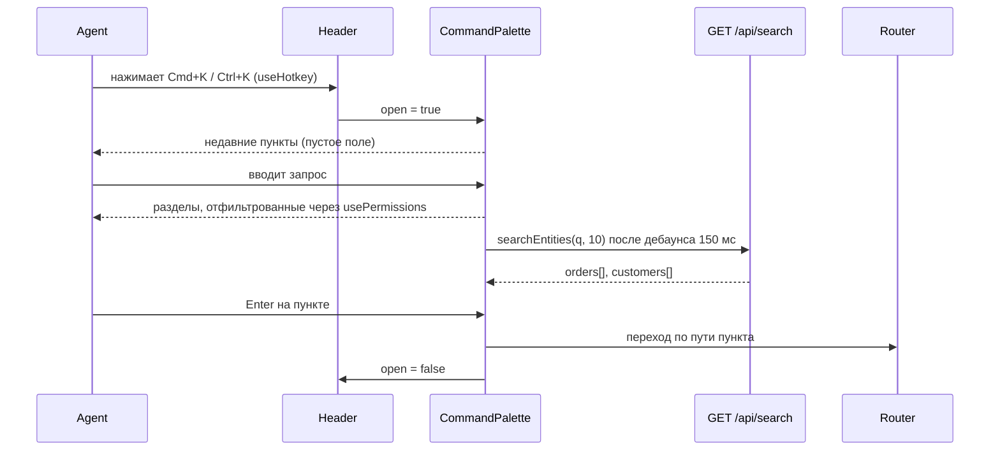

# Командная палитра (Cmd+K) — Спецификация

## Кратко

Изменение только на фронтенде: диалог `CommandPalette`, смонтированный в `Header` и открываемый глобальным хоткеем Cmd+K / Ctrl+K. Он показывает разделы из существующего конфига `routes` (с фильтрацией через `usePermissions`, как в `Sidebar`), заказы и клиентов из существующего `GET /api/search`, а также недавно открытые заказы и клиентов, которые хранятся в `localStorage`. Бэкенд не меняется. Зачем это нужно, описано в [PRD](./prd.md).

## Контекст и текущее состояние

- **Роуты и права.** `src/routes.tsx` описывает каждую страницу как `AppRoute` с полями `title`, `permission` и `inNav`. `Sidebar` (`src/components/layout/Sidebar.tsx`) показывает `routes.filter((r) => r.inNav && has(r.permission))`. `App.tsx` не защищает роуты по правам; фильтрация есть только в навигационном UI.
- **Хук прав.** `usePermissions()` (`src/auth/usePermissions.ts`) загружает `GET /api/me` и возвращает `has()` и `loaded`. Id пользователя он не отдаёт.
- **Поиск.** `searchEntities(q, limit, signal)` (`src/api/search.ts`) вызывает `GET /api/search`: заказы ищутся только по id, клиенты — по id, имени и email; минимальная длина запроса 2; p95 ≈ 350 мс. Ответ: `{ orders: OrderHit[], customers: CustomerHit[] }`. Применяется ли `limit` к каждой группе или ко всему ответу, не задокументировано.
- **Поиск в хедере.** `Header` (`src/components/layout/Header.tsx`) отправляет запрос на `/search?q=…` и шлёт `header_search_submitted`; `SearchPage` (`src/pages/SearchPage.tsx`) при клике по результату шлёт `search_result_opened` с `source: "search_page"`.
- **Хоткеи.** `useHotkey(key, handler, { meta })` (`src/hooks/useHotkey.ts`) слушает `window` и игнорирует события, у которых цель внутри `input, textarea, [contenteditable=true]`. Сейчас он используется только для `?` → `ShortcutsHelp`, которым владеет `Header`.
- **Диалоги.** `Dialog` (`src/components/ui/Dialog.tsx`) — обёртка над `@radix-ui/react-dialog` (фокус-ловушка, Esc, блокировка скролла), всегда рендерит видимый заголовок.
- **Аналитика.** `track()` (`src/analytics/track.ts`) принимает закрытый union `EventName`.
- **Прочие ограничения.** Страницы `OrderDetailsPage` и `CustomerDetailsPage` пока заглушки. В репозитории нет сервиса фича-флагов и нет e2e-тестов; тесты работают на `vitest` + `@testing-library/react`.

## Предлагаемое решение

### Обзор



Палитра показывает до четырёх групп в таком порядке: **Недавние** (только при пустом поле), **Разделы**, **Заказы**, **Клиенты**. Стрелки двигают выделение между группами, Enter открывает выбранный пункт, Esc закрывает палитру.

### Компоненты и изменения

- `src/components/command-palette/CommandPalette.tsx` — новый. Рендерит существующий `Dialog`, внутри — список `Command` из `cmdk` (`shouldFilter={false}`: разделы фильтруем сами, а сущности приходят с сервера уже отфильтрованными). При выборе: записывает недавний пункт (для заказов и клиентов), шлёт аналитику, вызывает `navigate()`, закрывается.
- `src/components/command-palette/usePaletteItems.ts` — новый. Собирает группы:
  - Разделы: `routes.filter((r) => r.inNav && has(r.permission))`, затем регистронезависимый поиск подстроки запроса в `title`. Тот же фильтр, что в `Sidebar`, поэтому R4 выполняется по построению. Пока `loaded` не стал true, ничего не показывается.
  - Заказы и клиенты: `useQuery({ queryKey: ["palette-search", q], queryFn: ({ signal }) => searchEntities(q, 10, signal), enabled: q.length >= 2, placeholderData: keepPreviousData })` по запросу с дебаунсом 150 мс; в UI не больше 5 результатов на группу. Группа заказов показывается только при `has("orders:view")`, группа клиентов — только при `has("customers:view")`, потому что их пункты ведут на роуты, которые требуют этих прав (до ответа на открытый вопрос PRD о видимости сущностей).
  - Недавние: читаются из `recentItems.ts` и фильтруются теми же проверками `orders:view` / `customers:view`.
- `src/components/command-palette/recentItems.ts` — новый. `getRecentItems(userId)`, `recordRecentItem(userId, item)`; хранит до `RECENT_LIMIT = 5` пунктов (до ответа на открытый вопрос PRD о количестве), новые сверху, без дублей по `type` + `id`. Запись без `label` сохраняет уже существующую метку.
- `src/components/command-palette/useRecordRecentItem.ts` — новый. Вызывается из `OrderDetailsPage` (параметр `orderId`) и `CustomerDetailsPage` (параметр `customerId`), так что недавними считаются пункты, открытые любым путём (до ответа на открытый вопрос PRD). Палитра и `SearchPage` перед переходом передают `label` из результата поиска.
- `src/hooks/useHotkey.ts` — добавить опцию `allowInInputs?: boolean`, которая пропускает проверку input/textarea/contenteditable, чтобы Cmd+K работал и когда курсор в поиске хедера или в поле самой палитры. Поведение `?` не меняется.
- `src/components/layout/Header.tsx` — добавить состояние `paletteOpen` рядом с `helpOpen`; зарегистрировать `useHotkey("k", toggle, { meta: true, allowInInputs: true })`. Хоткей переключает палитру; если открыт `ShortcutsHelp`, сначала закрывается он. Монтирование зависит от `import.meta.env.VITE_COMMAND_PALETTE`.
- `src/components/layout/ShortcutsHelp.tsx` — добавить в `SHORTCUTS` пункт для Cmd+K / Ctrl+K.
- `src/components/ui/Dialog.tsx` — добавить необязательный проп `hideTitle`, который визуально скрывает заголовок (скринридеры его по-прежнему читают); у палитры нет видимого заголовка.
- `src/auth/usePermissions.ts` — дополнительно возвращать `userId` (`data?.id`), чтобы хранить недавние пункты отдельно для каждого пользователя.
- `src/analytics/track.ts` — добавить `command_palette_opened` и `command_palette_item_selected` в `EventName`.
- `package.json` — добавить зависимость `cmdk`.

### Модель данных

Серверных изменений нет. Недавние пункты хранятся в `localStorage` под ключом `acme-admin:recent:<userId>` в виде JSON-массива:

```ts
interface RecentItem {
  type: "order" | "customer";
  id: string;        // "ORD-10482", "CUS-2210"
  label?: string;    // e.g. customer name; falls back to id
  openedAt: number;  // epoch ms
}
```

### API / интерфейсы

- Используется существующий `GET /api/search?q=&limit=` через `searchEntities`; новых эндпоинтов нет.
- Новые события аналитики:
  - `command_palette_opened` — без свойств.
  - `command_palette_item_selected` — `{ type: "section" | "order" | "customer", origin: "recent" | "query", ms_since_open: number, query_length: number }`.
- Когда заказ или клиент открыт из палитры, дополнительно шлётся существующее `search_result_opened` с `{ type, source: "command_palette" }`, чтобы на текущих дашбордах поиска можно было сравнить его с `source: "search_page"`.

## Покрытие требований

| ID в PRD | Как выполняется | Раздел |
|----------|-----------------|--------|
| R1 | `useHotkey` с `meta` + `allowInInputs` в `Header`; Esc и работа с фокусом — от Radix через `Dialog` | Компоненты и изменения |
| R2 | Разделы строятся из `routes` и фильтруются по запросу; навигация с клавиатуры от `cmdk`; `navigate()` по Enter | Компоненты и изменения |
| R3 | `searchEntities` с дебаунсом; Enter ведёт на `/orders/:orderId` или `/customers/:customerId` в обход `SearchPage`. Частично: заказы находятся только по id, потому что `GET /api/search` ищет заказы по id; поиск заказов по имени или email клиента зависит от открытого вопроса PRD | Компоненты и изменения |
| R4 | Тот же фильтр, что в `Sidebar` (`inNav && has(permission)`); пока права не `loaded`, ничего не показывается | Компоненты и изменения |
| R5 | `recentItems.ts` в `localStorage`, запись со страниц деталей; группа «Недавние» показывается при пустом поле | Модель данных |

## Альтернативы и решения

| Решение | Рассмотренные варианты | Выбрано | Почему |
|---------|------------------------|---------|--------|
| UI списка палитры | Свой ARIA combobox на `Dialog`; `cmdk` внутри `Dialog` | `cmdk` внутри `Dialog` | `cmdk` из коробки даёт навигацию с клавиатуры, группы и ARIA для combobox и построен на Radix, который у нас уже есть. Цена — одна новая зависимость. Корректно реализовать a11y-паттерн самим — больше кода и больше риска |
| Когда искать | Запрос на каждое нажатие; дебаунс 150 мс + отмена; поиск только по Enter | Дебаунс 150 мс + отмена через `signal` | Разумное число запросов при p95 ~350 мс, и при этом ощущается мгновенно; поиск по Enter вернул бы тот лишний шаг, который PRD убирает |
| Где хранить недавние | `localStorage` на пользователя; новый эндпоинт на бэкенде; `sessionStorage` | `localStorage` на пользователя | Не нужны изменения бэкенда, переживает перезагрузку. Не следует за агентом между устройствами; пересмотрим, если так ответят на открытый вопрос PRD |
| Где записывать недавние | Только при выборе в палитре; при заходе на страницу деталей | При заходе на страницу деталей (`useRecordRecentItem`) | Покрывает любой путь к заказу или клиенту (списки, ссылки, страница поиска, палитра) — это соответствует «агенты возвращаются к одному тикету»; перейти на «только из палитры» — изменение в одну строку |
| Хоткей внутри полей ввода | Оставить текущую проверку полей; добавить опцию `allowInInputs` | Опция `allowInInputs` | Агенты часто печатают в поиске хедера; палитра, которая там не открывается, не выполнит R1 на самом частом экране |
| Фича-флаг | Без флага; флаг сборки через env `VITE_COMMAND_PALETTE` | Флаг сборки через env | Сервиса рантайм-флагов в репозитории нет; env-флаг позволяет сначала выкатить на стейджинг и выключить фичу без реверта кода |

## Граничные случаи и обработка ошибок

- Запрос короче 2 символов → только разделы (и «Недавние» при пустом поле); запроса к `GET /api/search` нет.
- `GET /api/search` вернул ошибку → в группах «Заказы» и «Клиенты» строка «Поиск недоступен»; разделы продолжают работать.
- Медленный ответ, пока агент продолжает печатать → предыдущий запрос отменяется через `signal`; предыдущие результаты остаются на экране (`keepPreviousData`) с индикатором загрузки.
- Совпадений нет нигде → одна строка «Ничего не найдено».
- Права ещё не загружены → нет ни разделов, ни групп сущностей; они появляются, когда `loaded` становится true.
- Агент потерял доступ к заказам или клиентам → недавние пункты этого типа скрываются, но не удаляются.
- `localStorage` недоступен, переполнен или содержит невалидный JSON → считается пустым; запись обёрнута в `try/catch`.
- Выбранный пункт — текущая страница → палитра закрывается, перехода нет.
- Браузерный хоткей на Ctrl+K (адресная/поисковая строка в некоторых браузерах на Windows) → обработчик вызывает `preventDefault()`; проверяется при ручном тестировании.
- Номер заказа введён без префикса `ORD-` → поведение зависит от `GET /api/search`; см. открытые вопросы.

## Нефункциональные требования

- **Доступность.** Роли combobox/listbox и `aria-activedescendant` от `cmdk`; фокус-ловушка и возврат фокуса от Radix; визуально скрытый заголовок диалога.
- **Приватность.** Недавние пункты могут хранить имена клиентов в `localStorage` на общих машинах поддержки; ключи разделены по id пользователя, но при выходе не очищаются. Нужно согласование с безопасностью (см. открытые вопросы); запасной вариант — хранить только id.
- **Производительность.** Не больше одного активного запроса поиска на палитру; результаты кешируются TanStack Query (`staleTime` 30 с из `main.tsx`).

## План тестирования

- **Unit (`vitest`).** `recentItems.ts`: порядок, дедупликация, `RECENT_LIMIT`, ключи по пользователю, невалидный JSON. `useHotkey`: `allowInInputs` включён и выключен, `meta` и с `metaKey`, и с `ctrlKey`. Фильтрация разделов по запросу и правам.
- **Компонентные (`@testing-library/react`, `MemoryRouter`, моки `searchEntities` и `/api/me`).**
  - R1: Cmd+K и Ctrl+K открывают палитру и со страницы, и из поля поиска в хедере; Esc закрывает её, роут не меняется.
  - R2: при вводе «ref» в списке есть «Refunds»; стрелки + Enter ведут на `/refunds`.
  - R3: замоканные заказ и клиент появляются в списке; Enter ведёт на `/orders/ORD-10482` и `/customers/CUS-2210`, не заходя на `/search`.
  - R4: без `refunds:manage` при вводе «ref» нет «Refunds»; список разделов совпадает со списком `Sidebar` при тех же правах.
  - R5: после рендера `OrderDetailsPage` для `ORD-10482` палитра с пустым полем показывает его первым.
- **Ручные.** macOS (Chrome, Safari, Firefox) и Windows (Chrome, Edge, Firefox): хоткей побеждает браузерные сочетания; smoke-тест со скринридером. E2e-тестов в репозитории нет, поэтому сквозной флоу проверяется вручную на стейджинге.

## Раскатка и откат

1. Мержим за флагом `VITE_COMMAND_PALETTE` (по умолчанию выключен).
2. Включаем на стейджинге; пользуются QA и несколько агентов поддержки.
3. Включаем в продакшен-сборке.

Откат: пересобрать и задеплоить с выключенным `VITE_COMMAND_PALETTE` или откатить деплой. Миграций нет; оставшиеся ключи в `localStorage` ни на что не влияют. Поиск в хедере и `SearchPage` не меняются, так что у агентов всегда остаётся старый флоу.

## Наблюдаемость

- Доля открытий через палитру: `search_result_opened` в разбивке по `source` (`command_palette` против `search_page`).
- Время открытия через палитру: `ms_since_open` в `command_palette_item_selected`.
- Объём поиска в хедере: `header_search_submitted`, как сейчас.
- Базовое значение для флоу через хедер: существующие события дают только время от `header_search_submitted` до `search_result_opened`, а не от начала поиска; см. открытые вопросы.

## Открытые вопросы

- [ ] Кто владелец этой спецификации и кто её ревьюит? — техлид
- [ ] Проверяет ли `GET /api/search` права на сервере и находит ли он номера заказов, введённые без префикса `ORD-`? — владелец `/api/search` на бэкенде
- [ ] `limit` в `GET /api/search` применяется к каждой группе или ко всему ответу? — владелец `/api/search` на бэкенде
- [ ] Есть ли сервис рантайм-флагов, чтобы раскатывать на часть агентов вместо `VITE_COMMAND_PALETTE`? — техлид
- [ ] Допустимо ли хранить имена клиентов в `localStorage` для недавних пунктов на общих машинах поддержки, или хранить только id? — безопасность
- [ ] Добавить ли сейчас событие `header_search_focused`, чтобы измерять базовое значение из PRD от начала поиска? — аналитика
- [ ] Оставляем ли группы «Заказы» и «Клиенты» скрытыми для агентов без `orders:view` / `customers:view`, как сейчас в дизайне? Зависит от вопроса PRD про R4. — продакт
