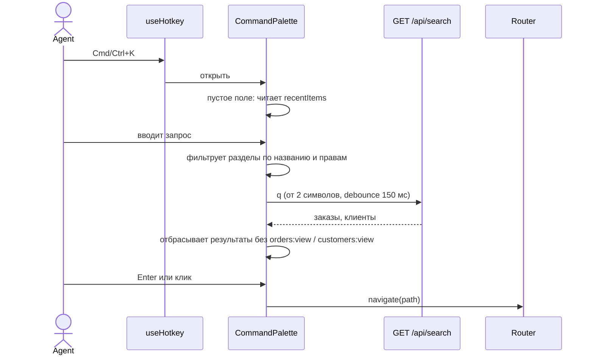

# Command palette (Cmd+K) — Спецификация

## Кратко

Фича целиком на клиенте: глобальный хоткей Cmd/Ctrl+K открывает модальное окно на основе существующего `Dialog`. Разделы берутся из конфига `routes` с фильтрацией через `usePermissions()`, заказы и клиенты — из существующего `GET /api/search`, а недавно открытые пункты хранятся в `localStorage` отдельно для каждого пользователя. Бэкенд не меняется. Зачем это нужно, описано в [PRD](./prd.md).

## Контекст и текущее состояние

- `src/hooks/useHotkey.ts` регистрирует глобальные сочетания клавиш. Он игнорирует нажатия, пока фокус в `input`, `textarea` или `[contenteditable=true]`, а опция `meta` принимает либо `metaKey`, либо `ctrlKey`. Используется только для `?` (справка по сочетаниям) в `src/components/layout/Header.tsx`.
- В `src/components/layout/Header.tsx` находится поиск в хедере: при отправке (минимум 2 символа) он шлёт `header_search_submitted` и переходит на `/search?q=…`.
- `src/pages/SearchPage.tsx` вызывает `searchEntities(q, 50, signal)` и рендерит ссылки на `/orders/:orderId` и `/customers/:customerId`, отправляя `search_result_opened` с `{ type, source: "search_page" }`.
- `src/api/search.ts`: `GET /api/search?q&limit` ищет заказы по id и клиентов по id, имени и email; p95 ≈ 350 мс, минимальная длина запроса 2. Возвращает `{ orders: OrderHit[], customers: CustomerHit[] }`.
- `src/routes.tsx`: у каждого маршрута есть `title`, `permission` и `inNav`. `src/components/layout/Sidebar.tsx` показывает маршруты с `inNav && has(permission)` — это ровно тот набор «разделов», который агент может видеть сейчас.
- `src/auth/usePermissions.ts` загружает `GET /api/me` и отдаёт `has()` и `loaded`; `id` пользователя загружается, но наружу не отдаётся.
- `src/components/ui/Dialog.tsx` — обёртка над Radix Dialog (focus trap, Esc, блокировка скролла), всегда рендерит видимый `title`.
- `src/analytics/track.ts`: `track()` принимает только имена из закрытого union-типа `EventName`.
- Ограничения: `src/App.tsx` не проверяет права на маршруты, поэтому скрывать разделы палитра должна сама. Ничто в `src/` не фильтрует результаты поиска по `orders:view` / `customers:view`; для `/search` нужен только `dashboard:view`. Механизма фича-флагов и постоянного хранилища на клиенте в приложении сейчас нет. Тестов пока нет, как и DOM-окружения для компонентных тестов: `jsdom` не установлен, `vitest.config.ts` нет.

## Предлагаемое решение

### Обзор



### Компоненты и изменения

- `src/hooks/useHotkey.ts` — добавляем опцию `allowInInputs` (по умолчанию `false`). Сочетание палитры использует `{ meta: true, allowInInputs: true }`, поэтому Cmd/Ctrl+K работает и когда курсор в текстовом поле; `?` ведёт себя как сейчас.
- `src/components/layout/Header.tsx` — регистрирует хоткей Cmd/Ctrl+K, хранит состояние `open` палитры, рендерит `CommandPalette`, отправляет `command_palette_opened`. Форма поиска в хедере остаётся как есть.
- `src/components/command-palette/CommandPalette.tsx` — новый. Рендерится внутри `Dialog`: текстовое поле и один список с группами Недавние / Разделы / Заказы / Клиенты. ↑/↓ переключают активный пункт, Enter или клик выбирают, Esc закрывает (Radix). Реализует ARIA-паттерн combobox + listbox (`role="combobox"`, `aria-activedescendant`). При выборе: `navigate(path)`, закрытие, событие аналитики.
- `src/components/command-palette/useSectionCommands.ts` — новый. `routes.filter(r => r.inNav && has(r.permission))` — то же правило, что в `Sidebar`; сопоставление с `title` по подстроке без учёта регистра. Ничего не возвращает, пока `loaded` не равно `true`.
- `src/components/command-palette/useEntitySearch.ts` — новый. TanStack Query с ключом `["palette-search", q]` вызывает `searchEntities(q, 5, signal)`, включается при `q.trim().length >= 2`, ввод с debounce 150 мс; `signal` запроса отменяет устаревшие запросы. Отбрасывает заказы без `has("orders:view")` и клиентов без `has("customers:view")` (допущение, см. Q4 в PRD).
- `src/components/command-palette/recentItems.ts` — новый. Функции чтения/записи поверх `localStorage` и хук `useRecordRecent(type, id)`.
- `src/pages/OrderDetailsPage.tsx`, `src/pages/CustomerDetailsPage.tsx` — при монтировании вызывают `useRecordRecent("order", orderId)` / `useRecordRecent("customer", customerId)`, так что «открытым» считается любой заход на страницу заказа или клиента (допущение, см. Q5 в PRD).
- `src/auth/usePermissions.ts` — дополнительно возвращает `userId` (из уже загруженного `/api/me`), чтобы разделять недавние по пользователям.
- `src/components/layout/ShortcutsHelp.tsx` — добавляем пункт для Cmd/Ctrl+K в `SHORTCUTS`; текст придёт вместе с дизайном (ответственный за Q7 в PRD).
- `src/analytics/track.ts` — добавляем `command_palette_opened` и `command_palette_item_selected` в `EventName`.

### Модель данных

Недавние пункты хранятся в `localStorage` под ключом `acme-admin:recent:<userId>`:

```ts
interface RecentItem {
  type: "order" | "customer";
  id: string;       // "ORD-10482", "CUS-2210"
  openedAt: number; // epoch ms
}
// value: JSON array of RecentItem, newest first, deduplicated by type + id, at most 5
```

Хранятся только тип и id, без имён и email клиентов (допущение, см. Q6 в PRD). Палитра показывает сохранённый id. Лимит в 5 пунктов — допущение (см. Q5 в PRD).

### API / интерфейсы

- Новых эндпоинтов нет. Палитра использует существующий `GET /api/search` через `searchEntities(q, limit, signal)` с `limit = 5` (допущение, см. Q7 в PRD).
- Пропсы `CommandPalette`: `{ open: boolean; onOpenChange: (open: boolean) => void }`.
- `useHotkey(key, handler, opts)` — в `opts` появляется `allowInInputs?: boolean`.
- `usePermissions()` возвращает `{ has, loaded, userId }`.
- События аналитики:
  - `command_palette_opened` — `{ trigger: "hotkey" }`.
  - `command_palette_item_selected` — `{ kind: "section" | "order" | "customer", from_recent: boolean, query_length: number, ms_since_open: number }`.
  - `search_result_opened` — отправляется и для заказов и клиентов, открытых из палитры, с `{ type, source: "command_palette" }`, чтобы метрика доли из PRD разбивалась по `source`.

## Покрытие требований

| ID в PRD | Как выполняется | Раздел |
|----------|-----------------|--------|
| R1 | Cmd/Ctrl+K через `useHotkey` с `meta` + `allowInInputs`, зарегистрирован в `Header` (его на каждой странице рендерит `AppLayout`); Esc обрабатывает `Dialog` | Компоненты и изменения |
| R2 | `useSectionCommands` сопоставляет названия из `routes`; Enter/клик вызывает `navigate(path)` | Компоненты и изменения |
| R3 | Тот же фильтр, что в `Sidebar`: `inNav && has(permission)`, до `loaded` ничего не показывается | Компоненты и изменения |
| R4 | `useEntitySearch` поверх `GET /api/search`; выбор сразу ведёт на `/orders/:orderId` или `/customers/:customerId` | Компоненты и изменения, API / интерфейсы |
| R5 | **Partial:** недавние хранятся в `localStorage` конкретного браузера, поэтому не переходят с агентом на другой компьютер или в другой браузер, и показываются только id, без имён клиентов (см. Q6 в PRD) | Модель данных |

## Альтернативы и решения

| Решение | Рассмотренные варианты | Выбрано | Почему |
|---------|------------------------|---------|--------|
| UI палитры | Подключить библиотеку `cmdk`; строить на существующем `Dialog` | Существующий `Dialog` + свой список | Без новой зависимости; focus trap и Esc уже даёт Radix. Цена: ARIA-паттерн combobox реализуем сами |
| Сопоставление разделов | Библиотека нечёткого поиска; подстрока без учёта регистра | Подстрока | Разделов шесть; нечёткий поиск добавит зависимость при небольшой пользе. Легко заменить позже |
| Где хранить недавние | Новый эндпоинт на бэкенде; `sessionStorage`; `localStorage` по пользователю | `localStorage` по пользователю | Без работы на бэкенде и переживает перезагрузку; ключ по `userId` разделяет агентов на общем компьютере. Цена: нет синхронизации между устройствами (R5 частично) |
| Что считается «открытым» | Только выбор в палитре; любой заход на страницу заказа или клиента | Любой заход на страницу | Соответствует «последним открытым» из тикета, включая открытия со страницы поиска и по ссылкам. Допущение, см. Q5 в PRD |
| Хоткей в текстовых полях | Отдельный обработчик keydown; расширить `useHotkey` | Расширить `useHotkey` опцией `allowInInputs` | Все глобальные сочетания в одном месте; сочетания с модификатором не мешают вводу текста |
| Права на записи | Показывать все результаты; скрывать по `orders:view` / `customers:view` | Скрывать | Самый консервативный вариант, пока нет ответа на Q4 в PRD |
| Частота запросов | Запрос на каждое нажатие; debounce + отмена | Debounce 150 мс + отмена через `signal` | Поиск по мере ввода шлёт гораздо больше запросов, чем нынешние ≈ 4 000 отправок в день |

## Граничные случаи и обработка ошибок

- Запрос короче 2 символов → только разделы (или недавние, если поле пустое); запроса к API нет.
- `GET /api/search` вернул ошибку или не ответил вовремя → разделы по-прежнему показываются; группа заказов/клиентов показывает состояние ошибки (текст по дизайну); палитрой можно пользоваться дальше.
- Ответы приходят не по порядку → TanStack Query отменяет устаревший запрос через `signal`; показываются только результаты для текущего запроса.
- Права ещё не загружены (`loaded === false`) → ни разделов, ни записей; они появляются, когда ответит `/api/me`.
- Ничего не найдено → пустое состояние (текст по дизайну).
- Недавний пункт, к которому у агента больше нет доступа (права отозваны) → скрывается при рендере палитры.
- `localStorage` недоступен, переполнен или содержит невалидный JSON → недавние пропускаются, сохранённое значение сбрасывается; остальная палитра работает.
- Cmd/Ctrl+K, когда палитра уже открыта → фокус возвращается в поле ввода; второе окно не открывается.
- Cmd/Ctrl+K, когда открыт другой диалог (например, `ShortcutsHelp`) → игнорируется.
- Ctrl+K на Windows — ещё и сочетание браузера (фокус на поиск браузера) → `useHotkey` вызывает `preventDefault()`, когда фокус на странице.
- Enter во время IME-ввода (`e.isComposing`) → игнорируется, чтобы не выбрать пункт.

## Нефункциональные требования

- Доступность: роли combobox + listbox, активный пункт озвучивается через `aria-activedescendant`, focus trap и возврат фокуса при закрытии — от Radix.
- Производительность: разделы фильтруются в памяти; поиск по записям добавляет примерно один запрос на каждую паузу в наборе от 150 мс, p95 ≈ 350 мс на текущем эндпоинте.
- Приватность: в `localStorage` лежат только типы и id записей, с разделением по `userId`.

## План тестирования

- Подготовка: добавить `jsdom` в dev-зависимости и `vitest.config.ts` с `environment: "jsdom"`, чтобы запускались компонентные тесты.
- Unit (Vitest): сопоставление и фильтрация по правам в `useSectionCommands` (R2, R3); порядок, дедупликация, лимит в 5, ключи по пользователю и невалидный JSON в `recentItems` (R5); `useHotkey` с `allowInInputs`.
- Компонентные (Testing Library, `searchEntities` замокан): Cmd+K и Ctrl+K открывают палитру, в том числе из поля ввода в фокусе, Esc закрывает её (R1); стрелки + Enter и клик ведут на страницы раздела, заказа и клиента (R2, R4); результаты отбрасываются без `orders:view` / `customers:view`; при пустом поле показываются недавние (R5); состояния ошибки и пустого результата.
- Ручные: macOS и Windows в браузерах, которыми пользуется поддержка; проверить, что собственное Ctrl+K / Cmd+K браузера не срабатывает.

## Раскатка и откат

Механизма фича-флагов в приложении нет, поэтому палитра закрыта переменной Vite на этапе сборки `VITE_FEATURE_COMMAND_PALETTE`: когда она выключена, хоткей не регистрируется и ничего не рендерится. Шаги: включить на стейджинге → включить в проде для всех. Поиск в хедере и страница результатов поиска не меняются, так что у агентов остаётся старый путь. Откат: пересобрать и задеплоить с выключенной переменной. Сохранённые недавние пункты при выключенной фиче ни на что не влияют.

## Наблюдаемость

- `command_palette_opened` и `command_palette_item_selected` (с `ms_since_open`) дают время от открытия палитры до открытия записи для метрики времени из PRD.
- `search_result_opened` в разбивке по `source` (`search_page` и `command_palette`) даёт метрику доли из PRD; `header_search_submitted` в день остаётся третьей метрикой.
- Базовое значение для метрики времени: интервал между `header_search_submitted` и следующим за ним `search_result_opened` в той же сессии. Он не включает время набора текста, поэтому занижает текущее время.

## Открытые вопросы

- [ ] **Q1.** Проверяет ли `GET /api/search` права `orders:view` / `customers:view` на сервере или отдаёт результаты всем? — команда бэкенда
- [ ] **Q2.** `limit` в `GET /api/search` применяется к каждому типу отдельно или к заказам и клиентам вместе? — команда бэкенда
- [ ] **Q3.** Выдержит ли `GET /api/search` дополнительную нагрузку от поиска по мере ввода у всех агентов? — команда бэкенда
- [ ] **Q4.** Есть ли рантайм-сервис фича-флагов, который стоит использовать вместо переменной сборки? — команда фронтенда
- [ ] **Q5.** Умеет ли коллектор аналитики считать интервал между двумя событиями в одной сессии — это нужно для метрики времени и её базового значения? — команда аналитики
- [ ] **Q6.** Какой инженер владеет этой спецификацией? — тимлид фронтенда
